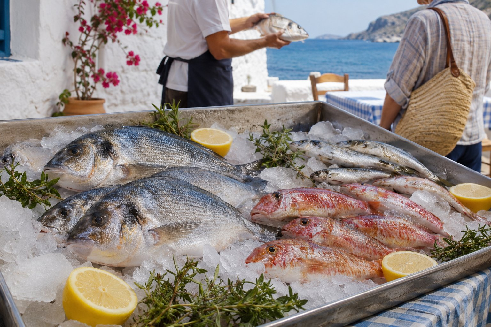
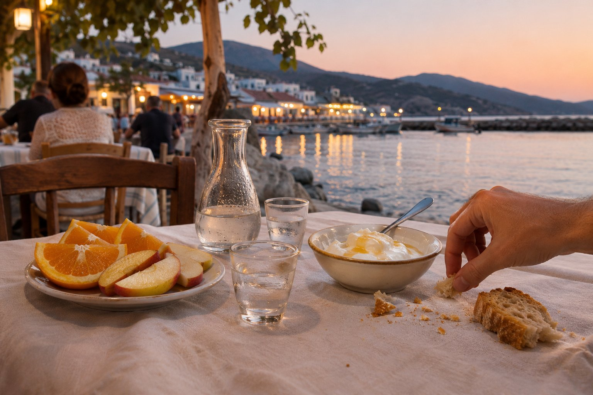

A Agios Nikolaos hi ha taules per tot arreu: al voltant del llac, al port, davant de la platja de Kitroplatia i als carrers que pugen cap al centre. Amb tanta oferta, escollir on menjar pot ser el més difícil del dia. Aquestes són les pistes en què ens fixem nosaltres i que solem donar a qui ens pregunta.

## Mira qui està menjant

El senyal més fiable continua sent la clientela. Si en una taverna hi ha famílies gregues, grups d'amics o gent del poble, vas ben encaminat.

Això sí, tingues en compte l'horari. A Grècia es dina tard, cap a les dues o les tres, i se sopa encara més tard: a partir de les nou i, a l'estiu, sovint passades les deu. Una taverna mig buida a les set de la tarda no diu res; una plena de gent del lloc a les deu i mitja, sí.

Les zones més turístiques adapten els seus horaris i serveixen des d'abans, així que, si prefereixes sopar d'hora, no tindràs cap problema. D'altra banda, en alguns llocs la cuina tanca abans del que t'imagines, sobretot fora de temporada, així que no vagis massa just.

## Una carta curta sol ser bon senyal

Una carta breu, amb plats que canvien segons el dia, sol indicar cuina feta al moment i producte de temporada. Fixa't en:

- **Pissarres o cartes escrites a mà** amb els plats del dia.
- **Guisats del dia** (μαγειρευτά, mageirefta): plats de cassola preparats al matí. En algunes tavernes et conviden a veure'ls a la cuina abans d'escollir.
- **Productes de temporada.** Si la carta ofereix el mateix a l'hivern que a l'agost, és probable que part del producte sigui congelat. A Grècia és habitual marcar els productes congelats amb un asterisc a la carta; val la pena mirar-ho, sobretot en peix i marisc.

Una carta llarga amb fotos en diversos idiomes no vol dir automàticament que es mengi malament, però sí que convé fixar-se més en la resta de senyals. I si no hi ha carta, pregunta directament: «Τι έχετε σήμερα;» (*ti échete símera?*, «què teniu avui?»).

## Cada local, la seva especialitat

No tot és «taverna». Conèixer els noms ajuda a saber què esperar:

- **Taverna (ταβέρνα):** cuina casolana variada, amb entrants, guisats i graella.
- **Psarotaverna (ψαροταβέρνα):** especialitzada en peix i marisc.
- **Psistaria (ψησταριά):** graella, sobretot de carn.
- **Mezedopoleio (μεζεδοπωλείο) o rakadiko (ρακάδικο):** plats petits per compartir acompanyats de raki. El rakadiko és un costum molt cretenc.
- **Kafeneio (καφενείο):** el cafè tradicional, per a un cafè grec o un raki amb alguna cosa per picar.

## El peix fresc es ven al pes

A les tavernes de peix és habitual que el peix fresc s'esculli sencer i es cobri per quilo. El preu per quilo apareix a la carta o te'l diuen, però el compte final depèn del que pesi la teva peça. Per evitar sorpreses:

1. Escull la peça i demana que la pesin davant teu.
2. Pregunta quant costarà aquesta peça concreta abans que la cuinin.
3. Si no saps quina mida demanar, digues quants sou i demana consell.

L'oferta depèn del temps i de la temporada: hi ha dies en què no se surt a pescar i espècies que només es troben en certs mesos. Que un dia no tinguin el que buscaves és, en certa manera, bon senyal.

## Demanar a la grega: tot al centre

A Grècia es comparteix. El normal és demanar diversos entrants i algun principal per al centre de la taula, i que cadascú vagi picant. Si no saps per on començar, al [nostre article sobre què menjar a Creta](/ca/blog/que-comer-en-creta/) expliquem els plats més típics.

El pa sol arribar sense demanar-lo i, en molts llocs, es cobra un petit import per persona en concepte de pa o cobert. Normalment figura a la carta; si tens dubtes, pregunta.

Tampoc no hi ha pressa: és estrany que et portin el compte sense demanar-lo. Quan vulguis pagar, n'hi ha prou de dir «to logariasmó, parakaló» (el compte, si us plau).

## El final: raki i alguna cosa dolça

A moltes tavernes cretenques, en acabar arriba a la taula una petita gerra de raki (també anomenat tsikoudiá) i alguna cosa dolça, com fruita, iogurt amb mel o un dolç casolà, sense cobrar-ho. És un gest d'hospitalitat que en grec s'anomena *kérasma*.

És un costum molt estès, però no una obligació: no tots els locals ho fan i no diu res de la qualitat del menjar. Si no beus alcohol, pots rebutjar el raki amb amabilitat. Si vols saber més d'aquest aiguardent, llegeix [el nostre article sobre els vins i el raki de Creta](/ca/blog/vinos-y-raki-de-creta/).

## Pagar i deixar propina

La propina no és obligatòria a Grècia. El més habitual és arrodonir el compte o deixar entorn d'un 5–10 % si has quedat content. Algunes coses útils:

- **Millor en efectiu.** Molts datàfons no permeten afegir propina, així que el més senzill és pagar amb targeta i deixar unes monedes o un bitllet a la taula.
- **Revisa el compte.** Si ja inclou un càrrec per servei, la propina addicional és opcional.
- **El pa o cobert no és propina**, encara que aparegui al compte.

## On buscar a Agios Nikolaos

- **El llac Voulismeni:** envoltat de restaurants, amb un ambient especial a la nit. T'ho expliquem al [nostre article sobre el llac](/ca/blog/lago-voulismeni/).
- **El port i Kitroplatia:** taules vora el mar. Des de la pensió, Kitroplatia és a un minut a peu i el port, a tres.
- **Els carrers de darrere:** tan bon punt t'apartes un o dos carrers del passeig, és fàcil trobar locals més senzills i amb més clientela local.
- **Els pobles propers:** les tavernes dels pobles de l'interior mereixen una sortida; al [nostre article sobre Kritsa i voltants](/ca/blog/kritsa-y-alrededores/) tens una bona excusa.

## Per acabar

Al final, el millor és refiar-se del que veus: gent del lloc, plats del dia i un tracte tranquil. Els horaris, els preus i el que ofereix cada local canvien segons la temporada, així que no dubtis a preguntar abans d'asseure't. I en temporada alta, si vols sopar en una taula vora l'aigua, convé reservar o arribar amb temps.
