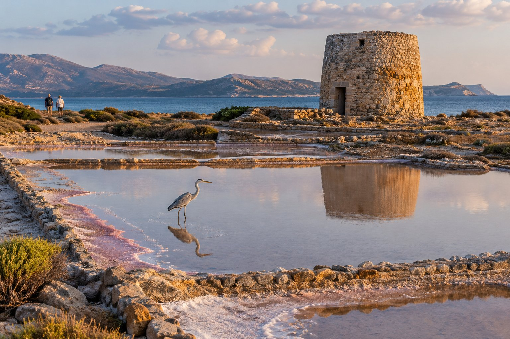
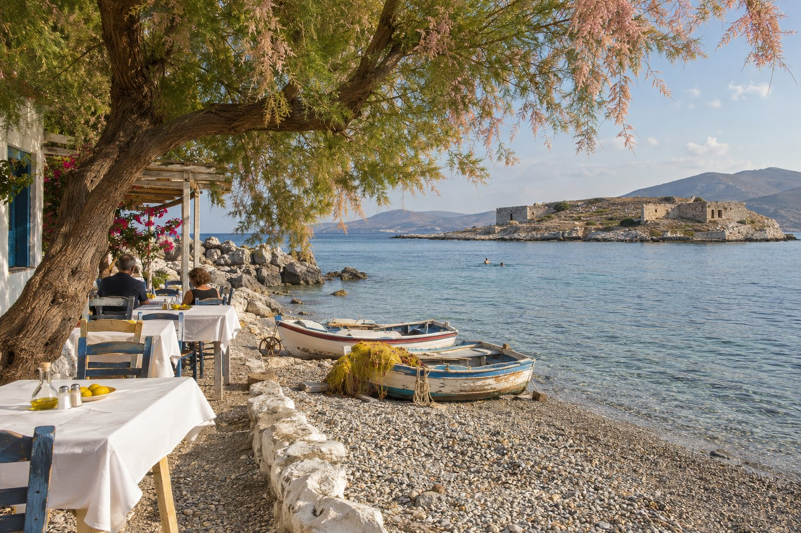

Elounda i Plaka són al nord d'Agios Nikolaos, al tram de costa on el golf de Mirabello es tanca amb la península de Spinalonga. Donen per a mig dia tranquil o per a un dia complet si ho combines amb la visita a l'illa. Aquest és el recorregut que solem recomanar, de sud a nord.

## La carretera des d'Agios Nikolaos

Des de la pensió hi ha uns 23 minuts en cotxe (uns 15 km) fins a Elounda i la zona de Spinalonga. La carretera surt cap al nord i va guanyant altura sobre el mar, amb el golf de Mirabello a la dreta. A la baixada cap a Elounda la vista s'obre sobre el golf, la península i les salines. Si vols aturar-te a mirar o a fer fotos, fes-ho només on hi hagi lloc per apartar-se: és una carretera amb revolts i molt trànsit a l'estiu.

Sense cotxe també es pot: hi ha autobusos de línia (KTEL) des de l'estació d'Agios Nikolaos a Elounda i Plaka, amb horaris que canvien segons la temporada. A [com moure's sense cotxe](/ca/blog/moverse-sin-coche/) t'expliquem com consultar-los.

## Elounda: el port i el passeig

Elounda reuneix diversos nuclis vora el mar. La vida es concentra al voltant del port, a la zona de Schisma, amb cafès, tavernes i botigues. D'allà surten els vaixells a Spinalonga i les excursions per la badia.

És una bona primera parada per prendre un cafè i orientar-se. A l'estiu l'aparcament prop del port s'omple aviat, així que com abans hi arribis, millor.

## L'istme de Poros: salines, molins i una ciutat sota l'aigua

Des del centre d'Elounda, una carretera vora la riba porta cap a la península de Spinalonga, que també es coneix com a Kolokitha. En un tram curt reuneix diverses coses que val la pena veure a poc a poc.

### Les salines

Primer passes pel costat de les antigues salines. La sal ja tenia importància en època veneciana, i aquestes basses es van utilitzar fins a principis dels anys setanta. Avui són un aiguamoll on es veuen agrons i, en algunes èpoques de l'any, flamencs. Els quadrats de pedra que treuen el cap a l'aigua són de les salines, no ruïnes antigues.

### Els molins i el canal

Vora el canal queden tres molins de pedra, rodons i ja en desús. El canal es va obrir el 1897–1898, durant l'administració francesa d'aquesta part de Creta, i va separar la península de la terra ferma. Un petit pont el creua a Poros.

### Olous, la ciutat submergida

Aquí hi havia l'antiga ciutat d'Olous. Amb els canvis de la línia de costa al llarg dels segles, part de les seves restes van quedar sota l'aigua, als fons poc profunds al voltant de Poros. Amb el mar en calma es distingeixen bases de murs des de la riba, i amb ulleres i tub es veuen millor. És un jaciment arqueològic: es mira, no es toca ni s'emporta res.

Molt a prop hi ha les restes d'una basílica paleocristiana del segle V, amb un mosaic de dofins i peixos al terra. Segons l'època, el mosaic pot estar cobert o el recinte tancat amb una tanca per protegir-lo.

### La platja de Kolokitha

Passat el canal, una pista de terra continua per la península. Des d'on es deixa el cotxe, es baixa a peu fins a la platja de Kolokitha en uns 10–15 minuts. Té l'aigua de color turquesa i l'illot de Kolokitha al davant. L'últim tram és de pedra solta: porta calçat tancat, no xancles, i aigua. Aquí hi paren també moltes excursions en vaixell. Per al dia de platja, mira [què portar a la platja a Creta](/ca/blog/que-llevar-a-la-playa-en-creta/).

## Plaka, davant de Spinalonga

A uns 5 km al nord d'Elounda hi ha Plaka, un antic poble de pescadors que té l'illa de Spinalonga just al davant, a uns 750 metres. Durant els anys de la leproseria, des d'aquí s'enviaven els subministraments a l'illa i des d'aquí es traslladaven els malalts. El poble apareix a la novel·la *The Island*, de Victoria Hislop, i a la sèrie grega basada en ella.

Avui és un lloc tranquil per passar la tarda:

- **Vaixells a Spinalonga.** És la travessia més curta, d'uns deu minuts. Si vols visitar l'illa, aquí ho tens explicat: [excursió a Spinalonga](/ca/blog/excursion-a-spinalonga/).
- **Bany amb vistes.** Les platges de Plaka són de pedra i miren directament a la fortalesa. Les sabatilles d'aigua s'agraeixen.
- **Menjar davant del mar.** Hi ha tavernes en primera línia. Per encertar-la amb qualsevol d'elles, et deixem unes pistes a [com triar una taverna](/ca/blog/como-elegir-una-taberna/).

## Com organitzar el dia

Un ordre que funciona bé a l'estiu:

1. **Sortida d'hora** d'Agios Nikolaos per la carretera de la costa.
2. **Spinalonga a primera hora**, des d'Elounda o Plaka, abans que apreti la calor.
3. **Passeig per l'istme de Poros**: salines, molins i les restes d'Olous.
4. **Bany** a Kolokitha o a Plaka.
5. **Dinar** a Plaka o al port d'Elounda.
6. **Tornada** a Agios Nikolaos a mitja tarda.

Si no entraràs a Spinalonga, el recorregut es queda en un matí llarg. A la primavera i a la tardor, amb menys calor, el passeig per les salines i la península es gaudeix més, i és bona època per veure aus a l'aiguamoll.

Per a un dia així n'hi ha prou amb portar aigua, protecció solar, banyador i un calçat que aguanti pedra i terra. Els horaris de vaixells i autobusos canvien segons la temporada, així que consulta'ls el dia abans, ja sigui per internet o a l'estació d'autobusos d'Agios Nikolaos.
