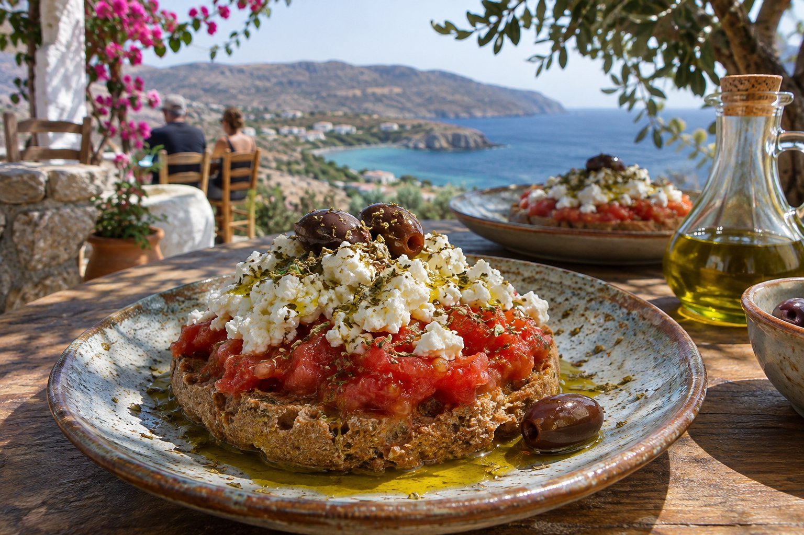
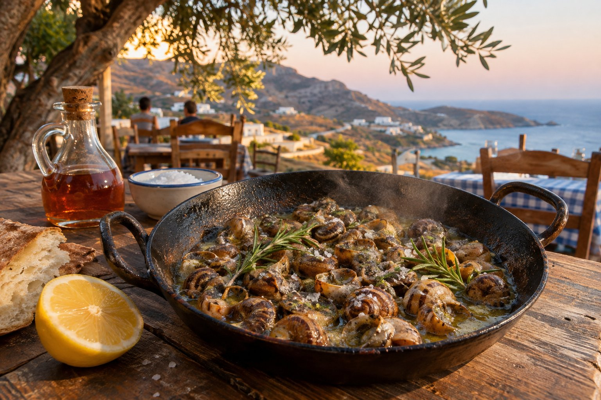

La cuina cretenca es basa en pocs ingredients i molt bons: oli d'oliva, verdures de temporada, llegums, formatges d'ovella i de cabra, herbes de muntanya i, més rarament, carn. Molts plats van néixer a les cases dels pobles i cada família té la seva versió, així que no t'estranyi trobar el mateix nom amb receptes una mica diferents d'una taverna a una altra.

Aquí tens els plats que més convé reconèixer en una carta, amb el seu nom en grec perquè et sigui més fàcil identificar-los.

## Per començar: plats per compartir

A Creta es demana per al centre de la taula, i aquests plats solen obrir l'àpat.

### Dakos (ντάκος)

És probablement l'entrant més conegut de l'illa. La base és un paximadi, un pa d'ordi cuit dues vegades fins a quedar dur, que s'humiteja una mica i es cobreix amb tomàquet ratllat, formatge (mizithra, xinomizithra o feta), oli d'oliva i orenga. El pa es va estovant amb el suc del tomàquet, així que convé no deixar-lo gaire estona a la taula.

### Horta (χόρτα)

Verdures bullides, silvestres o d'hort, amanides amb oli i llimona. El que arriba al plat depèn de l'estació: als mesos frescos és habitual el stamnagathi (σταμναγκάθι), una xicoira espinosa molt apreciada a l'illa, i a l'estiu són més comuns els vlita (βλίτα), fulles d'amarant. És un plat humil, però dels més cretencs.

### Kalitsounia (καλιτσούνια)

Pastissets de massa farcits de formatge fresc, normalment mizithra o anthotyros, de vegades amb menta o amb herbes. N'hi ha de salats i de dolços, amb mel per sobre, i la forma canvia segons la zona: tancats en mitja lluna o oberts com una petita estrella, amb el formatge a la vista. Són típics de Pasqua, encara que se'n troben tot l'any.

### Sfakianes pites (σφακιανές πίτες)

Vénen de Sfakia, al sud-oest de l'illa. Són coques molt fines amb mizithra a dins, que es couen a la paella gairebé sense greix i es serveixen amb mel de farigola. Valen com a postres i també per esmorzar; en parlem al [nostre article sobre l'esmorzar a Creta](/ca/blog/desayunar-en-creta/).

## Plats de cuina tradicional

### Boureki (μπουρέκι)

Típic de la zona de Chania: capes fines de patata i carbassó amb mizithra i menta, cuites lentament al forn. A l'estiu hi ha qui hi afegeix tomàquet, i n'hi ha versions amb massa i sense.

### Chochlioi boubouristi (χοχλιοί μπουμπουριστοί)

Cargols, un dels plats més característics de l'illa. Es posen cap per avall en una paella calenta amb sal i oli, i s'acaben amb vinagre i romaní. L'explicació més estesa és que el nom al·ludeix a aquesta manera de cuinar-los «cap per avall», encara que hi ha qui el relaciona amb l'espetec de la paella. Es recullen després de les pluges i són especialment populars durant la Quaresma ortodoxa, perquè es consideren compatibles amb el dejuni.

### Gamopilafo (γαμοπίλαφο)

L'«arròs de noces». Es cou al brou d'haver bullit xai o cabra i s'acaba amb mantega de staka i llimona, fins a quedar cremós i brillant. Tradicionalment es serveix en casaments i celebracions, així que no sempre apareix a la carta. Si el veus, demana'l.

### Staka (στάκα)

No és un plat, sinó un producte lacti: la nata de la llet d'ovella o de cabra, cuita amb una mica de farina i sal. En surt també una mantega, el stakovoutyro. És molt contundent i es menja, per exemple, amb ous ferrats.

### Apaki (απάκι)

Carn de porc macerada en vinagre i fumada amb herbes i llenya aromàtica, com la sàlvia o la farigola. Es serveix a talls fins o saltada, sovint com a meze per acompanyar el raki.

### Antikristo (αντικριστό)

Xai, i de vegades cabrit, rostit durant hores en grans trossos clavats en estaques al voltant del foc, no a sobre. És una tradició dels pastors de muntanya i requereix temps i espai, així que no totes les tavernes l'ofereixen.

## Els formatges de Creta

El formatge apareix a gairebé tots els àpats. Aquests són els que més veuràs:

- **Graviera (γραβιέρα):** formatge curat, sobretot de llet d'ovella. La graviera de Creta té denominació d'origen protegida. Es menja sola, fregida o amb mel.
- **Mizithra (μυζήθρα):** formatge fresc de xerigot, suau, amb una textura que recorda el mató. També n'hi ha una versió curada i seca.
- **Anthotyros (ανθότυρος):** de la mateixa família que la mizithra; es pren fresc o, ja sec, ratllat.
- **Xinomizithra (ξινομυζήθρα):** tova i àcida, també amb denominació d'origen protegida. És freqüent sobre el dakos.

A l'est de l'illa, la zona de Sitia té el seu propi formatge tou amb denominació d'origen, el xigalo (ξίγαλο Σητείας). Si hi vas amb la nostra [excursió a Sitia i el palmerar de Vai](/ca/blog/sitia-y-palmeral-de-vai/), busca'l.

## Temporada i regió: el que canvia

La cuina cretenca segueix molt el calendari. Les verdures canvien d'un mes a l'altre, els plats de forn de l'estiu porten tomàquet, carbassó o albergínia, i els cargols i bona part de les verdures silvestres apareixen sobretot als mesos de pluja. Per això, les cartes curtes i els plats del dia solen ser la millor aposta.

També hi ha diferències d'una zona a l'altra. El boureki i la bougatsa amb mizithra s'associen a Chania, les pites a Sfakia i el xigalo a Sitia. Que un plat no sigui en una taverna d'Agios Nikolaos no vol dir que no sigui cretenc: pot ser d'una altra part de l'illa o d'una altra època de l'any.

## Com demanar

- **Demana diversos plats per compartir**: així proves més coses.
- **Pregunta què hi ha avui.** Els guisats del dia (μαγειρευτά, mageirefta) solen ser el més casolà.
- **No tinguis por de l'oli.** És la base de tot; si en vols saber més, llegeix [el nostre article sobre l'oli d'oliva de Creta](/ca/blog/aceite-de-oliva-de-creta/).
- **Deixa lloc per al final.** A moltes tavernes, l'àpat acaba amb una mica de raki i alguna cosa dolça.

I per triar on seure, tens [la nostra guia per triar una taverna a Agios Nikolaos](/ca/blog/como-elegir-una-taberna/).

## Abans d'asseure't a taula

No cal provar-ho tot en un sol viatge. Comença per un dakos, unes horta i uns kalitsounia, pregunta què hi ha de temporada i deixa que la resta vingui segons els dies i els llocs. Les cartes canvien al llarg de l'any, així que, si un nom no et sona, pregunta què porta.
