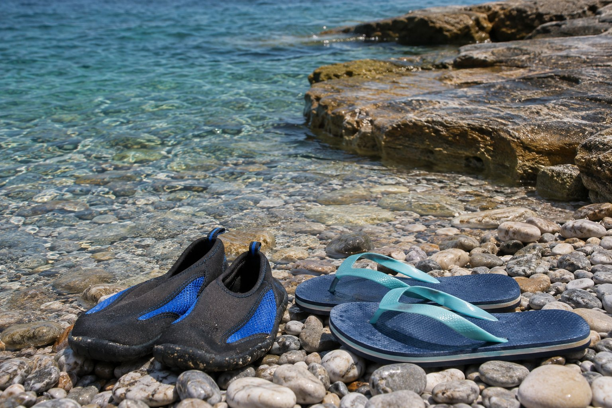

Un dia de platja a Creta s'assembla bastant a un dia de platja a qualsevol costa de la Mediterrània, però hi ha tres coses que marquen la diferència: el sol d'estiu és molt fort, el vent pot aixecar-se a la tarda i moltes platges són de còdols o tenen roques a la vora. Aquesta és la llista que solem recomanar, amb una versió resumida al final per repassar abans de sortir.

## Protecció solar, més de la que et penses

A l'estiu la radiació a Creta és molt alta, i la brisa del mar fa que no notis la calor fins que ja t'has cremat.

- **Crema solar de factor alt** (30 o, millor, 50). Posa-te-la abans de sortir i torna-te-la a aplicar després de cada bany i cada dues hores, més o menys.
- **Barret o gorra i ulleres de sol** amb filtre UV.
- **Una samarreta lleugera** per a les hores de més sol, i samarretes de licra per als nens, que es passen el dia a l'aigua.
- **Alguna cosa per a després del sol**, com una crema hidratant o d'aloe.

Si pots, evita les hores centrals del dia, aproximadament d'onze a quatre. Anar-hi d'hora o a última hora de la tarda té un altre avantatge: hi ha menys gent i és més fàcil trobar lloc. I recorda que amb núvols o amb vent també et cremes.

## Ombra

A les platges organitzades se solen llogar gandules i para-sols. Les condicions canvien d'una platja a una altra, i en algunes van lligades al que consumeixes al bar, així que pregunta en arribar.

A les platges sense serveis no hi ha res, de manera que porta el teu propi para-sol. Que sigui resistent i amb un bon sistema per clavar-lo a la sorra: amb vent, un para-sol mal subjectat surt volant i pot fer mal. En algunes platges hi ha tamarius que donen ombra natural, però a l'estiu aquests racons s'ocupen aviat.

## Calçat: les sabatilles d'aigua

Si només has d'afegir una cosa a la bossa de sempre, que siguin unes sabatilles d'aigua. Moltes platges de Creta són de còdols o tenen l'entrada amb pedres, i a les zones de roca hi ha garotes. Amb sabatilles d'aigua entres a l'aigua amb comoditat i et pots acostar a les roques sense por.

Porta també xancles o sandàlies: al migdia, la sorra i les pedres cremen.

## Aigua i alguna cosa per menjar

Porta més aigua de la que creus que beuràs, millor en una nevera portàtil o en ampolles tèrmiques. A les platges organitzades sol haver-hi un bar o un quiosc, però a les cales sense serveis no hi ha on comprar res. Fruita, fruita seca i alguna cosa salada ajuden a aguantar un dia de calor.

## Per al vent

A l'estiu bufa sovint el meltemi, un vent del nord que a Creta arriba del nord-oest. Sol aparèixer entre maig i setembre, és més fort a la tarda i moltes vegades amaina a la nit, tot i que de vegades dura diversos dies seguits. A les platges exposades aixeca onades i sorra.

- **Pinces per a la tovallola** i una bossa que tanqui bé, perquè la sorra no es fiqui en tot.
- **Una capa lleugera** per a quan el vent refresca.
- **Mira la previsió** abans de triar platja. Els dies de vent, busca una platja arrecerada.

Si el mar està molt mogut, no et banyis, i si hi ha socorrista, fes cas de les seves indicacions.

## Per veure el fons

L'aigua sol estar molt clara, sobretot vora les roques. Unes ulleres de busseig amb tub donen per moltes hores d'entreteniment, als nens i als grans. Una funda impermeable per al mòbil també va bé si vols fer fotos prop de l'aigua.

## Diners i objectes de valor

Porta una mica d'efectiu: cada cop es paga més amb targeta, però en alguns quioscos i xiringuitos petits no sempre es pot. Deixa a casa el que no necessitis i no deixis objectes de valor a la vista, ni a la tovallola mentre et banyes ni dins del cotxe aparcat.

## Costums locals

- **Per sortir de la platja, tapa't.** Amb un pareo o una samarreta n'hi ha prou per entrar en una taverna o passejar pel poble. Si aniràs a visitar una església o un monestir, porta alguna cosa per cobrir espatlles i genolls.
- **Topless i nudisme.** A moltes platges turístiques el topless és habitual, però a les platges de poble i a les més familiars es veu menys. El nudisme es limita a algunes platges concretes; a les urbanes no hi té cabuda. Si dubtes, fixa't en el que fa la gent al teu voltant.
- **Emporta't les escombraries**, burilles incloses. Una bossa petita ocupa poc.
- **No t'emportis pedres, sorra ni petxines de record.** Està mal vist i en algunes platges de Grècia està prohibit expressament i es multa.
- **Res de foc.** A l'estiu el risc d'incendi és alt: ni fogueres ni barbacoes a la platja.
- **Respecta les zones protegides**, com l'aiguamoll vora la platja d'Almiros, a Agios Nikolaos.

## Al principi i al final de la temporada

Al maig o a finals d'octubre l'aigua és més fresca i les tardes refresquen abans. Una tovallola de les que s'assequen ràpid i una dessuadora per a després del bany marquen la diferència. Si estàs decidint quan venir, tens més informació a [quan visitar Agios Nikolaos](/ca/blog/cuando-visitar-agios-nikolaos/).

## La llista, per repassar

- Crema solar de factor alt i alguna cosa per a després del sol
- Barret o gorra i ulleres de sol
- Samarreta lleugera o de licra
- Sabatilles d'aigua i xancles
- Tovallola, millor de secat ràpid, i pinces
- Para-sol resistent, si vas a una platja sense serveis
- Aigua de sobra i alguna cosa per menjar, en una nevera portàtil
- Ulleres de busseig i tub
- Funda impermeable per al mòbil
- Una mica d'efectiu i una targeta
- Pareo o samarreta per sortir de la platja
- Una bossa per a les escombraries
- Una capa lleugera per al vent o la tarda

## Per acabar

Si t'allotges amb nosaltres, Kitroplatia és a un minut de la pensió, de manera que si se't oblida alguna cosa, tornes a buscar-la en un moment. Per a les platges més allunyades, sobretot les que no tenen serveis, val la pena repassar la llista abans de sortir. Si encara no saps a quina anar, a [platges d'Agios Nikolaos](/ca/blog/playas-de-agios-nikolaos/) t'expliquem com és cadascuna, i si viatges amb nens, tens més idees a [Agios Nikolaos amb nens](/ca/blog/agios-nikolaos-con-ninos/).
