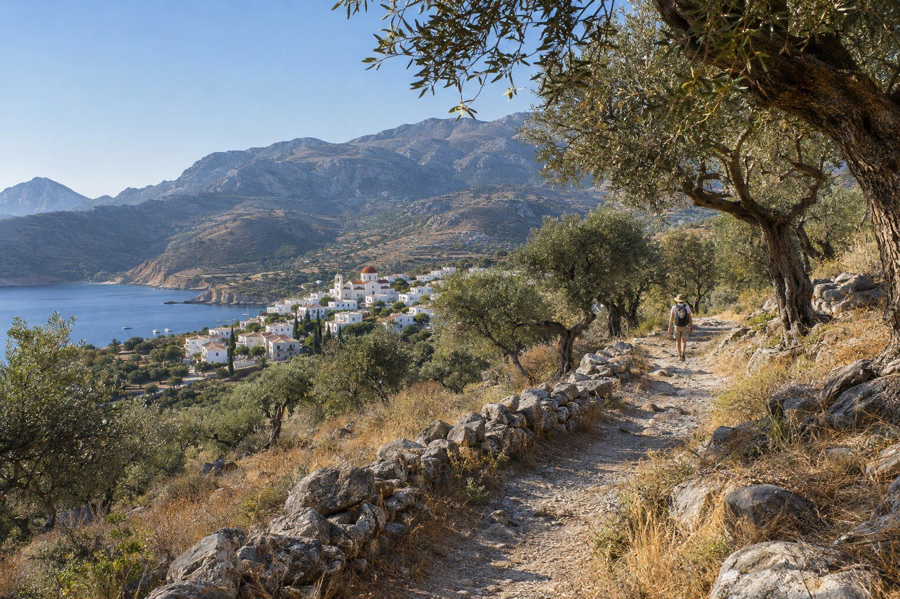
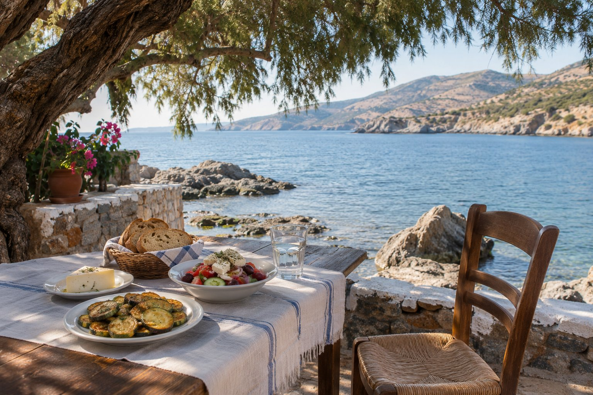

Viatjar sol té un avantatge clar: el dia és teu. Agios Nikolaos s'hi presta bé perquè és una ciutat petita, fàcil de recórrer a peu i ben comunicada en autobús i en vaixell amb la resta de l'est de Creta. Aquí tens algunes idees per organitzar-te.

## Una ciutat per recórrer a peu

Des de la pensió, a la zona costanera de Mylos, gairebé tot és a un passeig:

- Platja de Kitroplatia: 1 minut (100 m)
- Port, amb l'estàtua del rapte d'Europa: 3 minuts (200 m)
- Llac Voulismeni: 6 minuts (450 m)
- Centre de la ciutat: 9 minuts (600 m)
- Platja d'Ámmos: 10 minuts (650 m)
- Platja d'Ammoudi: 18 minuts (1,2 km)
- Platja d'Almiros: 26 minuts (2,1 km)

Sense cotxe pots passar diversos dies alternant banys, cafès i passejos sense dependre de ningú. Una bona primera tarda: baixar al port, fer la volta al llac, pujar a la part alta per veure'l des de dalt i acabar en una terrassa del centre. Tens més idees a [què veure a Agios Nikolaos](/ca/blog/que-ver-en-agios-nikolaos/).

## Excursions fàcils en autobús

Els autobusos interurbans KTEL uneixen Agios Nikolaos amb molts punts de l'est de l'illa, entre ells Elounda, Plaka, Kritsa, Ierapetra, Sitia i Heraklion. Són una manera còmoda i econòmica de moure's pel teu compte. Algunes idees per a un dia:

- **Kritsa.** En uns 20 minuts d'autobús arribes a aquest poble de muntanya, conegut pels seus teixits i brodats fets a mà. Una mica abans del poble hi ha l'església bizantina de Panagia Kera, amb frescos dels segles XIII i XIV. Si t'agrada caminar, molt a prop del poble comença el congost de Kritsa, d'uns 4 km. Ho expliquem a [Kritsa i voltants](/ca/blog/kritsa-y-alrededores/).
- **Elounda i Plaka.** Dos pobles costaners davant de Spinalonga, amb passejos vora el mar. Des de Plaka, la travessia en vaixell fins a l'illa dura només uns minuts.
- **Ierapetra.** A la costa sud, a una mica menys d'una hora d'autobús. Té un llarg passeig marítim amb cafès i la fortalesa de Kales a l'entrada del port vell, una bona excusa per canviar de mar per un dia.

Els horaris canvien segons la temporada i el dia de la setmana, així que consulta'ls a la web de KTEL o pregunta a l'estació abans de sortir. Fora de temporada hi ha menys serveis: comprova sempre a quina hora surt l'últim autobús de tornada. Més trucs a [moure's sense cotxe](/ca/blog/moverse-sin-coche/).

## En vaixell pel golf de Mirabello

Des del port surten excursions en vaixell cap a Spinalonga i altres punts del golf, algunes amb parada per banyar-se. Viatjant sol són una manera senzilla de passar el dia acompanyat sense haver d'organitzar res. Spinalonga va ser una fortalesa veneciana i, entre 1903 i 1957, una colònia de malalts de lepra; és una visita que impressiona. L'illa té molt poca ombra, així que porta aigua, gorra i calçat còmode. Una altra opció és anar en autobús fins a Elounda o Plaka i creuar des d'allà.

## Menjar sol en una taverna

A Creta menjar sol és el més normal del món. Les tavernes són llocs informals, ningú s'estranya de veure una taula per a un i, a les que són vora l'aigua, la vista fa bona companyia. Algunes idees:

- **Demana diversos plats petits** en lloc d'un de gran: una amanida, una mica de verdura, un formatge local. Així proves més coses.
- **Pregunta què hi ha aquell dia.** Moltes tavernes preparen plats de temporada que no sempre apareixen a la carta.
- **Ajusta la quantitat.** Les racions poden ser generoses; si no tens gaire gana, digues-ho en demanar.
- **No et sorprenguis** si al final et porten una mica de raki o un postre de part de la casa: és un costum habitual en moltes tavernes de l'illa.

Un cafè a mig matí en un *kafeneio*, el cafè tradicional grec, també és una bona manera de veure passar la vida del barri. Tens més pistes a [com triar una taverna](/ca/blog/como-elegir-una-taberna/).

## Conèixer gent pel camí

Viatjar sol no vol dir estar sol tot el temps. Si de tant en tant vols companyia:

- **Visites guiades a peu.** A la ciutat s'ofereixen passejos guiats, alguns amb tast de *mezedes*, que pots reservar en línia o en agències locals.
- **Excursions en grup.** Les sortides en vaixell o les excursions d'un dia a llocs com Cnossos o l'altiplà de Lassithi reuneixen viatgers de molts països, i la conversa sorgeix sola.
- **Senderisme amb guia.** Si vols fer rutes per la muntanya i prefereixes no anar pel teu compte, hi ha guies que organitzen caminades per la zona.

## Una habitació per a tu

A la pensió tenim una habitació individual amb vista panoràmica, pensada per a qui viatja sol. Des dels balcons de la pensió es veu sortir el sol sobre el golf de Mirabello, i no hi ha millor manera de començar el dia que amb un cafè o un te davant d'aquest paisatge, abans de decidir què et ve de gust fer.

## Consells pràctics

- **Avisa dels teus plans.** Si vas a caminar per la muntanya o per un congost, explica a algú la teva ruta i l'hora a la qual penses tornar.
- **Evita la calor.** A l'estiu, fes les caminades llargues d'hora i reserva les hores centrals per al mar o per descansar.
- **Porta aigua de sobra**, també a les excursions en vaixell.
- **Tingues a mà els contactes.** Desa al mòbil el telèfon de la pensió (+30 2841 14 15 17) per si necessites qualsevol indicació.
- **Porta una mica d'efectiu.** Et pot anar bé en llocs petits o en pobles.

Agios Nikolaos és una bona destinació per viatjar sol precisament perquè no exigeix gaire: pots passar el dia entre el mar i el centre sense cotxe, i sortir d'excursió quan et vingui de gust. Consulta els horaris d'autobusos i vaixells la vigília i deixa buits lliures al pla; sovint són els millors moments del viatge.
