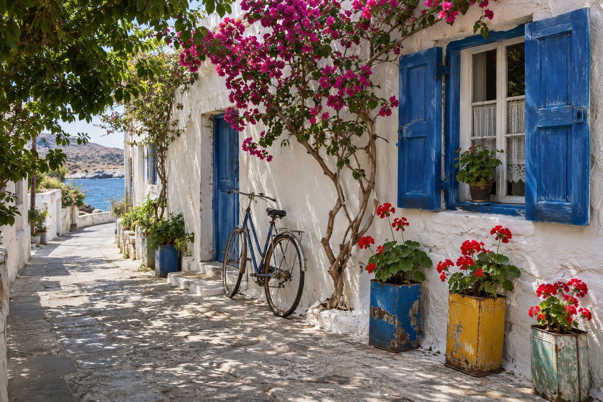
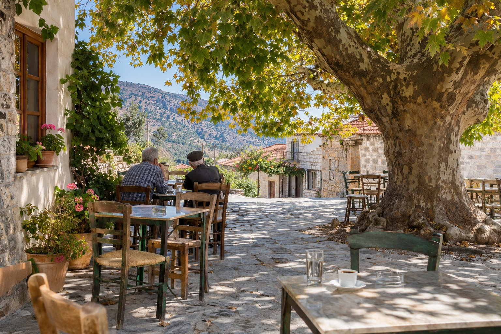
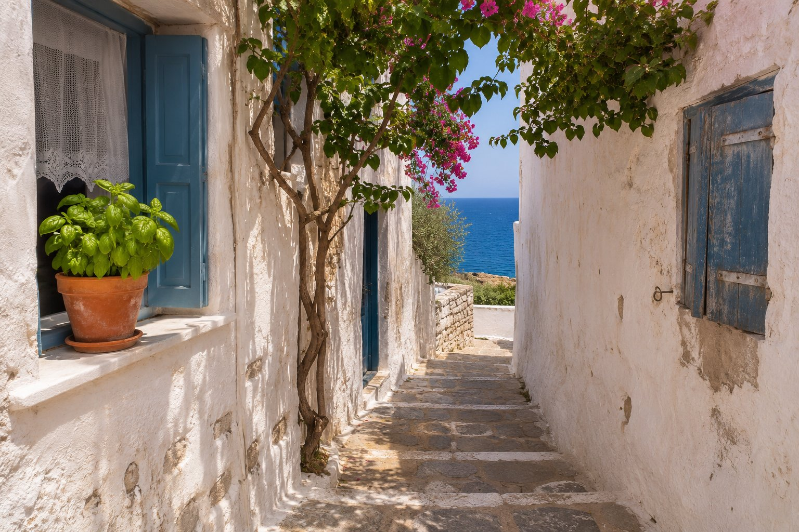

Auf Kreta gibt es nebeneinander große Hotels, Ferienapartments und eine ältere, einfachere Form der Unterkunft: die Familienpension. Wenn Sie noch nie in einer gewohnt haben, ist es normal, nicht genau zu wissen, was einen erwartet. Wir erzählen Ihnen, wie sie meist sind, wie sie sich von einem Hotel unterscheiden und was Sie vor der Buchung fragen sollten. Wir tun das von innen heraus, denn wir führen selbst eine, seit den Achtzigerjahren.

## Was eine Pension in Griechenland ist

In Griechenland ist eine Pension (griechisch *pansión*) meist eine kleine Unterkunft mit wenigen Zimmern, die von einer Familie geführt wird. Oft ist es ein Gebäude mit wenigen Stockwerken, mit einfachen Zimmern und, in den Küstenorten, mit Balkonen oder Terrassen, von denen man das Meer sieht.

Dennoch gleicht keine der anderen. Es gibt Pensionen, die Frühstück anbieten, und andere, die es nicht tun; manche haben einen großen Teil des Tages eine Rezeption, in anderen empfängt Sie die Familie, wenn Sie ankommen. Statt etwas als gegeben anzunehmen, fragen Sie deshalb am besten nach.

## Wie sie sich von einem Hotel unterscheidet

### Der Umgang

In einer Familienpension haben Sie meist direkt mit denen zu tun, die sie führen. Das hat einen praktischen Vorteil: Sie können nach einem Strand, einer Taverne oder einer Busverbindung fragen, und es antwortet Ihnen jemand, der das ganze Jahr über dort lebt.

### Die Rezeption und die Zeiten

In vielen Pensionen gibt es keine 24 Stunden besetzte Rezeption. Das ist meist kein Problem, aber Sie müssen Ihre Ankunftszeit ankündigen, vor allem wenn Ihr Flug spät landet oder Sie von weit her mit dem Auto kommen.

### Die Leistungen

Ein großes Hotel bietet meist Restaurant, Pool, Animation und weitere Leistungen. Eine Pension konzentriert sich auf das Wesentliche: ein sauberes Zimmer, ein gutes Bett und ein ruhiger Ort, von dem aus Sie die Gegend erkunden können. Wenn Ihnen eine bestimmte Leistung wichtig ist, fragen Sie vorher nach, statt sie vorauszusetzen.

### Die Atmosphäre

Bei wenigen Zimmern ist die Atmosphäre ruhiger und persönlicher. Der Preis dafür ist, dass man Lärm stärker wahrnimmt; bedenken Sie das am frühen Morgen und abends, vor allem auf Balkonen und in Fluren.

## Was Sie vor der Buchung fragen sollten

Diese Fragen vermeiden die meisten Überraschungen, in einer Pension oder in jeder anderen kleinen Unterkunft:

- **Bettart.** Ein *Twin*-Zimmer hat zwei Einzelbetten; ein Doppelzimmer ein großes Bett. Wenn Sie als Paar reisen und eine Vorliebe haben, sagen Sie es bei der Buchung.
- **Aussicht.** „Meerblick“ kann Verschiedenes bedeuten: ein frontaler, freier Blick, ein seitlicher Blick oder ein Stück Meer zwischen Gebäuden. Fragen Sie, was genau man aus dem Zimmer sieht, das Sie buchen.
- **Treppen und Zugänglichkeit.** Viele kleine Gebäude in Griechenland haben keinen Aufzug. Wenn Sie mit schwerem Gepäck, mit kleinen Kindern oder mit Mobilitätseinschränkungen reisen, fragen Sie, in welchem Stockwerk das Zimmer liegt und wie viele Stufen es sind.
- **Ankunftszeit.** Geben Sie an, wann Sie voraussichtlich ankommen, und fragen Sie, wie die Schlüsselübergabe funktioniert, wenn Sie spät kommen.
- **Anreise.** Fragen Sie nach der genauen Adresse, wo Sie das Taxi absetzen kann und wo Sie parken können, wenn Sie mit dem Auto kommen. Wenn Sie vom Flughafen kommen, kann Ihnen unser Führer [Vom Flughafen Heraklion nach Agios Nikolaos](/de/blog/como-llegar-desde-el-aeropuerto-de-heraclion/) nützlich sein.
- **Was im Preis enthalten ist.** Frühstück, Reinigung, Handtücher, Zahlungsarten. Und bedenken Sie, dass es in Griechenland eine Abgabe pro Nacht gibt, die in der Unterkunft bezahlt wird und nicht immer im Preis enthalten ist, der bei der Buchung angezeigt wird.

## Einige nützliche Bräuche

- **Das Toilettenpapier.** In vielen Unterkünften in Griechenland bittet man darum, es nicht in die Toilette zu werfen, weil die Rohre eng sind; dafür steht ein Abfalleimer neben der Toilette. Wenn Sie einen Hinweis sehen, befolgen Sie ihn.
- **Das Frühstück.** Wenn Ihre Unterkunft es nicht einschließt, gehört das Frühstück auswärts zur Reise dazu. Ideen dazu finden Sie unter [Frühstücken auf Kreta](/de/blog/desayunar-en-creta/).
- **Die Jahreszeit.** Im Frühling und im Herbst sind weniger Leute da, und kleine Pensionen sind besonders ruhig; im Juli und August sollten Sie früher reservieren. Wenn Sie sich noch nicht für ein Datum entschieden haben, lesen Sie [Wann Sie Agios Nikolaos besuchen sollten](/de/blog/cuando-visitar-agios-nikolaos/).
- **Fragen Sie.** Wer eine Pension führt, kennt die Gegend besser als jeder Reiseführer: wann man an einen Strand gehen sollte, wie man Bus und Boot kombiniert oder wo man den Sonnenuntergang sieht.

## Wie es in der Pension Mylos ist

Wir sind seit den Achtzigerjahren eine Familienpension, in der Sarolidi-Straße 24, im Viertel Mylos von Agios Nikolaos, direkt am Meer. Wir haben Twin- und Dreibettzimmer mit Panoramablick aufs Meer sowie Einzelzimmer mit Panoramablick. Von den Balkonen sieht man die Mirabello-Bucht und, wenn Sie früh aufstehen, den Sonnenaufgang über dem Wasser.

Die Lage macht es möglich, fast alles zu Fuß zu erreichen: Der Strand von Kitroplatia ist 1 Minute entfernt (100 m), der Hafen 3 Minuten (200 m), der Voulismeni-See 6 Minuten (450 m) und das Zentrum 9 Minuten (600 m). Am Hafen gibt es einen großen, kostenlosen öffentlichen Parkplatz.

Dieselben Fragen aus der Liste oben gelten auch für uns. Wenn Sie Fragen zum Zimmer, zur Aussicht oder zu Ihrer Ankunftszeit haben, schreiben Sie uns an info@pensionmylos.com oder rufen Sie uns an unter +30 2841 14 15 17.

## Zum Schluss

Eine Pension ist kein kleines Hotel: Sie ist eine andere Art zu wohnen, einfacher und persönlicher. Sie funktioniert am besten, wenn Sie wissen, was Sie erwartet. Klären Sie deshalb vor der Buchung Bettart, Aussicht, Treppen und Ankunftszeit. Wenn Sie sich schon sicher sind, können Sie auf unserer Seite für [Reservierungen](/de/reservations/) die Verfügbarkeit prüfen.
