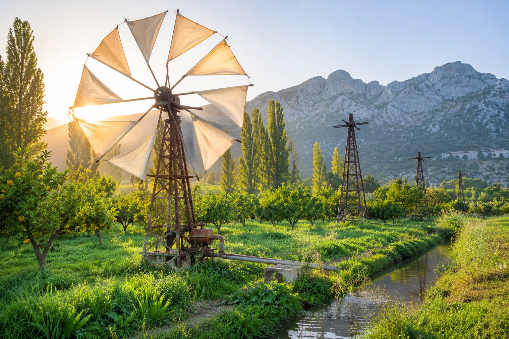
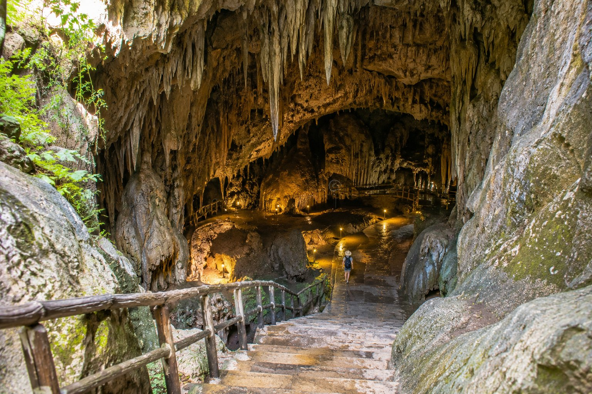

Eine Autostunde von der Küste entfernt zeigt sich auf der Lassithi-Hochebene ein anderes Kreta: eine völlig ebene Ackerlandschaft in etwa 800-850 Metern Höhe, umgeben von den Bergen des Dikti-Massivs. Sie misst rund 11 km von Ost nach West und etwa 6 km von Nord nach Süd, und angebaut werden vor allem Kartoffeln, Gemüse und Obstbäume. Sie teilt ihren Namen mit dem Regionalbezirk, zu dem Agios Nikolaos gehört, darf aber nicht damit verwechselt werden: Hier geht es um die Hochebene.

Sie ist ein idealer Ausflug für einen Tag, an dem Ihnen nach etwas anderem als Strand zumute ist, und die bekannteste Station ist die Diktäische Höhle in Psychro, die die Mythologie als Geburtsort des Zeus bezeichnet.

## Anfahrt von Agios Nikolaos

Von unserer Pension aus liegt die Höhle von Psychro eine Autostunde entfernt (rund 45 km). Auf die Hochebene führen zwei asphaltierte Hauptstraßen hinauf:

- **Von Osten, von der Seite Agios Nikolaos aus**: Man fährt Richtung Neapoli und steigt von dort durchs Landesinnere hinauf, vorbei an Bergdörfern wie Exo Potami und Mesa Potami, bis man in die Ebene gelangt.
- **Von Norden, von der Küste bei Malia aus**: Die Straße steigt mit vielen Kurven durch das Dorf Krasi bis zum Pass Seli Ambelou in rund 900 Metern Höhe, von wo man die Hochebene zum ersten Mal sieht.

Eine gute Idee ist ein Rundkurs: auf der einen Seite hinauf und auf der anderen hinunter, und zurück nach Agios Nikolaos auf der Hauptstraße an der Nordküste. Wenn Sie lieber nicht selbst durch die Berge fahren möchten, gibt es organisierte Ausflüge, die in der Gegend starten.

Es sind Bergstraßen: an manchen Abschnitten schmal, mit engen Kurven und manchmal Tieren auf der Fahrbahn. Fahren Sie ohne Eile, tanken Sie vor der Abfahrt voll und vermeiden Sie die Rückfahrt im Dunkeln, wenn Sie die Strecke nicht kennen.

## Eine Ackerebene, von Bergen umgeben

Die Hochebene ist seit der Jungsteinzeit besiedelt. Im 13. Jahrhundert, während der venezianischen Herrschaft und nach mehreren Aufständen, vertrieben die Venezianer ihre Bewohner und verboten etwa zwei Jahrhunderte lang den Anbau. Später erlaubten sie wieder, das Land zu bewirtschaften, und legten ein Netz von Entwässerungskanälen an, das noch heute das Raster der Felder prägt. Jahrhunderte später, bei den Aufständen gegen die Osmanen und während der Besatzung im Zweiten Weltkrieg, dienten die umliegenden Berge als Zuflucht.

Die Dörfer, rund 17 oder 18, liegen nicht in der Ebene, sondern an ihrem Rand, am Fuß der Berge, um das fruchtbare Land freizuhalten und vor den Überschwemmungen der Schneeschmelze geschützt zu sein. Eine Straße von etwa 20-25 km umrundet die Hochebene und verbindet sie, sodass man sie leicht in Ruhe abfahren und anhalten kann, wo es einem gefällt:

- **Tzermiado**, das größte Dorf.
- **Agios Georgios**, das zweitgrößte, mit einigen kleinen Museen, darunter eines zur Volkskunde (prüfen Sie vorher, ob es geöffnet ist).
- **Psychro**, Ausgangspunkt für die Diktäische Höhle.

Die Straße rund um die Hochebene ist ziemlich eben, und zwischen den Dörfern sieht man Gemüsegärten, Obstbäume und Feldwege.

## Die Windmühlen

Lassithi ist berühmt für seine Mühlen, doch man sollte mit angepassten Erwartungen kommen. Es gibt zwei Arten:

- **Die Steinmühlen** am Pass Seli Ambelou, am Nordeingang, die zum Mahlen von Getreide dienten. Die meisten sind verfallen, einige wurden restauriert.
- **Die Pumpwindmühlen**, Metallkonstruktionen mit weißen Stoffsegeln, die Wasser aus dem Untergrund zur Bewässerung förderten. Sie verbreiteten sich zwischen dem Ende des 19. Jahrhunderts und der ersten Hälfte des 20. Jahrhunderts, und es soll Tausende gegeben haben (oft ist von rund 10.000 die Rede).

Heute sind die meisten Pumpwindmühlen aufgegeben und durch Motorpumpen ersetzt. Sie sehen viele Gerüste ohne Segel auf den Feldern verteilt und nur wenige, die in Betrieb oder restauriert sind. Trotzdem bleibt die Landschaft sehr fotogen, vor allem am frühen Morgen oder am späten Nachmittag.

## Die Diktäische Höhle, die „Zeus-Höhle“

Nach der griechischen Mythologie versteckte sich Rhea in einer Höhle auf Kreta, um Zeus zur Welt zu bringen und ihn vor seinem Vater Kronos zu retten, der seine Kinder verschlang. Die Überlieferung identifiziert diese Höhle mit der Diktäischen Höhle oberhalb des Dorfes Psychro, auch wenn eine andere Überlieferung die Episode in der Höhle am Ida-Gebirge ansiedelt. Mythos beiseite, bestätigt die Archäologie tatsächlich, dass sie seit minoischer Zeit ein Kultort war: Dort wurden zahlreiche Weihegaben gefunden, viele davon heute im Archäologischen Museum von Heraklion ausgestellt, das sich mit einem Besuch des [Palastes von Knossos](/de/blog/palacio-de-knossos/) verbinden lässt.

### So läuft der Besuch ab

- Vom Parkplatz in Psychro müssen Sie rund 800 Meter **zu Fuß hinaufgehen**, über einen steilen Anstieg, je nach Tempo 15 bis 20 Minuten.
- In der Höhle **steigt man Stufen hinab** bis zum Grund, zwischen Stalaktiten und Stalagmiten, und muss sie anschließend wieder hinaufgehen. Der Boden kann feucht und rutschig sein: Tragen Sie Schuhe mit guter Sohle.
- Für Menschen mit eingeschränkter Mobilität ist der Besuch nicht geeignet.
- Die Höhle war etwa zwei Jahre lang wegen Sicherungs- und Verbesserungsarbeiten geschlossen und wurde 2026 wiedereröffnet. Prüfen Sie Öffnungszeiten und Besuchsmöglichkeiten, bevor Sie aufbrechen, denn sie ändern sich je nach Jahreszeit.

## Tipps für den Tag

- **Nehmen Sie etwas Warmes mit.** Auf der Hochebene ist es kühler als an der Küste, auch im Sommer. Im Winter kann es richtig kalt werden, und der Schnee hält sich manchmal in den Bergen, und sogar in der Ebene, bis weit in den Frühling hinein.
- **Fahren Sie früh los**, um vor den organisierten Gruppen an der Höhle zu sein.
- **Essen Sie in einem der Dörfer der Hochebene.** Es ist ein landwirtschaftliches Gebiet, und die Bergküche hat ihren eigenen Charakter; in [was man in Kreta essen sollte](/de/blog/que-comer-en-creta/) geben wir einige Hinweise auf Gerichte, die man probieren sollte.
- **Planen Sie den ganzen Tag ein.** Mit Anfahrt, Höhle, Rückkehr in die Ebene und Mittagessen ist leicht der ganze Tag vorbei.

Wenn Sie etwas Kürzeres suchen: In [Autorouten für einen halben Tag](/de/blog/rutas-en-coche-de-medio-dia/) schlagen wir Touren von wenigen Stunden in der Nähe von Agios Nikolaos vor, und wenn Sie mehrere Tage in der Gegend planen, finden Sie Ideen in [eine Woche im Osten Kretas](/de/blog/una-semana-en-el-este-de-creta/).

Kurz gesagt: Planen Sie einen ganzen Tag ein, fahren Sie früh los, nehmen Sie eine warme Schicht und bequeme Schuhe mit und prüfen Sie am Vortag den Zustand der Höhle. So ist Lassithi einer der angenehmsten Ausflüge, um das Landesinnere der Insel kennenzulernen.
