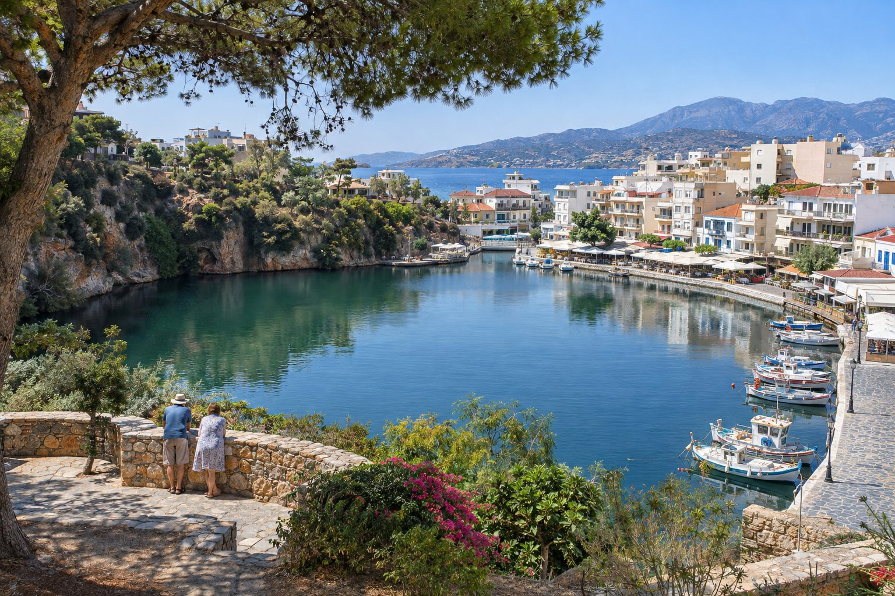
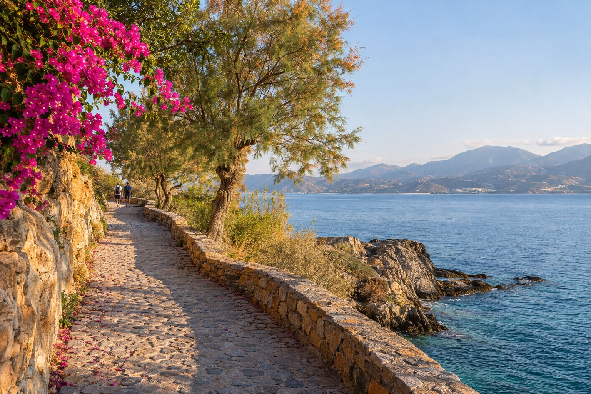
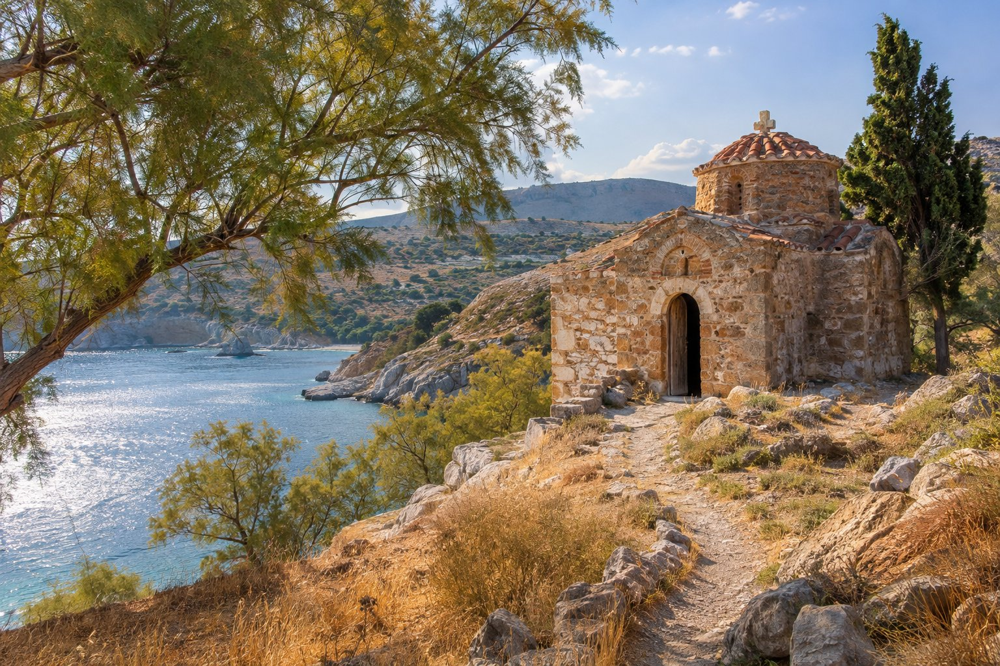

Agios Nikolaos ist eine kleine Stadt, die man schnell versteht. Fast alles Sehenswerte liegt rund ums Wasser: ein See mitten im Zentrum, ein Hafen, mehrere Stadtstrände und eine Promenade, die an der Küste entlangführt. Von der Pension in der Gegend von Mylos aus liegt fast alles, was in diesem Guide vorkommt, weniger als eine halbe Stunde zu Fuß entfernt. Wir stellen Ihnen die Stadt nach Gegenden vor, in der Reihenfolge, in der Sie sie am ersten Tag ablaufen würden.

## Der Voulismeni-See

Er ist das Wahrzeichen der Stadt: ein fast kreisrunder See mit einem Durchmesser von etwa 137 Metern, an dem einen Ufer Häuser und Terrassen, am anderen eine bewachsene Felswand. Seit dem 19. Jahrhundert verbindet ihn ein Kanal mit dem Hafen; durch ihn laufen die Fischerboote ein und aus, die Sie am Kai festgemacht sehen werden.

Den schönsten Blick haben Sie vom kleinen Park oberhalb des Sees auf seiner Südseite: Von oben überblicken Sie Wasser, Stadt und Bucht auf einmal. Wenn Sie neugierig auf seine Tiefe und seine Legenden sind, haben wir ihm einen eigenen Artikel gewidmet: [der Voulismeni-See](/de/blog/lago-voulismeni/).

Neben der Kanalbrücke befindet sich das Museum für Volkskunst: klein, mit Webarbeiten, Stickereien und Gegenständen aus dem kretischen Landleben. Es ist saisonal geöffnet, prüfen Sie die Öffnungszeiten also vor Ihrem Besuch.

## Der Hafen und die Statue der Entführung der Europa

Drei Minuten von der Pension entfernt liegt der Hafen, über den die Skulptur der Entführung der Europa wacht: rund vier Meter Metall, die den Mythos darstellen, in dem Zeus, in einen Stier verwandelt, die Prinzessin Europa nach Kreta entführte. Sie gehört zu den meistfotografierten Ecken der Stadt und ist ein guter Orientierungspunkt. Daneben gibt es einen großen kostenlosen öffentlichen Parkplatz, praktisch, wenn Sie mit dem Auto kommen.

## Spaziergänge am Meer

Eine der besten Eigenschaften von Agios Nikolaos ist, dass Sie einen großen Teil der Stadt erkunden können, ohne sich vom Wasser zu entfernen.

- **Zwischen Hafen und Kitroplatia.** Ein kurzer Spaziergang um die Landzunge mit freiem Blick auf die Mirabello-Bucht. Auf einem kleinen Platz bei den Felsen steht eine weitere mythologische Skulptur: das Horn der Amaltheia, jener Ziege, die der Sage nach den kleinen Zeus gesäugt hat und deren Horn zum Symbol des Überflusses wurde.
- **Von Kitroplatia zur Marina.** Ein gepflasterter Weg am Meer führt nach Süden zur Marina und zum Strand von Ámmos. Besonders angenehm ist er am frühen Morgen, bevor die Hitze zunimmt.

## Die Strände der Stadt

Zum Baden brauchen Sie kein Auto. Diese Strände erreichen Sie zu Fuß, mit der ungefähren Gehzeit ab der Pension:

- **Kitroplatia (1 Minute):** klein, mit Sand und Kieseln, mit Tavernen rund um den Platz. Der Name bedeutet in etwa „Platz der Zitronatzitrone“ und erinnert an den Handel mit dieser Zitrusfrucht, die hier verschifft wurde, bevor die Stadt einen Hafen hatte.
- **Ámmos (10 Minuten):** Sand und ruhiges Wasser, direkt bei der Marina.
- **Ammoudi (18 Minuten):** eine weite Sandbucht nördlich des Zentrums.
- **Almiros (26 Minuten):** im Süden, dort, wo der Fluss Almiros ins Meer mündet.

Mehr Einzelheiten zu jedem Strand finden Sie in [unserem Strandführer für Agios Nikolaos](/de/blog/playas-de-agios-nikolaos/).

## Das Archäologische Museum

Es wurde in den letzten Jahren wiedereröffnet, nachdem es mehr als ein Jahrzehnt wegen Bauarbeiten geschlossen war, und ist der interessanteste Besuch für die heißesten Stunden oder einen Regentag. Es versammelt Funde aus Ostkreta von der Jungsteinzeit bis in die römische Epoche, mit starkem Schwerpunkt auf der minoischen Kultur. Das bekannteste Stück ist die sogenannte Göttin von Myrtos, eine Tonfigur einer Frau mit einem Krug, etwa 4.500 Jahre alt.

Die Öffnungszeiten ändern sich je nach Saison; prüfen Sie sie daher vor Ihrem Besuch auf der offiziellen Website oder direkt an der Kasse.

## Die Kirchen

Mitten im Zentrum steht die Kirche Agia Triada (Heilige Dreifaltigkeit), an der Sie auf dem Weg zwischen See und Einkaufsstraßen vorbeikommen.

Die Kirche, die der Stadt ihren Namen gibt, ist eine andere, viel kleinere und ältere: die byzantinische Kirche Agios Nikolaos auf der Landzunge Nisí an der Bucht von Katholikó, nördlich des Zentrums, hinter dem Strand von Ammoudi. Sie gehört zu den ältesten Kirchen Kretas und bewahrt Reste einer geometrischen und pflanzlichen Dekoration ohne Figuren, wie sie für die Zeit des Bilderstreits (8. und 9. Jahrhundert) typisch ist. Nach einem Erdbeben im Jahr 1303 wurden darüber Fresken von Heiligen gemalt, von denen einige erhalten sind.

Heute liegt sie auf dem Gelände eines Hotels und ist meist geschlossen. Wenn Sie sich dafür interessieren, fragen Sie vorher nach, wie und wann eine Besichtigung möglich ist; selbst wenn Sie nicht hineinkommen, lohnt sich schon der Spaziergang dorthin, vorbei an Ammoudi.

## Eine Route für den ersten Tag

Wenn Sie nur einen Tag haben, um die Stadt kennenzulernen, können Sie sie auf diese einfache Weise ohne Eile erleben:

1. Früh baden in Kitroplatia und auf dem gepflasterten Weg Richtung Marina spazieren.
2. An der Küste zurück zum Hafen und zur Europa-Statue.
3. Über die Kanalbrücke zum See und hinauf in den Park, um die Stadt von oben zu sehen.
4. Archäologisches Museum in den Mittagsstunden.
5. Bei einbrechender Dämmerung auf eine Terrasse am See oder am Hafen. Wie Sie diese Zeit am besten nutzen, erzählen wir Ihnen in [Agios Nikolaos bei Nacht](/de/blog/agios-nikolaos-de-noche/).

## Wenn Sie mehr Tage haben

Agios Nikolaos ist ein guter Ausgangspunkt, um Ostkreta kennenzulernen. Elounda und die Insel Spinalonga mit ihrer venezianischen Festung liegen etwa 23 Autominuten entfernt; alles dazu erklären wir in [unserem Guide zum Ausflug nach Spinalonga](/de/blog/excursion-a-spinalonga/).

## Bevor Sie losgehen

Tragen Sie bequeme Schuhe, denn die Stadt ist auf Hügeln gebaut, und zwischen Zentrum und Küste gibt es Steigungen und Treppen. Richten Sie im Sommer den Tag nach der Hitze aus: Strand und Spaziergänge am Vormittag, Museum zur Mittagszeit und wieder auf die Straße, wenn die Sonne tiefer steht. Und wenn Sie unsicher sind, wie Sie irgendwohin kommen, fragen Sie uns: Wir zeigen Ihnen den kürzesten Weg von der Haustür aus.
