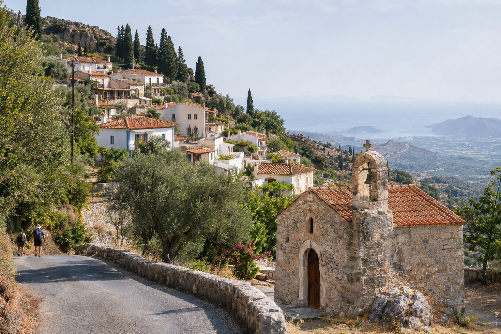
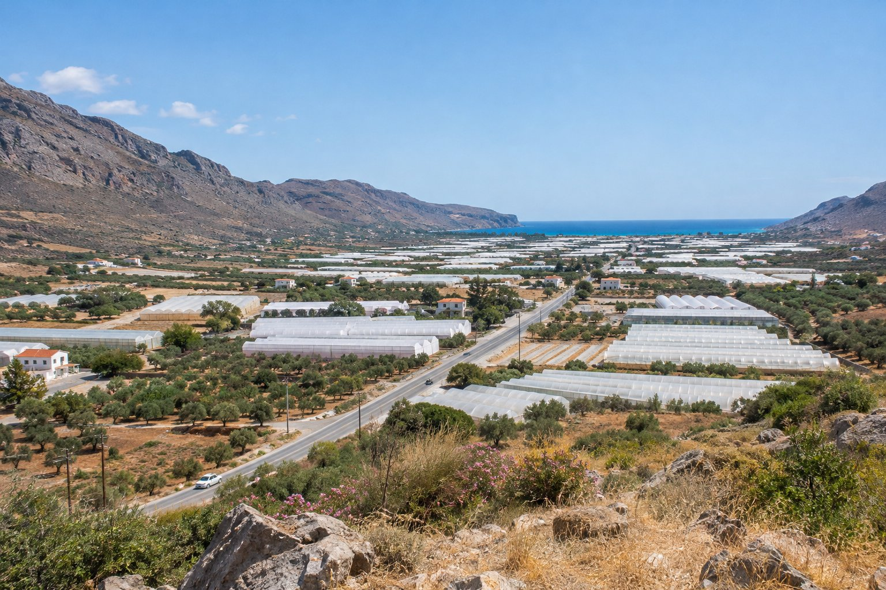

Einer der Vorteile, in Agios Nikolaos zu wohnen, ist, dass vieles in der Nähe liegt. Mit einem Mietwagen können Sie am Morgen losfahren, ein Dorf, eine Ausgrabungsstätte oder einen anderen Strand sehen und rechtzeitig zum Mittagessen zurück sein oder den Nachmittag am Strand von Kitroplatia verbringen, eine Gehminute von unserer Pension entfernt. Das sind vier Touren von zwei bis vier Stunden, die wir oft empfehlen.

## Vor der Abfahrt

- **Parken.** Am Hafen, 3 Gehminuten von der Pension entfernt (200 m), gibt es einen großen, kostenlosen öffentlichen Parkplatz, praktisch zum Abstellen des Autos bei der Rückkehr.
- **Treibstoff.** Tanken Sie in Agios Nikolaos oder an der Hauptstraße voll. In den Bergdörfern sind Tankstellen rar.
- **Straßen.** Die Hauptstraßen sind in gutem Zustand, aber die Nebenstraßen können schmal sein, mit engen Kurven, wenig seitlichem Schutz und manchmal Ziegen auf der Fahrbahn. Fahren Sie ohne Eile und meiden Sie Bergstraßen bei Nacht, wenn Sie sie nicht kennen.
- **Hitze.** Im Sommer genießt man die Ausgrabungsstätten unter freiem Himmel viel mehr früh am Morgen oder am späten Nachmittag. Die Öffnungszeiten ändern sich je nach Saison, prüfen Sie sie also vorher im Internet oder vor Ort.
- **Beschilderung.** Auf den Hauptstraßen sind die Schilder meist auf Griechisch und in lateinischer Schrift, aber laden Sie die Karte auf Ihr Handy herunter, falls der Empfang ausfällt.

## 1. Elounda und Plaka an der Küste (2-3 Stunden)

Es ist die einfachste und eine der schönsten Touren. Die Straße führt an der Küste entlang nach Norden, und beim Hinabfahren nach Elounda öffnet sich der Blick auf die Bucht. Elounda liegt etwa 23 Minuten mit dem Auto entfernt (15 km).

Es lohnt sich, bis zur Landenge zu fahren, die Elounda mit der Halbinsel Kolokitha verbindet. Dort sieht man die alten Salinen venezianischen Ursprungs, die bis in die Siebzigerjahre in Betrieb waren, einige alte Steinmühlen ohne Flügel und am Ufer Reste der antiken Stadt Olous, teilweise unter Wasser.

Etwa 5 km weiter nördlich liegt Plaka, ein Fischerdorf direkt gegenüber der Insel Spinalonga. Von Elounda und Plaka fahren Boote zur Insel, falls Sie den Ausflug verlängern möchten. Im Sommer kann es in Plaka etwas schwierig sein zu parken, deshalb ist es ratsam, früh zu fahren. Mehr Details finden Sie in unserem Artikel über [Elounda und Plaka](/de/blog/elounda-y-plaka/).

## 2. Kritsa und das antike Lato (2-3 Stunden)

Kritsa liegt etwa 10 km landeinwärts am Berghang, mit Blick auf die Mirabello-Bucht. Kurz vor dem Dorf, direkt an der Straße, liegt die Kirche der Panagia Kera mit byzantinischen Fresken aus dem 13. und 14. Jahrhundert, die zu den besterhaltenen Kretas gehören.

In Kritsa lässt man das Auto am besten am Ortseingang stehen und geht zu Fuß durch die steilen Gassen hinauf. Das Dorf ist für seine traditionellen Webarbeiten und Stickereien bekannt. Von dort führt eine ausgeschilderte Straße in etwa 3-4 km nach Lato, einer antiken Stadt aus nachminoischer Zeit, in Terrassen auf einem Hügel erbaut. Die Ausgrabungsstätte ist klein, hat wenig Schatten und bietet schöne Ausblicke auf die Landschaft, die bis zum Meer hinabfällt. Ausführlicher erzählen wir davon unter [Kritsa und Umgebung](/de/blog/kritsa-y-alrededores/).

## 3. Die Küste Richtung Istro und Gournia (2-4 Stunden)

Diese Tour folgt der Straße, die die Mirabello-Bucht nach Osten säumt. Hinter Kalo Chorio, etwa 12 km von Agios Nikolaos entfernt, erreichen Sie Istro mit mehreren Stränden; der bekannteste ist der von Voulisma mit Sand und sehr klarem Wasser. Weitere Ideen zum Baden finden Sie unter [den Stränden von Agios Nikolaos](/de/blog/playas-de-agios-nikolaos/).

Einige Kilometer weiter, etwa 19 km von Agios Nikolaos entfernt, liegt Gournia, die Überreste einer minoischen Stadt an einem Hang, mit gepflasterten Straßen, Häusern und einem kleinen Palast. Es ist eine der am besten erhaltenen minoischen Siedlungen Kretas und lässt sich gut in einer Stunde besichtigen. Nehmen Sie Wasser und eine Mütze mit: Es gibt keinen Schatten.

Eine gute Art, die Tour zu gestalten: Gournia früh ansehen und den Vormittag auf dem Rückweg mit einem Bad in Istro beschließen.

## 4. Ierapetra und die Südküste (3-4 Stunden)

Ierapetra liegt etwa 36 km entfernt, gut 40 Minuten mit dem Auto. Die Straße folgt der Küste nach Osten und biegt auf der Höhe von Pachia Ammos nach Süden ab, um die Landenge von Ierapetra zu queren, den schmalsten Teil der Insel: Auf gut einem Dutzend Kilometern geht es vom Kretischen Meer zum Libyschen Meer. In der Gegend sehen Sie viele Gewächshäuser, eine der wichtigsten Tätigkeiten der Region.

In Ierapetra können Sie an der Strandpromenade und durch die Altstadt mit ihren engen Gassen spazieren und zur Festung Kales venezianischen Ursprungs am alten Hafen gehen. Von hier fahren in der Saison die Boote zur Insel Chrissi, auch wenn das schon ein ganztägiger Ausflug ist; erkundigen Sie sich im Hafen oder im Internet nach den Abfahrten.

## So wählen Sie aus

- **Ein ruhiger Vormittag am Meer:** Elounda und Plaka.
- **Dorf, byzantinische Kirche und etwas Geschichte:** Kritsa und Lato.
- **Archäologie und Baden auf demselben Ausflug:** Istro und Gournia.
- **Das Meer wechseln und eine andere Stadt sehen:** Ierapetra.

Wenn Sie Lust auf einen längeren Ausflug durch das Landesinnere haben, nimmt die [Lassithi-Hochebene](/de/blog/meseta-de-lasithi/) einen ganzen Tag in Anspruch. Auf unserer [Entfernungskarte](/de/#location) sehen Sie, was von der Pension aus zu Fuß erreichbar ist und was sich besser mit dem Auto machen lässt.

Für jede dieser Touren funktioniert der folgende Plan am besten: früh losfahren, Wasser und bei Bergtouren etwas Warmes zum Anziehen mitnehmen und bei der Rückkehr das Auto auf dem Parkplatz am Hafen abstellen. So bleibt der Nachmittag frei für den Strand oder einen Spaziergang durch das Zentrum.
