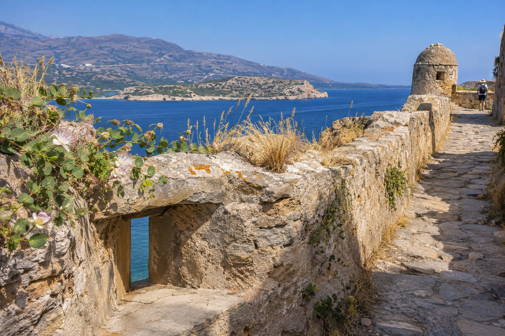
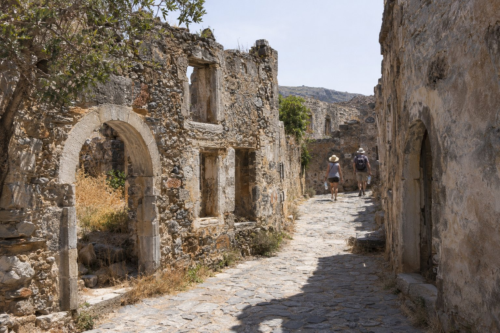

Η Σπιναλόγκα είναι μία από τις εκδρομές για τις οποίες μας ρωτούν περισσότερο, και είναι εύκολο να την οργανώσετε μόνοι σας. Το νησάκι βρίσκεται στην είσοδο του κόλπου της Ελούντας, βόρεια του Αγίου Νικολάου, και σε μία πρωινή βόλτα προλαβαίνετε να περάσετε απέναντι, να το γυρίσετε με την ησυχία σας και να επιστρέψετε για φαγητό. Εδώ θα βρείτε τους τρόπους για να φτάσετε, όσα θα συναντήσετε και όσα αξίζει να πάρετε μαζί σας.

## Ένα νησάκι με δύο ιστορίες

Η Σπιναλόγκα, γνωστή και ως Καλυδών, είναι μικρή: περίπου οκτώμισι εκτάρια. Δεν πρέπει να τη συγχέετε με τη χερσόνησο με το ίδιο όνομα που κλείνει τον κόλπο της Ελούντας. Το νησί είναι ο οχυρωμένος βράχος που φαίνεται απέναντι από το χωριό Πλάκα, σε απόσταση περίπου 750 μέτρων από την ακτή.

### Το ενετικό φρούριο

Οι Ενετοί έθεσαν τον θεμέλιο λίθο του φρουρίου το 1579, πάνω στα ερείπια μιας αρχαίας ακρόπολης, για να ελέγχουν την είσοδο του κόλπου. Ήταν τόσο γερό που παρέμεινε στα χέρια τους ακόμα και αφού το υπόλοιπο νησί της Κρήτης πέρασε στους Οθωμανούς το 1669, και δεν το παρέδωσαν παρά το 1715. Στη συνέχεια εγκαταστάθηκε εκεί ένας μουσουλμανικός πληθυσμός που τον 19ο αιώνα σχημάτισε ένα χωριό με αρκετές δεκάδες οικογένειες. Καθώς γυρίζετε το νησί, θα δείτε ίχνη τόσο της ενετικής όσο και της οθωμανικής περιόδου.

### Το λεπροκομείο (1903–1957)

Το 1903 αποφασίστηκε να μετατραπεί το νησί σε λεπροκομείο, και οι πρώτοι ασθενείς έφτασαν το 1904. Για πάνω από μισό αιώνα έζησαν εκεί απομονωμένοι, με τα σπίτια, τα μαγαζιά, την εκκλησία και το νοσοκομείο τους. Η αποικία έκλεισε το 1957, όταν πια υπήρχε αποτελεσματική θεραπεία, και οι τελευταίοι κάτοικοι μεταφέρθηκαν σε ένα κέντρο στην Αττική. Ήταν ένα από τα τελευταία ενεργά λεπροκομεία της Ευρώπης. Σύμφωνα με τις πηγές, ο τελευταίος κάτοικος, ένας ιερέας, έφυγε το 1962.

Πολλοί άνθρωποι φτάνουν εδώ έχοντας ήδη στο μυαλό τους αυτή την ιστορία, χάρη στο μυθιστόρημα *Το Νησί* (*The Island*) της Βικτόρια Χίσλοπ και στην ελληνική σειρά που βασίστηκε σε αυτό, *Το Νησί*.

## Πώς να φτάσετε στη Σπιναλόγκα

Υπάρχουν τρεις βασικές επιλογές. Και οι τρεις λειτουργούν καλά· η διαφορά είναι στον χρόνο που θέλετε να περάσετε στο πλοιάριο.

### Από την Πλάκα: η πιο σύντομη διαδρομή

Η Πλάκα είναι το χωριό που έχει τη Σπιναλόγκα ακριβώς απέναντι, και τα πλοιάρια περνούν σε περίπου δέκα λεπτά. Είναι η καλύτερη επιλογή αν πηγαίνετε με αυτοκίνητο και θέλετε να κινηθείτε με τους δικούς σας ρυθμούς: φτάνετε, περνάτε απέναντι, και στην επιστροφή μπορείτε να κολυμπήσετε ή να φάτε στο χωριό.

### Από την Ελούντα: περισσότερα δρομολόγια

Από το λιμάνι της Ελούντας αναχωρούν τακτικά πλοιάρια για το νησί, με αρκετή συχνότητα τη σεζόν. Η διαδρομή διαρκεί περίπου 15–20 λεπτά. Υπάρχει περισσότερη κίνηση και περισσότερες υπηρεσίες απ' ό,τι στην Πλάκα, και ορισμένα πλοιάρια προσθέτουν έναν γύρο του κόλπου.

Από την πανσιόν, η Ελούντα και η περιοχή της Σπιναλόγκα απέχουν περίπου 23 λεπτά με το αυτοκίνητο (περίπου 15 km). Υπάρχουν επίσης λεωφορεία γραμμής (ΚΤΕΛ) από τον σταθμό του Αγίου Νικολάου προς την Ελούντα και την Πλάκα. Τα δρομολόγιά τους αλλάζουν ανάλογα με την εποχή, γι' αυτό ελέγξτε τα στον ιστότοπο της εταιρείας ή στον ίδιο τον σταθμό. Αν δεν σκοπεύετε να νοικιάσετε αυτοκίνητο, στο [πώς να μετακινηθείτε χωρίς αυτοκίνητο](/el/blog/moverse-sin-coche/) θα βρείτε περισσότερες λεπτομέρειες.

### Από το λιμάνι του Αγίου Νικολάου: οργανωμένη εκδρομή

Από το λιμάνι του Αγίου Νικολάου, περίπου 3 λεπτά με τα πόδια από την πανσιόν, αναχωρούν εκδρομές με πλοιάριο προς τη Σπιναλόγκα. Η διαδρομή είναι μεγαλύτερη, περίπου 45–60 λεπτά ανά διαδρομή, αλλά γνωρίζετε τον κόλπο του Μιραμπέλλου από το νερό. Πολλές περιλαμβάνουν μια στάση για μπάνιο, συχνά στην περιοχή της Κολοκύθας, και μερικές γεύμα στο πλοίο.

Πριν διαλέξετε, δείτε καλά τι περιλαμβάνει η καθεμία: συνολική διάρκεια, στάσεις, αν υπάρχει ξεναγός και αν το εισιτήριο του αρχαιολογικού χώρου συμπεριλαμβάνεται. Οι τιμές και τα ωράρια αλλάζουν κάθε σεζόν· το πιο πρακτικό είναι να ρωτήσετε στα περίπτερα του λιμανιού ή να συγκρίνετε στο διαδίκτυο.

## Η είσοδος και ο χρόνος στο νησί

Αν πάτε με τα πλοιάρια γραμμής, το εισιτήριο για τον αρχαιολογικό χώρο πληρώνεται χωριστά, στο ταμείο του νησιού, και την υψηλή περίοδο μπορεί να υπάρχει ουρά. Κάποιες οργανωμένες εκδρομές το περιλαμβάνουν και άλλες όχι.

Υπολογίστε μιάμιση ή δύο ώρες για να το δείτε χωρίς βιασύνη. Η συνηθισμένη διαδρομή:

- Μπαίνετε από την **πύλη του Δάντη**, ένα πέρασμα περίπου 20 μέτρων από το οποίο έφταναν οι ασθενείς.
- Συνεχίζετε στον **κεντρικό δρόμο**, με τα σπίτια και τα μαγαζιά της εποχής του λεπροκομείου, αρκετά από τα οποία έχουν αποκατασταθεί.
- Ανεβαίνετε στους **ενετικούς προμαχώνες**, με θέα στον κόλπο της Ελούντας και την Πλάκα.
- Μπορείτε να ολοκληρώσετε το **μονοπάτι που περιβάλλει το νησί** δίπλα στα τείχη, μήκους περίπου 1,5 km.

Σας συνιστούμε να διαβάσετε λίγο πριν πάτε. Είναι ένας τόπος μνήμης, και η βόλτα γίνεται πολύ πιο κατανοητή όταν γνωρίζετε ποιος έζησε εκεί και σε ποιες συνθήκες.

## Πρακτικές συμβουλές

- **Εποχή.** Τα πλοιάρια λειτουργούν κυρίως από την άνοιξη έως το φθινόπωρο. Τον χειμώνα τα δρομολόγια μειώνονται πολύ και ο αρχαιολογικός χώρος μπορεί να έχει περιορισμένο ωράριο ή να κλείνει, γι' αυτό αν έρχεστε εκτός σεζόν επιβεβαιώστε το πριν. Στο [πότε να επισκεφθείτε τον Άγιο Νικόλαο](/el/blog/cuando-visitar-agios-nikolaos/) εξηγούμε πώς αλλάζει η περιοχή μέσα στον χρόνο.
- **Ζέστη και σκιά.** Στο νησί υπάρχει πολύ λίγη σκιά και το καλοκαίρι ο μεσημεριανός ήλιος είναι καυτός. Το καλύτερο είναι να πάτε πρωί πρωί ή αργά το απόγευμα.
- **Νερό και προστασία.** Πάρτε άφθονο νερό, καπέλο ή τζόκεϊ και αντηλιακό.
- **Υπόδηση.** Το έδαφος είναι από ανώμαλη πέτρα, με σκαλιά και χαλαρό χαλίκι. Καλύτερα άνετα αθλητικά παπούτσια παρά σαγιονάρες.
- **Μειωμένη κινητικότητα.** Το εξωτερικό μονοπάτι είναι πιο εύκολο· το εσωτερικό του οικισμού έχει ανηφόρες και σκαλοπάτια.
- **Μπάνιο.** Αν θέλετε να κολυμπήσετε μετά, πάρτε μαγιό και παπουτσάκια θαλάσσης: στην Πλάκα και στη χερσόνησο της Κολοκύθας υπάρχουν μέρη για να το κάνετε. Περισσότερες ιδέες στο [τι να πάρετε στην παραλία στην Κρήτη](/el/blog/que-llevar-a-la-playa-en-creta/).

## Πώς να τη συνδυάσετε μέσα στη μέρα

Η Σπιναλόγκα ταιριάζει πολύ καλά με την Ελούντα και την Πλάκα. Νωρίς το πρωί, το νησί. Μετά, η βόλτα στον ισθμό της Ελούντας, με τις αλυκές, τους ανεμόμυλους και τα βυθισμένα ερείπια της αρχαίας Ολούς. Και για φαγητό, οποιοδήποτε από τα δύο χωριά. Το εξηγούμε με περισσότερες λεπτομέρειες στο [Ελούντα και Πλάκα](/el/blog/elounda-y-plaka/).

Αν ξεκινήσετε νωρίς, θα είστε πίσω στον Άγιο Νικόλαο στα μέσα του απογεύματος, με χρόνο για ένα μπάνιο στην Κιτροπλατεία, ένα λεπτό από την πανσιόν. Πριν πάτε, επιβεβαιώστε τα ωράρια των πλοιαρίων και του αρχαιολογικού χώρου, γιατί αλλάζουν ανάλογα με την εποχή.
