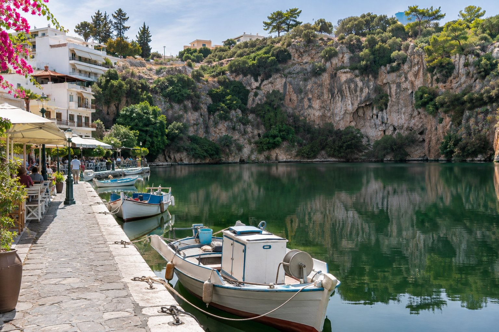
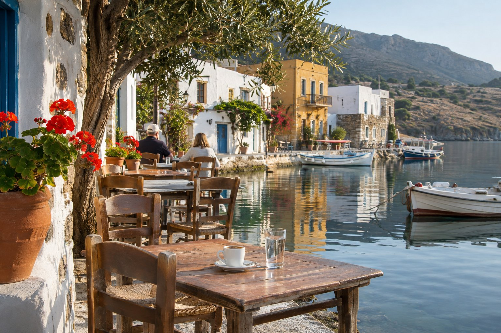
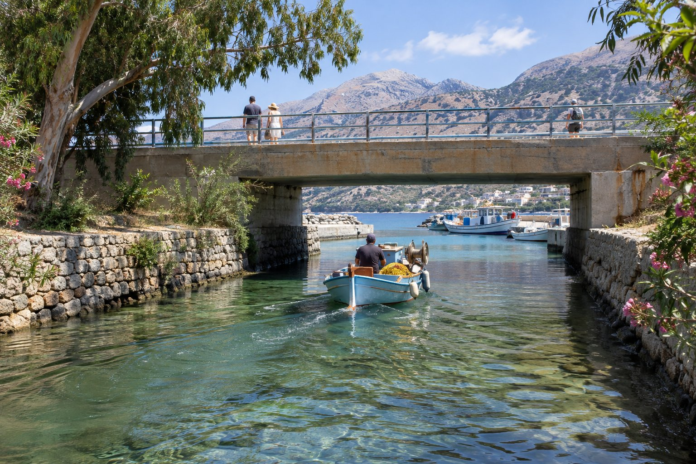

Βγαίνετε από την πανσιόν, περπατάτε περίπου έξι λεπτά (450 μέτρα) και φτάνετε στην καρδιά του Αγίου Νικολάου: τη λίμνη Βουλισμένη. Εδώ σχεδόν κανείς δεν τη λέει με το πλήρες όνομά της· για τους ανθρώπους της πόλης είναι απλώς «η Λίμνη». Κρύβει πίσω της περισσότερη ιστορία απ' όση φαίνεται.

## Μια λίμνη στη μέση της πόλης

Είναι σχεδόν κυκλική, με διάμετρο περίπου 137 μέτρα. Στη μία όχθη υπάρχουν σπίτια, τραπεζάκια και μια προβλήτα όπου δένουν τα αλιευτικά σκάφη· στην άλλη, ένας σχεδόν κάθετος βραχώδης τοίχος καλυμμένος με βλάστηση. Ένα στενό κανάλι τη συνδέει με το λιμάνι, και από εκεί μπαίνει και βγαίνει το νερό της θάλασσας.

Η προέλευσή της είναι γεωλογική, όχι ηφαιστειακή, αν και για πολύ καιρό πίστευαν το αντίθετο. Οι γεωλόγοι την εξηγούν ως δολίνη: πριν από εκατομμύρια χρόνια, ένα υπόγειο ρεύμα άνοιξε μια κοιλότητα στον ασβεστόλιθο, η οροφή κατέληξε να καταρρεύσει και το κενό γέμισε με το νερό μιας πηγής. Ο βραχώδης τοίχος που βλέπετε είναι, μάλιστα, το πρανές ενός ρήγματος.

## Πόσο βαθιά είναι;

Ο αριθμός που θα δείτε να επαναλαμβάνεται σχεδόν παντού είναι 64 μέτρα. Είναι αυτός που μέτρησε ο Βρετανός ναυτικός Thomas Spratt στα μέσα του 19ου αιώνα, όταν χαρτογραφούσε τις ακτές της Κρήτης. Το 2000, μια υποβρύχια μελέτη που ανατέθηκε από το Πανεπιστήμιο της Αθήνας, η πρώτη του είδους της, μέτρησε μέγιστο βάθος περίπου 49 μέτρων· η διαφορά αποδίδεται στο ότι αποκολλήθηκε μέρος του τοιχώματος της λίμνης.

Όποιος κι αν είναι ο αριθμός, είναι πολύ βάθος για μια τόσο μικρή λίμνη, και αυτό εξηγεί σε μεγάλο βαθμό τις ιστορίες που λέγονται γι' αυτήν.

## Από «βρωμερή λίμνη» σε καταφύγιο για βάρκες

Επί αιώνες η λίμνη τροφοδοτούνταν από μια πηγή και αποστραγγιζόταν στη θάλασσα μέσω ενός μικρού ρυακιού. Όταν η πηγή σταμάτησε να ρέει, το νερό λιμνάστηκε και άρχισε να βρωμάει, σε σημείο που την ονόμαζαν Βρωμολίμνη, «η βρωμερή λίμνη».

Η λύση ήρθε στα τέλη της δεκαετίας του 1860, όταν ο οθωμανός διοικητής της περιοχής διέταξε να ανοιχτεί ένα κανάλι προς τη θάλασσα για να ανανεώνεται το νερό. Το κανάλι αυτό εκβαθύνθηκε και διευρύνθηκε αρκετές φορές, και στις αρχές του 20ού αιώνα ο γαλλικός στρατός κατασκεύασε ένα πλατύτερο. Η τσιμεντένια γέφυρα που διασχίζετε σήμερα για να πάτε από τη λίμνη στο λιμάνι είναι του 1954.

Το σημερινό όνομα, Βουλισμένη, αποδίδεται συνήθως ως «βουλιαγμένη».

## Οι θρύλοι

Μια τόσο βαθιά λίμνη, με σχεδόν κάθετα τοιχώματα και στην καρδιά της πόλης, ήταν φυσικό να συσσωρεύσει ιστορίες. Αυτές είναι οι πιο διαδεδομένες, και πρέπει να τις παίρνετε γι' αυτό που είναι: θρύλοι.

- **Η λίμνη χωρίς πάτο.** Για πολύ καιρό πίστευαν ότι δεν είχε πάτο. Οι μετρήσεις του 19ου αιώνα και οι μεταγενέστερες μελέτες το διαψεύδουν, αλλά η φήμη έμεινε.
- **Το λουτρό των θεαινών.** Σύμφωνα με την παράδοση, η θεά Αθηνά λουζόταν στα νερά της· κάποιες εκδοχές προσθέτουν και την Άρτεμη.
- **Η σύνδεση με τη Σαντορίνη.** Έχει ειπωθεί ότι η λίμνη είναι ο κρατήρας ενός σβησμένου ηφαιστείου και ότι συνδέεται υπογείως με τη Σαντορίνη. Η ιδέα δυνάμωσε το 1956, όταν ένας ισχυρός σεισμός στο Αιγαίο, που πολλοί απέδωσαν τότε στο ηφαίστειο, συνέπεσε με διαταραχές στο νερό της λίμνης. Η γεωλογία δεν στηρίζει ούτε το ένα ούτε το άλλο.
- **Τι κρύβει ο πυθμένας.** Μια άλλη ιστορία λέει ότι, στο τέλος του Β' Παγκοσμίου Πολέμου, ο γερμανικός στρατός πέταξε στη λίμνη όπλα και οχήματα. Δεν έχουν βρεθεί ποτέ.
- **Ο Κουστώ.** Η πιο επαναλαμβανόμενη: ότι ούτε ο ωκεανογράφος Ζακ Κουστώ κατάφερε να βρει τον πάτο. Υπάρχουν εκδοχές για όλα τα γούστα (ότι έκανε κατάδυση, ότι την απέρριψε ως επικίνδυνη) και καμία δεν είναι καλά τεκμηριωμένη. Κι εμείς την αφηγούμαστε, αλλά γι' αυτό που είναι: μια ωραία ιστορία για τα μετά το φαγητό.

## Γωνιές για να την απολαύσετε

### Τα τραπεζάκια στην όχθη

Γύρω από τη λίμνη υπάρχουν καφέ και εστιατόρια με τραπέζια σχεδόν στο ύψος του νερού. Το πρωί είναι ωραίο μέρος για έναν ήσυχο καφέ· το απόγευμα και το βράδυ, η ατμόσφαιρα αλλάζει εντελώς. Αν διστάζετε πού να καθίσετε, μπορεί να σας φανούν χρήσιμες [οι συμβουλές μας για την επιλογή ταβέρνας](/el/blog/como-elegir-una-taberna/).

### Το πάρκο από πάνω

Στη νότια πλευρά, πάνω από τον βραχώδη τοίχο, υπάρχει ένα μικρό πάρκο από το οποίο φαίνονται η λίμνη, η πόλη και ο κόλπος. Είναι η κλασική φωτογραφία του Αγίου Νικολάου, και το απαλό φως της πρώτης πρωινής ώρας ή του τέλους του απογεύματος της ταιριάζει ιδιαίτερα.

### Το κανάλι και η γέφυρα

Αξίζει να σταθείτε λίγο στη γέφυρα για να δείτε τις βάρκες να περνούν ανάμεσα στη λίμνη και το λιμάνι. Ακριβώς δίπλα βρίσκεται το μικρό Μουσείο Λαϊκής Τέχνης, με παραδοσιακά υφαντά και κεντήματα· λειτουργεί εποχιακά, γι' αυτό ελέγξτε πρώτα το ωράριο. Από τη λίμνη είναι περίπου τρία λεπτά με τα πόδια μέχρι το λιμάνι και το άγαλμα της αρπαγής της Ευρώπης.

### Τη νύχτα

Με τα φώτα των τραπεζιών να καθρεφτίζονται στο νερό και τις βάρκες ακίνητες δίπλα στην προβλήτα, η λίμνη γίνεται ένα άλλο μέρος. Σας εξηγούμε πώς να αξιοποιήσετε αυτή τη στιγμή στο [Άγιος Νικόλαος τη νύχτα](/el/blog/agios-nikolaos-de-noche/).

### Η νύχτα του Πάσχα

Αν βρεθείτε στην Κρήτη το Ορθόδοξο Πάσχα, εδώ θα δείτε ένα πολύ βαθιά ριζωμένο έθιμο: τα μεσάνυχτα του Μεγάλου Σαββάτου, μετά την αναγγελία της Ανάστασης, καίγεται ένα ομοίωμα του Ιούδα πάνω σε μια πλατφόρμα στη μέση της λίμνης, ανάμεσα σε πυροτεχνήματα και βαρελότα. Ένα μεγάλο μέρος της πόλης μαζεύεται γύρω από το νερό, οπότε καλό είναι να φτάσετε νωρίς για να βρείτε θέση. Η ημερομηνία αλλάζει κάθε χρόνο και δεν συμπίπτει πάντα με το Πάσχα των Καθολικών.

## Πρακτικές συμβουλές

- **Για να τη δείτε ήσυχα**, πηγαίνετε νωρίς: τότε υπάρχει λίγος κόσμος και το φως είναι πολύ καλό για φωτογραφίες.
- **Για μπάνιο**, η παραλία της Κιτροπλατείας είναι λίγα λεπτά με τα πόδια, πολύ κοντά στην πανσιόν.
- **Για να τη συνδυάσετε**, η λίμνη ταιριάζει σε κάθε βόλτα: βρίσκεται ανάμεσα στο λιμάνι και το κέντρο, και είναι εύκολο να τη συνδέσετε με όσα σας προτείνουμε στο [τι να δείτε στον Άγιο Νικόλαο](/el/blog/que-ver-en-agios-nikolaos/).
- **Προσοχή στα παπούτσια** αν ανεβείτε στο πάρκο: βρίσκεται αρκετά πιο ψηλά από την όχθη.

Το πιο πρακτικό είναι να μην της κρατήσετε μια συγκεκριμένη στιγμή, αλλά να περάσετε από εκεί αρκετές φορές κατά τη διαμονή σας: έναν καφέ το πρωί, τη θέα από ψηλά κάποιο απόγευμα και ένα δείπνο δίπλα στο νερό. Είναι τόσο κοντά στην πανσιόν που καταλήγει να είναι μέρος της διαδρομής προς σχεδόν οπουδήποτε.
