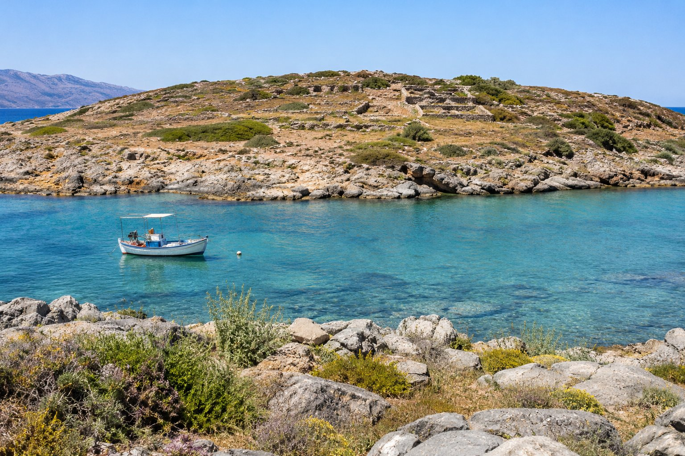
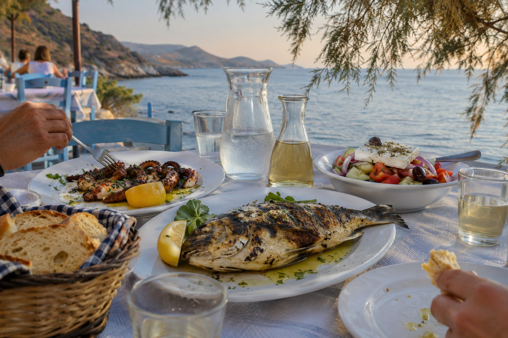

Ο Μόχλος είναι ένα μικρό ψαροχώρι στην ανατολική όχθη του κόλπου του Μιραμπέλλου, στην απέναντι πλευρά του κόλπου που φαίνεται από τον Άγιο Νικόλαο. Έχει ένα μικρό λιμάνι, λίγους δρόμους, ταβέρνες με θέα στη θάλασσα και, περίπου 150 μέτρα από την ακτή, μια νησίδα με μινωικά ερείπια.

Δεν είναι μέρος για να κάνετε χίλια πράγματα. Έρχεται κανείς για να περπατήσει, να κολυμπήσει ανάμεσα στα βράχια και να φάει ή να δειπνήσει δίπλα στο νερό. Γι' αυτό είναι μία από τις αποδράσεις που μας αρέσει να προτείνουμε περισσότερο.

## Πώς να πάτε από τον Άγιο Νικόλαο

Ο Μόχλος απέχει περίπου 36-38 km οδικώς, δηλαδή περίπου 45 λεπτά με το αυτοκίνητο. Ακολουθείτε τον εθνικό δρόμο προς τη Σητεία, περνώντας από την Παχιά Άμμο και το Καβούσι, και κοντά στο χωριό Σφάκα υπάρχει η διακλάδωση προς την ακτή. Από εκεί είναι περίπου 6 km ασφαλτοστρωμένου δρόμου, στενού και με στροφές, που κατεβαίνει στο χωριό με θέα στον κόλπο.

- Τα μέσα μαζικής μεταφοράς μέχρι το χωριό είναι πολύ περιορισμένα, οπότε το πρακτικό είναι να πάτε με αυτοκίνητο.
- Το χωριό είναι μικρό και οι δρόμοι δίπλα στο νερό στενοί. Το πιο βολικό είναι να παρκάρετε μόλις βρείτε χώρο και να συνεχίσετε με τα πόδια.
- Αν μείνετε για δείπνο, η επιστροφή θα γίνει νύχτα από τον ίδιο δρόμο με τις στροφές: λάβετέ το υπόψη όταν αποφασίζετε ποιος θα οδηγήσει.

## Η νησίδα και η μινωική της ιστορία

Η νησίδα που φαίνεται απέναντι από το χωριό λέγεται επίσης Μόχλος. Σήμερα είναι ακατοίκητη, αλλά στη μινωική εποχή πιθανότατα ήταν ενωμένη με την ξηρά και λειτουργούσε ως λιμάνι, σύμφωνα με τους αρχαιολόγους που τη μελετούν.

Οι πρώτες ανασκαφές, το 1908, έφεραν στο φως μια μινωική νεκρόπολη της Εποχής του Χαλκού στο δυτικό τμήμα της νησίδας. Τα χρυσά κοσμήματα που βρέθηκαν στους τάφους της εκτίθενται σήμερα στο Αρχαιολογικό Μουσείο Ηρακλείου. Από το 1989, ένα ελληνοαμερικανικό πρόγραμμα συνεχίζει τις ανασκαφές και έχει καταγράψει μια μινωική πόλη, λείψανα της ελληνιστικής εποχής και, στην ξηρά, πίσω από το σημερινό χωριό, εργαστήρια μινωικών τεχνιτών.

### Επίσκεψη στη νησίδα

- Τα ερείπια βρίσκονται σε ανοιχτό χώρο και δεν υπάρχουν παροχές ούτε σχεδόν καθόλου σκιά. Πάρτε νερό, καπέλο και υποδήματα που κρατούν καλά το πόδι, γιατί το έδαφος είναι ανώμαλο.
- Οι τοίχοι είναι αρχαίοι και ορισμένοι είναι ασταθείς: μην ανεβαίνετε πάνω τους.
- Όποιος κολυμπά με άνεση μπορεί να περάσει κολυμπώντας τις μέρες με ήρεμη θάλασσα. Προσέξτε τις βάρκες που περνούν από το κανάλι.
- Την τουριστική περίοδο, μερικές φορές μπορεί να περάσει κανείς με μια μικρή βάρκα από το χωριό· ρωτήστε στο λιμάνι.

## Κολύμπι στον Μόχλο

Στο ίδιο το χωριό υπάρχει μια μικρή παραλία με άμμο και βότσαλα, χωρίς ξαπλώστρες και ναυαγοσώστη. Πολλοί προτιμούν να κολυμπούν από τα βράχια, όπου το νερό βαθαίνει αμέσως και είναι πεντακάθαρο. Με μάσκα και αναπνευστήρα βλέπει κανείς ψάρια και βραχώδη βυθό.

- Στα βράχια υπάρχουν αχινοί: τα παπούτσια θαλάσσης είναι πολύ χρήσιμα. Περισσότερες ιδέες θα βρείτε στο [τι να πάρετε στην παραλία στην Κρήτη](/el/blog/que-llevar-a-la-playa-en-creta/).
- Η ακτή βλέπει προς τον βορρά και, με τον βοριά, που είναι συχνός το καλοκαίρι, η θάλασσα έχει κύμα. Οι μέρες με ηρεμία είναι οι καλύτερες για κολύμπι και για να περάσετε στη νησίδα.
- Στα γύρω μέρη υπάρχουν μικροί κολπίσκοι με βράχια και βότσαλα, όπως αυτοί στις Λούτρες, ιδανικοί για snorkeling.

## Φαγητό δίπλα στη θάλασσα

Ο λόγος για τον οποίο πολλοί επιστρέφουν στον Μόχλο είναι οι ταβέρνες της παραλιακής, με τα τραπέζια σχεδόν μέσα στο νερό και τη νησίδα απέναντι. Η κουζίνα είναι αυτή της κρητικής ακτής: ψάρι της ημέρας, χταπόδι, σαλάτες, εποχιακά λαχανικά και πιάτα για να μοιραστείτε.

Μερικές απλές συμβουλές:

- **Ρωτήστε ποιο ψάρι έφτασε σήμερα.** Στην Ελλάδα το φρέσκο ψάρι συνήθως χρεώνεται με το βάρος, οπότε αξίζει να δείτε το ψάρι και να μάθετε πόσο ζυγίζει πριν παραγγείλετε.
- **Μοιραστείτε αρκετά μικρά πιάτα.** Είναι ο συνήθης τρόπος να τρώει κανείς σε μια ταβέρνα και επιτρέπει να δοκιμάσετε περισσότερα πράγματα.
- **Διαλέξτε την ώρα.** Ένα αργό μεσημεριανό, μετά το κολύμπι, ή ένα νωρίς δείπνο με το τελευταίο φως πάνω στη νησίδα είναι καλές στιγμές.
- **Εκτός περιόδου**, το χωριό είναι πολύ ήσυχο και δεν ανοίγουν όλα τα μαγαζιά. Αν πάτε τον χειμώνα, επιβεβαιώστε το εκ των προτέρων.

Δεν προτείνουμε συγκεκριμένα μέρη, γιατί αλλάζουν από χρονιά σε χρονιά. Αυτό που μπορούμε να σας δώσουμε είναι ενδείξεις για να διαλέξετε σωστά στον οδηγό μας για το [πώς να διαλέξετε ταβέρνα](/el/blog/como-elegir-una-taberna/).

## Πώς να οργανώσετε την απόδραση

Ο Μόχλος ταιριάζει σε μια μεγάλη μισή μέρα ή σε μια μέρα χωρίς βιασύνη. Δύο τρόποι να το σχεδιάσετε:

1. **Απόγευμα και δείπνο.** Ήρεμο πρωί στον Άγιο Νικόλαο, αναχώρηση μετά το μεσημέρι, κολύμπι στα βράχια, βόλτα στο χωριό και δείπνο δίπλα στο νερό.
2. **Ολόκληρη μέρα.** Αναχώρηση το πρωί, επίσκεψη στη νησίδα πριν δυναμώσει η ζέστη, μεσημεριανό στο λιμάνι και απογευματινό κολύμπι σε κάποιον κοντινό κολπίσκο.

Αν θέλετε να συνεχίσετε προς τα ανατολικά, η Σητεία απέχει περίπου 35 km ακόμη. Μπορείτε να συνδυάσετε τα δύο ή, αν η μέρα θα είναι μεγάλη, να αφήσετε τη Σητεία για άλλη μέρα με τη διαδρομή [Σητεία και φοινικόδασος του Βάι](/el/blog/sitia-y-palmeral-de-vai/).

## Πριν πάτε

Πάρτε μαγιό, παπούτσια θαλάσσης, νερό και κάποια υποδήματα για τη νησίδα. Δείτε τον άνεμο της ημέρας: αν φυσά δυνατά ο βοριάς, ίσως είναι καλύτερο να αφήσετε το κολύμπι στον Μόχλο για άλλη στιγμή και να μείνετε στη βόλτα και στο φαγητό. Και αν πάτε εκτός περιόδου, βεβαιωθείτε ότι υπάρχει κάπου ανοιχτό για φαγητό πριν κάνετε τα 45 λεπτά του δρόμου.
