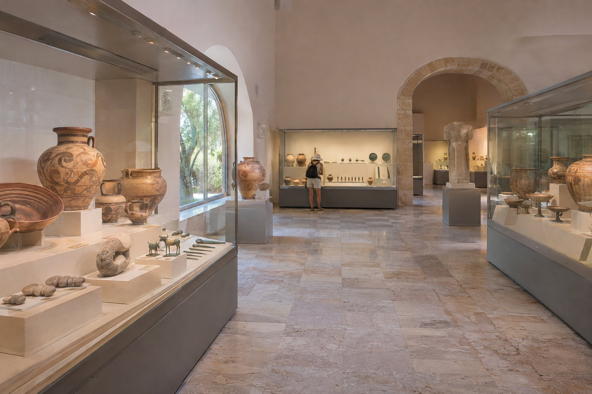
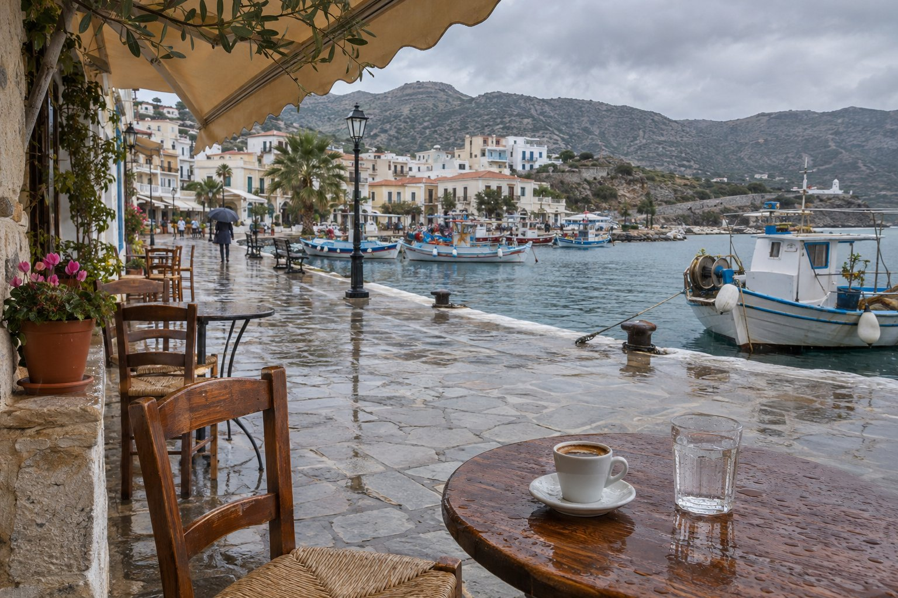
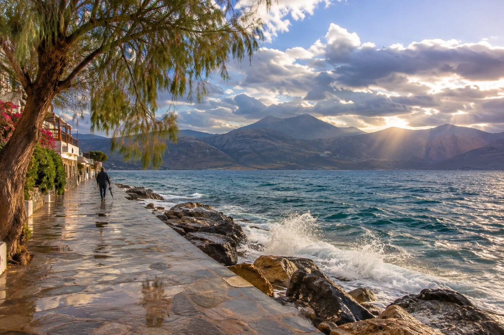

Στον Άγιο Νικόλαο βρέχει λίγο, και σχεδόν ποτέ το καλοκαίρι: από τον Ιούνιο ως τον Αύγουστο οι βροχερές μέρες μετριούνται στα δάχτυλα του ενός χεριού. Το μεγαλύτερο μέρος της βροχής πέφτει περίπου από τον Νοέμβριο ως τον Μάρτιο, με κάποια μπόρα τον Οκτώβριο και τον Απρίλιο. Παρ' όλα αυτά, ακόμη και στους πιο υγρούς μήνες οι περισσότερες μέρες είναι στεγνές, και ανάμεσα σε μια βροχερή μέρα και την επόμενη συνήθως παρεμβάλλονται μέρες με ήλιο.

Αν σας τύχει μια γκρίζα μέρα, δεν χρειάζεται να τη θεωρήσετε χαμένη. Αυτές είναι οι ιδέες που συνήθως δίνουμε σε όσους μας ρωτούν τι να κάνουν όταν ο καιρός δεν συνεργάζεται.

## Πρώτα, κοιτάξτε τη θάλασσα από το παράθυρο

Μπορεί να φαίνεται λίγο, αλλά το να βλέπετε μια θαλασσοταραχή πάνω από τον κόλπο του Μιραμπέλλου είναι από μόνο του ένα θέαμα. Από τα δωμάτια με πανοραμική θέα φαίνεται πώς αλλάζουν το χρώμα του νερού και το φως πάνω στα βουνά καθώς περνούν τα σύννεφα. Ένας καφές χωρίς βιασύνη, ένα βιβλίο και το παράθυρο ανοιχτό μόλις σταματήσει η βροχή είναι μια καλή αρχή για κάθε μέρα.

## Το Αρχαιολογικό Μουσείο του Αγίου Νικολάου

Είναι η πιο προφανής επιλογή σε εσωτερικό χώρο μέσα στην πόλη. Το μουσείο άνοιξε ξανά έπειτα από μια μακρά ανακαίνιση και σήμερα εκθέτει τη συλλογή του με πολύ περισσότερο χώρο από πριν. Συγκεντρώνει ευρήματα της ανατολικής Κρήτης που εκτείνονται από τη Νεολιθική εποχή ως τη ρωμαϊκή περίοδο.

Μερικά εκθέματα που αξίζει να αναζητήσετε:

- **Η λεγόμενη Θεά του Μύρτου**, ένα πολύ παλιό μινωικό αγγείο σε σχήμα γυναίκας που κρατά μια στάμνα, το οποίο βρέθηκε κοντά στον Μύρτο, στη νότια ακτή.
- **Τα κτερίσματα της νεκρόπολης της Αγίας Φωτιάς**, κοντά στη Σητεία, με αγγεία και εκατοντάδες χάλκινα αντικείμενα.
- **Ένα κρανίο ρωμαϊκής εποχής με το νόμισμα για τον Χάροντα**, τον βαρκάρη που, σύμφωνα με την ελληνική μυθολογία, μετέφερε τις ψυχές στην άλλη όχθη.

Τα ωράρια αλλάζουν ανάμεσα στη θερινή και στη χειμερινή περίοδο και υπάρχουν ημέρες κλειστού, γι' αυτό καλό είναι να τα ελέγξετε στον ιστότοπο του ελληνικού Υπουργείου Πολιτισμού πριν πάτε.

## Ένα μικρό μουσείο λαϊκής τέχνης δίπλα στη λίμνη

Δίπλα στη [λίμνη Βουλισμένη](/el/blog/lago-voulismeni/), στο παλιό κτίριο του λιμεναρχείου, υπάρχει ένα μουσείο λαϊκής τέχνης με παραδοσιακά υφαντά και κεντήματα (ορισμένα από την Κριτσά), αντικείμενα ενός παλιού κρητικού σπιτιού, αγροτικά εργαλεία και εικόνες. Είναι μικρό και το βλέπετε σε λίγο χρόνο. Τα ωράριά του έχουν αλλάξει πολύ με τα χρόνια, γι' αυτό ρωτήστε στο γραφείο τουρισμού ή τηλεφωνήστε πριν πάτε.

## Ένας μακρύς καφές ή ένα γεύμα χωρίς βιασύνη

Η βροχή είναι η τέλεια δικαιολογία για να κάνετε αυτό που στην Κρήτη γίνεται πολύ καλά: να καθίσετε. Γύρω από τη λίμνη και το λιμάνι υπάρχουν καφέ όπου μπορείτε να περάσετε το απόγευμα κοιτάζοντας το νερό, και οι ταβέρνες της πόλης είναι ένα καλό καταφύγιο την ώρα του φαγητού.

Τους δροσερούς μήνες έχουν περισσότερο νόημα τα φαγητά του κουταλιού και τα μαγειρευτά: όσπρια, γιαχνιστά, χόρτα του κάμπου με ελαιόλαδο. Αν διστάζετε στην επιλογή μέρους, σας αφήνουμε μερικές ιδέες στο άρθρο [πώς να διαλέξετε ταβέρνα](/el/blog/como-elegir-una-taberna/). Και μην εκπλαγείτε αν στο τέλος του γεύματος εμφανιστεί λίγο ρακί.

## Η Κριτσά και η εκκλησία της Παναγίας Κεράς

Αν έχετε αυτοκίνητο, η ανάβαση στην Κριτσά είναι μια καλή επιλογή για μια ασταθή μέρα. Το χωριό βρίσκεται περίπου δέκα με έντεκα χιλιόμετρα μακριά, στις πρώτες πλαγιές προς την ενδοχώρα, και πριν φτάσετε, σε περίπου ένα χιλιόμετρο, βρίσκεται η **Παναγία Κερά**, μια μικρή βυζαντινή εκκλησία με το εσωτερικό της καλυμμένο με τοιχογραφίες, σε μεγάλο μέρος του 13ου και του 14ου αιώνα. Είναι ένα μέρος για να το επισκεφθείτε αργά και με το βλέμμα προς τα πάνω, και η βροχή απ' έξω δεν ενοχλεί.

Η Κριτσά, με τα στενά δρομάκια και τα μαγαζιά με υφαντά και κεντήματα, γυρίζεται καλά ανάμεσα σε δύο μπόρες. Αυτό που δεν συνιστούμε με βροχή είναι ο αρχαιολογικός χώρος του Λατώ, που βρίσκεται σε ύπαιθρο και σε υψόμετρο: κρατήστε τον για μια στεγνή μέρα. Θα βρείτε περισσότερες λεπτομέρειες στο άρθρο μας για την [Κριτσά και τα περίχωρα](/el/blog/kritsa-y-alrededores/).

## Ηράκλειο: μια μέρα στα μουσεία

Αν η κακοκαιρία κρατήσει, το Ηράκλειο απέχει περίπου μία ώρα με αυτοκίνητο και συγκεντρώνει αρκετά από τα καλύτερα μουσεία του νησιού.

### Αρχαιολογικό Μουσείο Ηρακλείου

Είναι το παγκόσμιο σημείο αναφοράς για να γνωρίσετε τον μινωικό πολιτισμό. Εδώ βρίσκονται οι πρωτότυπες τοιχογραφίες της Κνωσού, ο δίσκος της Φαιστού και μια τεράστια συλλογή κεραμικής, σφραγίδων και κοσμημάτων. Χρειάζονται τουλάχιστον δυο ώρες.

### Ιστορικό Μουσείο Κρήτης

Διατρέχει την ιστορία του νησιού από τη βυζαντινή εποχή ως τον 20ό αιώνα. Μεταξύ άλλων, φιλοξενεί τα δύο μοναδικά έργα του Ελ Γκρέκο που υπάρχουν στην Κρήτη και μια αίθουσα αφιερωμένη στον συγγραφέα Νίκο Καζαντζάκη, με το γραφείο και τη βιβλιοθήκη του σπιτιού του στη Γαλλία.

Αν η βροχή κάνει ένα διάλειμμα, μπορείτε να συνδυάσετε την επίσκεψη με το [ανάκτορο της Κνωσού](/el/blog/palacio-de-knossos/), στα περίχωρα της πόλης, αν και να έχετε υπόψη ότι εκεί όλα βρίσκονται σε ύπαιθρο.

## Όταν καθαρίζει ο καιρός

Μετά τη βροχή, ο αέρας συνήθως μένει καθαρός και η θέα προς τον κόλπο ανοίγει ως τα βουνά της απέναντι πλευράς. Είναι μια καλή στιγμή για να βγείτε για περίπατο: από την πανσιόν, η παραλία της Κιτροπλατείας απέχει ένα λεπτό, το λιμάνι τρία και η λίμνη περίπου έξι λεπτά με τα πόδια. Οι δρόμοι είναι ήσυχοι και η θάλασσα, αν έχει φυσήξει, παραμένει για λίγο ταραγμένη πάνω στα βράχια.

## Πρακτικές συμβουλές για τις βροχερές μέρες

- **Δείτε την πρόγνωση** την προηγούμενη μέρα. Συχνά μια βροχερή μέρα έχει στεγνά διαστήματα, και καλό είναι να ξέρετε πότε.
- **Ελέγξτε τα ωράρια πριν βγείτε.** Τα μουσεία και τα μνημεία έχουν χειμερινό ωράριο, πιο σύντομο, και συνήθως κλείνουν μία μέρα την εβδομάδα.
- **Οδηγήστε με ηρεμία.** Με βροχή οι ορεινοί δρόμοι γλιστρούν και μπορεί να υπάρχουν πέτρες ή λάσπη στο οδόστρωμα.
- **Κλειστά παπούτσια και κάτι αδιάβροχο** αν έρθετε ανάμεσα στον Νοέμβριο και τον Μάρτιο. Οι ανηφορικοί δρόμοι και τα σκαλιά γλιστρούν όταν είναι βρεγμένα.
- **Λάβετε υπόψη την εποχή.** Τον χειμώνα πολλές τουριστικές επιχειρήσεις κλείνουν, αν και στην πόλη υπάρχουν πάντα ανοιχτά καφέ και ταβέρνες.

Μια βροχερή μέρα στον Άγιο Νικόλαο σπάνια διαρκεί πολύ, και συνήθως αφήνει τον κόλπο με το καλύτερο φως του ταξιδιού. Αν διστάζετε για το τι να κάνετε ή τι θα είναι ανοιχτό εκείνη τη μέρα, ρωτήστε μας: θα σας πούμε ό,τι ξέρουμε και, αν δεν το ξέρουμε, πού να το ελέγξετε.
