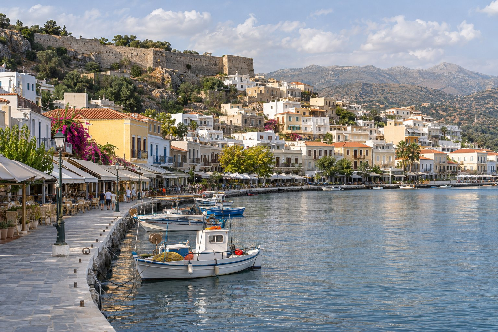
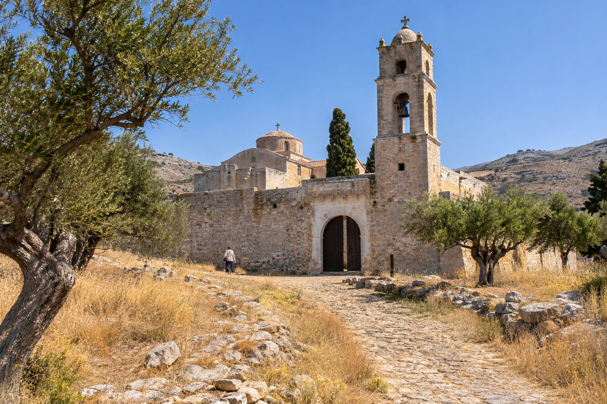

Η ανατολική άκρη της Κρήτης είναι πιο ήσυχη και λιγότερο επισκέψιμη από την υπόλοιπη βόρεια ακτή. Σε μία μέρα μπορείτε να δείτε τη Σητεία, μια πόλη-λιμάνι με χαλαρούς ρυθμούς· την οχυρωμένη Μονή Τοπλού· και το Βάι, μια αμμώδη παραλία με ένα από τα λίγα φυσικά φοινικόδασα της Ευρώπης. Από τον Άγιο Νικόλαο είναι εκδρομή ολόκληρης ημέρας και αξίζει να τη σχεδιάσετε έτσι.

## Πώς να σχεδιάσετε τη μέρα

### Αποστάσεις και χρόνοι

- **Άγιος Νικόλαος – Σητεία:** περίπου 65-70 km, λίγο περισσότερο από μία ώρα με το αυτοκίνητο (υπολογίστε περίπου 1 ώρα και 15 λεπτά).
- **Σητεία – Τοπλού:** περίπου 15 km, γύρω στα 20 λεπτά.
- **Τοπλού – Βάι:** περίπου 8 km ακόμη.
- **Σύνολο μέχρι το Βάι:** περίπου 90 km, από 1 ώρα και 45 λεπτά έως 2 ώρες χωρίς στάσεις.

Ο εθνικός δρόμος διατρέχει τον κόλπο του Μιραμπέλλου και, από το Καβούσι και μετά, μπαίνει στους λόφους με αρκετές στροφές. Δεν είναι δύσκολος, αλλά προχωράτε πιο αργά απ' ό,τι φαίνεται στον χάρτη. Ξεκινήστε νωρίς.

### Αυτοκίνητο ή λεωφορείο

Υπάρχουν λεωφορεία από τον Άγιο Νικόλαο προς τη Σητεία και, την τουριστική περίοδο, συνήθως υπάρχει κάποια σύνδεση από τη Σητεία προς το Βάι, αλλά με λίγα δρομολόγια. Για να δείτε και τις τρεις στάσεις σε μία μέρα, το πρακτικό είναι το αυτοκίνητο.

### Με ποια σειρά

- **Το καλοκαίρι**, πηγαίνετε κατευθείαν στο Βάι πρωί-πρωί, πριν γεμίσει η παραλία, και σταματήστε στην Τοπλού και στη Σητεία στην επιστροφή.
- **Εκτός περιόδου**, όταν η παραλία μετράει λιγότερο, ξεκινήστε από τη Σητεία και τελειώστε στο Βάι.
- Για να μη διανύσετε την ίδια διαδρομή δύο φορές, μπορείτε να πάτε μέσω Τοπλού και να επιστρέψετε μέσω Παλαίκαστρου, που βρίσκεται λίγα χιλιόμετρα από το Βάι.

Σε κάθε περίπτωση, ελέγξτε εκ των προτέρων τα ωράρια του μουσείου, του φρουρίου και της μονής, γιατί αλλάζουν ανάλογα με την εποχή.

## Σητεία: λιμάνι, μουσείο και φρούριο

Η Σητεία απλώνεται σε μια πλαγιά πάνω από τον κόλπο της, με μακρύ παραλιακό δρόμο, καφέ μπροστά στο νερό και ψαρόβαρκες στο λιμάνι. Έχει πιο χαλαρό ρυθμό από τον Άγιο Νικόλαο και είναι καλό μέρος για καφέ ή για φαγητό.

### Το Αρχαιολογικό Μουσείο

Βρίσκεται στην είσοδο της πόλης, στον δρόμο που έρχεται από την Ιεράπετρα, και συγκεντρώνει ευρήματα από θέσεις της ανατολικής Κρήτης. Το πιο γνωστό του έκθεμα είναι ο κούρος του Παλαικάστρου, ένα μινωικό αγαλματίδιο ύψους περίπου μισού μέτρου από ελεφαντόδοντο με χρυσές λεπτομέρειες, που έχει ανασυντεθεί από πολλά θραύσματα.

### Το φρούριο της Καζάρμα

Πάνω από την πόλη σώζονται τα τείχη της Καζάρμα, ενός ενετικού οχυρού, το όνομα του οποίου προέρχεται από το ιταλικό *casa di arma*. Έχει ανοικοδομηθεί αρκετές φορές και σήμερα σώζονται κυρίως τα τείχη. Αξίζει να ανεβείτε για τη θέα πάνω από τις στέγες και τον κόλπο. Το καλοκαίρι φιλοξενεί πολιτιστικές εκδηλώσεις στο ύπαιθρο. Έχει λίγη σκιά, οπότε καλύτερα να αποφύγετε τις μεσημεριανές ώρες.

Η περιοχή της Σητείας έχει επίσης τη δική της Προστατευόμενη Ονομασία Προέλευσης (ΠΟΠ) για το ελαιόλαδο. Αν σας ενδιαφέρει το θέμα, το εξηγούμε στο άρθρο μας για [το ελαιόλαδο της Κρήτης](/el/blog/aceite-de-oliva-de-creta/).

## Η Μονή Τοπλού

Ανάμεσα στη Σητεία και το Βάι, σε ένα ξερό και ανοιχτό τοπίο, εμφανίζεται η Τοπλού, μια μονή με όψη μικρού φρουρίου, περιτριγυρισμένη από ψηλά τείχη και με ένα καμπαναριό που φαίνεται από μακριά. Η πιο διαδεδομένη εξήγηση για το όνομά της είναι ότι προέρχεται από την τουρκική λέξη *top*, κανόνι, εξαιτίας ενός κανονιού που ήταν τοποθετημένο πάνω από την είσοδο.

Η ίδρυσή της τοποθετείται γύρω στον 14ο αιώνα. Λεηλατήθηκε από πειρατές, καταστράφηκε από σεισμό το 1612 και ξαναχτίστηκε, και έπαιξε ρόλο στις κρητικές εξεγέρσεις και στην αντίσταση κατά τον Β΄ Παγκόσμιο Πόλεμο.

- **Η εικόνα «Μέγας εἶ, Κύριε».** Ζωγραφισμένη από τον Ιωάννη Κορνάρο το 1770, συγκεντρώνει δεκάδες μικρές σκηνές σε έναν μόνο πίνακα.
- **Το μουσείο.** Εκθέτει εικόνες, χαρακτικά και έγγραφα.
- **Κρασί και λάδι.** Η μονή καλλιεργεί τη γη της και παράγει κρασί, ρακί και ελαιόλαδο με δική της μάρκα. Για τα κρασιά του νησιού μιλάμε στο [κρασιά και ρακί της Κρήτης](/el/blog/vinos-y-raki-de-creta/).

Είναι ενεργή μονή: φροντίστε να έχετε καλυμμένους τους ώμους και τα γόνατα. Δεν επιτρέπεται η φωτογράφιση μέσα στην εκκλησία ούτε στο μουσείο.

## Βάι: το φοινικόδασος και η παραλία

### Οι φοίνικες

Οι φοίνικες του Βάι είναι *Phoenix theophrasti*, ο κρητικός φοίνικας ή φοίνικας του Θεοφράστου. Είναι αυτόχθονο είδος λίγων σημείων της ανατολικής Μεσογείου (Κρήτη, μερικά άλλα ελληνικά νησιά και η νοτιοδυτική Τουρκία), και για πολύ καιρό θεωρούνταν απλές αγριεμένες χουρμαδιές. Δεν περιγράφηκε ως ξεχωριστό είδος παρά μόλις το 1967.

Για την καταγωγή τους κυκλοφορούν διάφοροι θρύλοι: άλλοι λένε ότι οι φοίνικες φύτρωσαν από κουκούτσια χουρμάδων που άφησαν Άραβες πειρατές, άλλοι μιλούν για Φοίνικες ναυτικούς. Είναι απλώς θρύλοι. Για τους βοτανολόγους πρόκειται για ένα είδος που φυτρώνει στο νησί από την αρχαιότητα.

Το φοινικόδασος καταλαμβάνει περίπου 20 εκτάρια, με αρκετές χιλιάδες δέντρα. Πριν προστατευθεί, η περιοχή χρησιμοποιούνταν για ελεύθερο κάμπινγκ και υπέφερε αρκετά. Από τη δεκαετία του 1980 είναι προστατευόμενη και περιφραγμένη, και δεν επιτρέπεται η διανυκτέρευση ούτε το κάμπινγκ. Η περιήγηση γίνεται από τα σηματοδοτημένα μονοπάτια, χωρίς να μπαίνετε ανάμεσα στους φοίνικες.

### Η παραλία

Μπροστά από το φοινικόδασος υπάρχει μια αμμώδης παραλία με καθαρά νερά και, την τουριστική περίοδο, ξαπλώστρες και ομπρέλες. Τον Ιούλιο και τον Αύγουστο γεμίζει το μεσημέρι. Το καλύτερο είναι να φτάσετε νωρίς ή αργά το απόγευμα. Ο χώρος στάθμευσης δίπλα στην παραλία είναι επί πληρωμή.

- **Το σημείο θέας.** Ένα σύντομο μονοπάτι ανεβαίνει από την παραλία σε ένα σημείο θέας με την κλασική εικόνα του φοινικόδασους. Είναι απότομο και χωρίς κιγκλιδώματα: πηγαίνετε με κατάλληλα υποδήματα.
- **Λίγη περισσότερη ηρεμία.** Από τα μονοπάτια τριγύρω φτάνετε σε έναν μικρότερο και λιγότερο πολυσύχναστο κολπίσκο.
- **Ίτανος.** Λίγα χιλιόμετρα βόρεια βρίσκονται τα ερείπια της αρχαίας πόλης Ίτανος, μαζί με άλλες μικρές παραλίες.

## Πρακτικές συμβουλές

- Πάρτε νερό, καπέλο και αντηλιακό: στην Καζάρμα, στην Τοπλού και στο σημείο θέας του Βάι υπάρχει λίγη σκιά.
- Εκτός περιόδου είναι πιθανό οι υπηρεσίες της παραλίας να μη λειτουργούν, αλλά το φοινικόδασος αξίζει την επίσκεψη και τότε.
- Αν θέλετε να σπάσετε το ταξίδι, είτε πηγαίνοντας είτε επιστρέφοντας μπορείτε να σταματήσετε στον [Μόχλο](/el/blog/mochlos/), περίπου 6 km από τον κεντρικό δρόμο.
- Αν θα περάσετε μια εβδομάδα στην περιοχή, η διαδρομή αυτή ταιριάζει καλά στο [πρόγραμμά μας των επτά ημερών στην ανατολική Κρήτη](/el/blog/una-semana-en-el-este-de-creta/).

Υπολογίστε περίπου τέσσερις ώρες οδήγησης για πήγαινε-έλα, γι' αυτό ξεκινήστε νωρίς και μην προσπαθήσετε να χωρέσετε τίποτε άλλο εκείνη τη μέρα. Και πάρτε μαγιό, ακόμη κι αν δεν σκοπεύετε να κολυμπήσετε.
