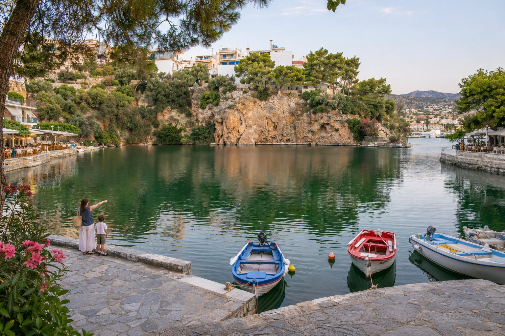
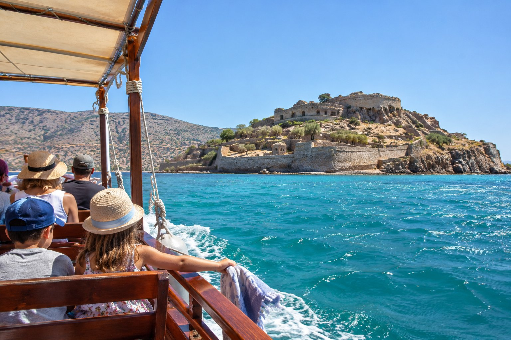

Agios Nikolaos is a small town with the sea always close by and almost everything within walking distance. For a family that means less time in the car and more time for swimming, strolling and eating without rushing. Here is what we usually recommend to families staying near Mylos.

## Calm beaches a few minutes away

The town's coastline has several small beaches where the water is usually calm, which is a blessing with little ones. These are the closest, with walking times from the pension:

- **Kitroplatia (1 minute, 100 m).** A small town beach of sand and fine pebbles, with trees that give a bit of shade and cafés and tavernas all around. Perfect for a quick dip first thing in the morning or at the end of the afternoon. In summer it tends to be busy.
- **Ámmos (10 minutes, 650 m).** Small, with sand and some pebbles in places and shallow water, which makes it one of the easiest beaches for the youngest ones. It sits next to the marina and has facilities nearby.
- **Almiros (26 minutes, 2.1 km).** Golden sand and shallow water, at the mouth of a small river. Next to the beach there is a protected wetland with reeds, eucalyptus trees and birds, which children often enjoy discovering. Watch out: near where the river flows in, the water can be quite cold. With small children you may prefer to go by car or taxi rather than on foot.

Ammoudi (18 minutes, 1.2 km) is another option, a wider sandy beach. At all of them it is worth checking whether there is a lifeguard that day and keeping an eye on the children in the water, however calm it looks. You will find more detail on each one in our guide to the [beaches of Agios Nikolaos](/blog/playas-de-agios-nikolaos/).

A simple tip: on pebbly beaches, a pair of water shoes makes getting into the sea much more pleasant for little feet. The full list is in [what to bring to the beach in Crete](/blog/que-llevar-a-la-playa-en-creta/).

## Short walks around town

### Lake Voulismeni

Six minutes on foot (450 m) away is Lake Voulismeni, connected to the harbour by a narrow channel. Watching the boats come and go and peering into the water from the edge is an easy outing that works for almost any age. If you climb up to the higher part that surrounds the lake, you get a good view of the town and the harbour.

Tell them the local legend that the lake has no bottom (it is only that, a legend) and you will have their attention for a good while. There are more stories in the article on [Lake Voulismeni](/blog/lago-voulismeni/).

### The harbour and the seafront walk

The harbour is three minutes away (200 m). That is where you will find the statue of the abduction of Europa, a good meeting point and an excuse to tell one of the best-known myths of Crete: according to the legend, Zeus, turned into a bull, carried Princess Europa to the island. From the harbour to the lake and to Kitroplatia, everything is a short trip, easy to do in stages with stops for an ice cream or a juice.

## Boat trips

Boats leave the harbour for the island of Spinalonga and other spots around Mirabello Bay, and some include a stop for a swim. For children, the boat ride itself is already part of the adventure. Before booking, bear in mind:

- **The duration.** From Agios Nikolaos the trip takes half a day or more. If you are looking for something shorter, you can drive to Elounda (about 23 minutes, 15 km) or to Plaka, a little further on: from Plaka the crossing to the island takes only a few minutes.
- **The heat.** Spinalonga has very little shade and is explored on foot along uneven stone paths, not well suited to strollers. In summer it is better to choose an early departure and bring a hat, sunscreen and plenty of water.
- **The age.** Spinalonga was a Venetian fortress and, in the first half of the 20th century, a leper colony. Older children often find the history interesting; with the little ones, it is sometimes better to stick to the boat ride and the swim.

We tell the story in more detail in the [trip to Spinalonga](/blog/excursion-a-spinalonga/).

## Planning the day around the heat

In high summer, the middle hours of the day in Crete can be very hot. A simple way to organise things:

- **Early in the morning:** beach or excursion, while the sun is still gentle.
- **At midday:** a relaxed lunch in the shade and a rest.
- **Late in the afternoon:** a second swim, a walk around the lake and the harbour, and dinner.

In Greece it is normal to have dinner late and to see families with children on the terraces until well into the night, so you will not feel out of place. Tavernas tend to be informal, and many Cretan dishes (salads, vegetables, grilled meats, cheeses) are easy to share at the table.

## Practical tips

- **Sun and water.** High-factor sunscreen, a hat and a bottle of water for each person, even on short walks. The Cretan sun is noticeable even in spring and autumn.
- **Strollers.** The centre has slopes and some steps, especially around the lake. A lightweight stroller or a baby carrier may be more practical than a large pram.
- **Timetables and prices.** Timetables for boats, museums and buses change with the season. It is best to check them at the time, at the harbour itself or online.
- **Days without the beach.** If the wind picks up one day or you fancy something different, the village of Kritsa, on the mountainside, or the town's Archaeological Museum are good alternatives.

## Staying as a family

At the pension we have double rooms with two beds and triple rooms, with panoramic sea views; a triple can suit a small family well. With the beach a minute away, going back to the room for a nap is easy. If you are unsure which room suits you best, you can write to us at info@pensionmylos.com or call us on +30 2841 14 15 17.

With children, the most useful thing is not to overfill the schedule: one plan in the morning, another as evening approaches, and the rest of the day for the sea. Save the longer excursions for the early hours, always carry water, and check the boat timetables the day before.
