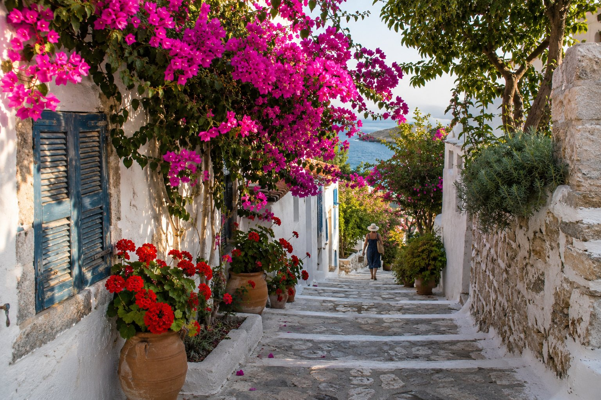
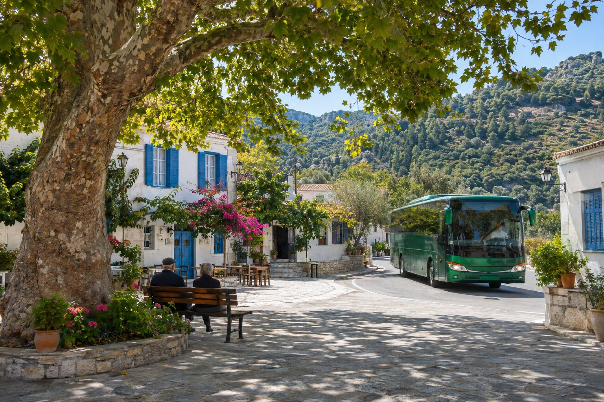
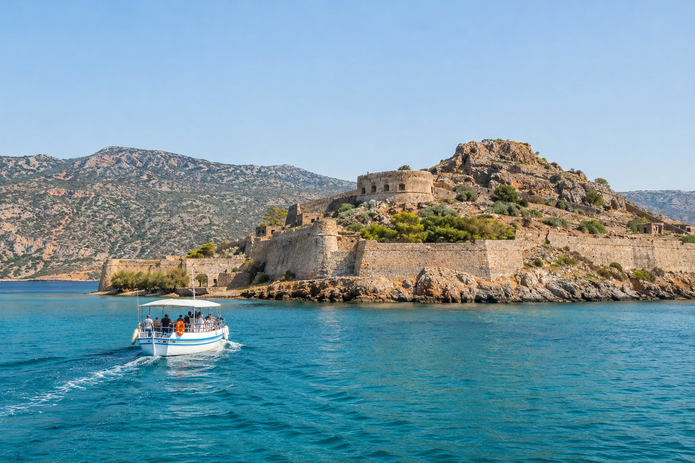

Agios Nikolaos is a small, compact town, and for much of a stay you do not need a car. The centre can be explored on foot, the town beaches are a short stroll away and there are buses to the most visited towns and cities of eastern Crete. This is what we usually tell people who ask us whether it is worth renting a car.

## The town, on foot

From the pension, in the Mylos area, the essentials are less than ten minutes' walk away:

- **Kitroplatia beach:** 1 minute (100 m).
- **The harbour**, with the statue of the abduction of Europa: 3 minutes (200 m).
- **Lake Voulismeni:** 6 minutes (450 m).
- **Centre:** 9 minutes (600 m).
- **Ámmos beach:** 10 minutes (650 m).

If you would like to get your bearings before you arrive, our [map with distances](/#location) shows the exact location.

Two things to bear in mind. The first is that Agios Nikolaos is not flat: the seafront promenade and the area around the lake are easy going, but as soon as you move away from the water you come across sloping streets and some steps. The second is the heat. In high summer, walking at midday is a lot more tiring than it looks on the map, so it is best to do longer walks first thing in the morning or as evening falls, with water and something to cover your head.

## Walks along the coast

### To the north: Ammoudi

Going round the harbour and following the avenue that runs beside the sea to the north, you reach Ammoudi beach, about 18 minutes (1.2 km) from the pension.

### To the south: Ámmos and Almirós

In the opposite direction, the coast leads to the marina, next to which is Ámmos beach. If you keep going south you reach Almirós, about 26 minutes (2.1 km) away, the beach where the river of the same name flows into the sea. It is the longest walk; in summer, do it early or consider coming back by taxi. You will find more details on each one in our guide to the [beaches of Agios Nikolaos](/blog/playas-de-agios-nikolaos/).

## KTEL buses: the towns and cities of the area

Crete's intercity buses are run by the KTEL cooperatives; in this part of the island, KTEL Heraklion-Lasithi. From the Agios Nikolaos bus station there are routes to:

- **Elounda and Plaka**, to the north, on the coast facing Spinalonga.
- **Kritsa**, the mountain village a few kilometres away, inland.
- **Istro and Kalo Chorio**, on the coast to the southeast.
- **Ierapetra**, on the island's south coast.
- **Sitia**, at the eastern tip.
- **Heraklion**, with stops on the north coast, such as Malia or Hersonissos, and on some services also at the airport.

To get to Knossos, the usual way is to take the bus to Heraklion and, from there, a city bus to the site. If you arrive by plane and want to come by public transport, we explain it step by step in [how to get here from Heraklion airport](/blog/como-llegar-desde-el-aeropuerto-de-heraclion/).

Some practical tips:

- **Check timetables and prices before each excursion.** They change with the season and in winter there are usually fewer departures. Up-to-date information is on the official KTEL Heraklion-Lasithi website (ktelherlas.gr) and at the station itself.
- **Look at the time of the last bus back.** On the less frequent routes it is what shapes the day most.
- **Allow time to get to the station.** Check where it is and how long it takes from your accommodation, especially if you have suitcases.

## By boat: Spinalonga and Chrissi

### Spinalonga

The old fortress island can only be reached by boat, and there are three usual ways to do it:

- **From the port of Agios Nikolaos**, on organised excursions. The journey is longer and many include a stop for a swim.
- **From Elounda**, with frequent boats in season.
- **From Plaka**, with the shortest crossing, about ten minutes.

Since Elounda and Plaka have a bus from Agios Nikolaos, you can combine bus and boat without any problem. The site usually opens from April to October and closes in winter, so if you are travelling out of season, check beforehand. We tell the story in more detail in the [trip to Spinalonga](/blog/excursion-a-spinalonga/).

### Chrissi

Boats to Chrissi Island leave from Ierapetra, on the south coast, roughly from May to October. You can reach Ierapetra by bus, but it makes for a long day: before booking the boat, check that its return time leaves you enough margin to catch the last bus to Agios Nikolaos.

## Taxis

Taxis fill the gaps left by the bus and your legs:

- The trip back from Almirós or another beach on a very hot day.
- Getting to the bus station or the airport with luggage.
- Places or times when there is no bus.

For longer journeys, ask for the approximate price before setting off. In high season, if you need a taxi at a specific time (for a flight, for example), book it in advance.

## Bicycle and motorbike rental

In town there are places that rent bicycles and motorbikes. A bicycle is comfortable along the seafront, but the surrounding area has hills and in summer the heat weighs on you; if you plan to leave town, an electric bike is a more realistic option.

If you rent a motorbike or scooter, a helmet is compulsory in Greece. Also check that your driving licence entitles you to ride that type of vehicle, and what the insurance covers, before you sign.

## When a car is worth it

You can see a lot without a car, but some places get complicated. The Lasithi Plateau is not simple by public transport, the Cave of Zeus is almost an hour away by car (45 km), and small villages inland or secluded coves tend to lie off the bus routes.

A middle way is to rent a car for just one or two days and devote them to those trips. Next to the harbour, 3 minutes' walk from the pension, there is a large free public car park. If you are interested, in [half-day driving routes](/blog/rutas-en-coche-de-medio-dia/) we suggest some short drives from Agios Nikolaos.

## In short

For the town and its beaches, on foot. For Elounda, Kritsa, Ierapetra, Sitia or Heraklion, the bus. For Spinalonga, the boat. And a taxi for the gaps. Before each outing, check the day's timetables and the time of the last return; if you are unsure how to combine them, ask us.
