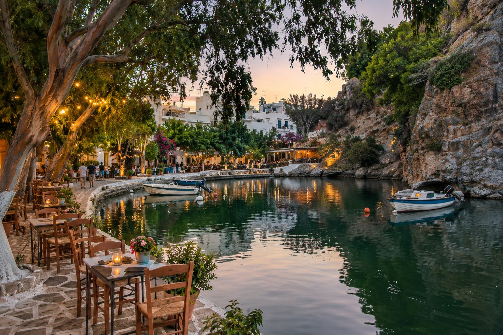
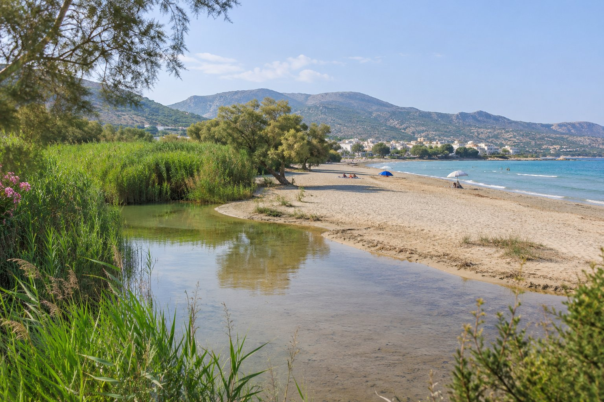

Agios Nikolaos es lo bastante pequeña como para que ninguna zona quede realmente lejos de otra, pero cada una tiene su ritmo. No es lo mismo dormir junto a los bares del lago que en una calle tranquila sobre el mar, ni alojarse a dos pasos del puerto que en un hotel de Elounda. Aquí repasamos las zonas principales con sus ventajas y sus inconvenientes. Nosotros vivimos en una de ellas, así que lo decimos desde el principio y procuramos ser justos con las demás.

## Antes de elegir: tres preguntas

- **¿Vas a tener coche?** Si no, te interesa estar cerca del centro, del puerto y de la estación de autobuses. Con coche, las afueras y Elounda se vuelven mucho más cómodas.
- **¿Quieres salir de noche o dormir sin ruido?** La vida nocturna se concentra en unas pocas calles; a unos minutos de ellas, el ambiente cambia mucho.
- **¿Qué pesa más: la playa, las vistas o tenerlo todo a mano?** Las playas de arena más amplias están en los extremos del pueblo; el centro tiene más servicios, pero menos playa.

## El centro: el lago Voulismeni y el puerto

Es el corazón del pueblo. Alrededor del [lago Voulismeni](/es/blog/lago-voulismeni/) y en las calles que suben desde el puerto se reúnen cafeterías, restaurantes, tiendas y bares, y del puerto salen las excursiones en barco por la bahía y a Spinalonga.

**A favor:** todo está a un paseo, no necesitas coche y tienes ambiente a cualquier hora.

**En contra:** es la zona más concurrida y, en verano, la más ruidosa por la noche, sobre todo en las calles con bares. Si tienes el sueño ligero, pregunta hacia dónde da la habitación. Lo que ofrece la noche en esta zona lo contamos en [Agios Nikolaos de noche](/es/blog/agios-nikolaos-de-noche/).

## Kitroplatia

Una pequeña bahía con playa, muy cerca del centro, rodeada de cafeterías y tabernas tradicionales. Es de esas zonas en las que te bañas por la mañana, comes junto al agua y vuelves andando al lago en pocos minutos.

**A favor:** playa y centro sin necesidad de transporte.

**En contra:** la playa es pequeña y en temporada alta suele llenarse; a la hora de comer y de cenar, el paseo tiene bastante movimiento.

## Mylos, junto al mar

Es nuestra zona, así que la conocemos bien. La pensión está en la calle Sarolidi, en la zona de Mylos, junto al mar y con vistas abiertas a la bahía de Mirabello. Desde aquí, la playa de Kitroplatia queda a 1 minuto (100 m), el puerto a 3 minutos (200 m), el lago Voulismeni a 6 minutos (450 m) y el centro a 9 minutos (600 m).

**A favor:** estás muy cerca de la playa, de los restaurantes y de las cafeterías, pero sin tenerlos debajo de la ventana. Desde los balcones que miran a la bahía se ve amanecer sobre el mar.

**En contra:** si lo que buscas es una playa larga de arena a la puerta, Ammoudi y Almirós quedan más lejos (18 y 26 minutos a pie). Y si te apetece salir hasta tarde, tendrás un pequeño paseo de vuelta desde las zonas de bares.

## Hacia el norte: la costa de Ammoudi

Desde el puerto, la avenida que bordea el mar hacia el norte lleva a Ammoudi, una playa en una bahía resguardada a alrededor de un kilómetro del centro. En esta costa, camino de Elounda, hay hoteles y apartamentos frente al mar.

**A favor:** más tranquilidad que en el centro, mar al lado y un paseo agradable para ir al pueblo.

**En contra:** el centro ya no queda a la vuelta de la esquina; para ir y volver varias veces al día, o de noche, puede que acabes tirando de taxi.

## Hacia el sur: Ámmos, la marina y Almirós

Al sur de Kitroplatia, junto al puerto deportivo, está la playa de Ámmos, con hamacas y locales alrededor. Más allá, ya en las afueras, Almirós es una de las playas de arena más amplias de los alrededores, con un humedal donde el río se encuentra con el mar.

**A favor:** si lo tuyo son los días de playa, alojarte cerca de Almirós te deja la arena a mano y un ambiente más relajado.

**En contra:** el pueblo queda a una caminata larga, sobre todo con calor. Con coche no es un problema; sin él, cuenta con algún taxi.

## Elounda

No es un barrio de Agios Nikolaos, sino un pueblo costero al norte, a algo más de 20 minutos en coche. Muchos de los grandes hoteles de lujo del este de Creta están en su costa, y desde su puerto salen barcos frecuentes a Spinalonga en temporada.

**A favor:** tranquilidad, mar y Spinalonga muy cerca. Es una buena opción si prefieres un hotel tipo resort y pasar buena parte del tiempo en él.

**En contra:** para ir a Agios Nikolaos, a Kritsa o a cualquier excursión dependes del autobús, del taxi o del coche. Tienes más sobre la zona en [Elounda y Plaka](/es/blog/elounda-y-plaka/).

## Resumen rápido

- **Para salir de noche y tenerlo todo a mano:** el centro.
- **Para ir a todo andando y dormir más tranquilo:** Kitroplatia o Mylos.
- **Para una playa de arena amplia:** la zona de Almirós.
- **Para un hotel tipo resort:** Elounda o la costa hacia el norte.
- **Si no vas a tener coche:** el centro, Kitroplatia o Mylos. Lo explicamos en [cómo moverse sin coche](/es/blog/moverse-sin-coche/).

## Antes de reservar

Sea cual sea la zona, mira el alojamiento en un mapa y calcula a cuántos minutos a pie te quedan la playa, el centro y la parada de autobús o el aparcamiento. Pregunta también si la habitación da a la calle o al mar y cuántas escaleras hay que subir. Si quieres comparar, en nuestro [mapa con distancias](/es/#location) tienes las de la pensión a los principales puntos del pueblo.
