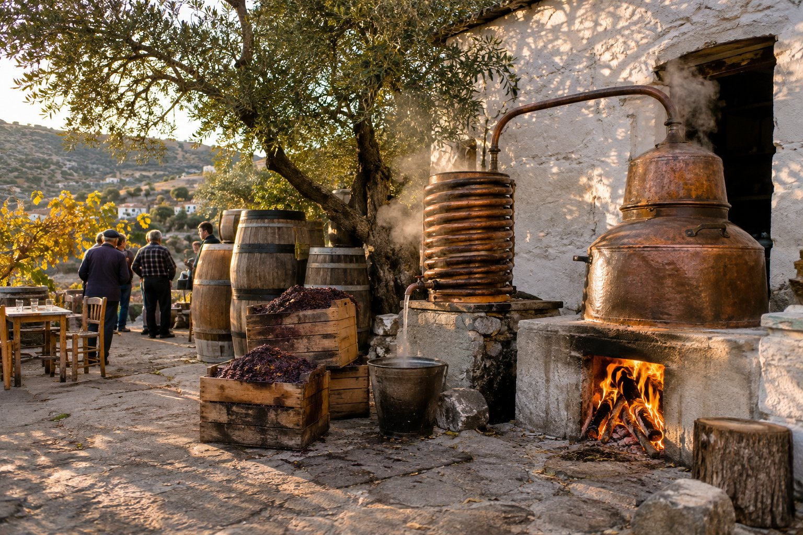
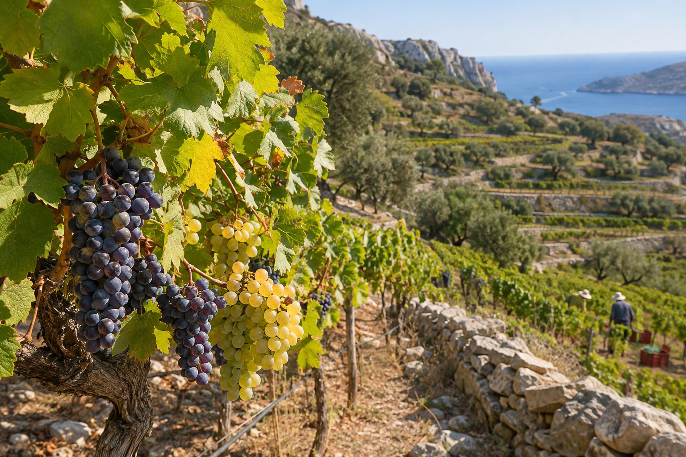

En Creta casi cualquier comida acaba con un vasito de raki, y casi cualquier taberna tiene su vino de la casa. Detrás de los dos hay una tradición larga y bastante desconocida fuera de la isla. Esta es una introducción sencilla para que sepas qué estás bebiendo y cómo disfrutarlo con cabeza.

## El raki: qué es exactamente

El raki cretense, que en buena parte de la isla también se llama *tsikoudia*, es un aguardiente de orujo de uva. Se elabora con lo que queda tras prensar la uva para hacer vino, sobre todo hollejos y pepitas. Esa masa se deja fermentar unas semanas en barriles cerrados y después se destila una sola vez en un alambique de cobre.

Para un español, lo más parecido es el orujo. No lleva anís, así que no tiene nada que ver con el ouzo griego ni con el rakı turco, aunque comparta nombre con este último. En el este de Creta, donde estamos, lo normal es llamarlo raki.

Es una bebida de alta graduación. El embotellado suele moverse en torno a los 37–40 grados, y el casero puede ser bastante más fuerte, porque cada productor lo hace a su manera.

## Un gesto de hospitalidad

En Creta el raki es, sobre todo, una forma de recibir. Es habitual que, al final de la comida, la casa invite a una jarrita de raki bien frío, a menudo acompañada de fruta o de algún dulce. También se ofrece en los cafés de pueblo (*kafenía*) y en las casas cuando llega una visita.

Se toma en vasitos pequeños, a sorbos y brindando: *¡yamas!*, que viene a ser «a nuestra salud». En invierno es fácil encontrar también *rakómelo*, raki templado con miel y, a veces, especias.

Aceptar es un gesto de cortesía, pero nadie se ofende si solo lo pruebas o si prefieres no beber.

## Kazanémata: la temporada del alambique

Tras la vendimia llega la época de destilar. Entre finales de octubre y noviembre, y en algunos sitios hasta diciembre, se ponen en marcha los alambiques (*kazania*) de los pueblos. Hoy la destilación solo puede hacerse en alambiques con licencia, y cada pueblo suele tener uno o dos.

Estas jornadas se conocen como *kazanémata* o *rakokázana*, y son mucho más que trabajo: amigos y vecinos se reúnen alrededor del alambique, se prueba el raki recién salido, se come y a veces hay música. Si viajas en otoño, pregunta en los pueblos o consulta la agenda local, porque algunas localidades organizan encuentros abiertos a los visitantes.

## Un vino con mucha historia

En Creta se hace vino desde época minoica, y durante el periodo veneciano sus vinos dulces, conocidos como malvasía, se exportaban por el Mediterráneo. En las últimas décadas, las bodegas de la isla han apostado por recuperar sus variedades autóctonas, algunas de las cuales estuvieron a punto de desaparecer. El resultado son vinos con personalidad propia, que tiene sentido probar aquí, junto a la comida local.

## Las uvas que conviene conocer

### Blancas

- **Vilana**: una de las blancas más extendidas de la isla. Da vinos frescos y es la base de los blancos de la DOP Peza.
- **Vidiano**: estuvo a punto de perderse y se recuperó a partir de los años ochenta. Hoy es una de las más valoradas, con vinos de más cuerpo y aromas de melocotón, albaricoque y hierbas.
- **Thrapsathiri**: se suele mezclar con la vilana; juntas forman los blancos de la DOP Sitia.

### Tintas

- **Kotsifali**: aromática y de color no muy intenso. Suele mezclarse con mandilari, que le aporta color y estructura.
- **Mandilari** (o mandilaria): muy oscura y tánica, la compañera habitual de la kotsifali.
- **Liatiko**: una variedad antigua que da tintos de color claro y también vinos dulces. Es la protagonista en Dafnes y en Sitia.

## Las denominaciones de origen

La mayoría de las DOP de vino de Creta están en la provincia de Heraclión:

- **Peza**: blancos de vilana y tintos de kotsifali y mandilari.
- **Archanes**: tintos de esas mismas dos uvas.
- **Dafnes**: liatiko, en seco y en dulce.

Archanes está a pocos kilómetros de Knossos, así que se puede combinar una visita a una bodega con la del [palacio de Knossos](/es/blog/palacio-de-knossos/).

En Lasithi, nuestra provincia, está la **DOP Sitia**, con tintos de liatiko y mandilari, blancos de vilana y thrapsathiri y dulces de liatiko, y la **DOP Malvasia Sitia**, reservada a vinos dulces con crianza en barrica. Es una buena excusa para añadir una bodega a la excursión a [Sitia y el palmeral de Vai](/es/blog/sitia-y-palmeral-de-vai/).

Muchos buenos vinos cretenses se venden fuera de las DOP, con la indicación geográfica de Creta o como vino de mesa, así que no te guíes solo por el sello.

## Dónde probarlos

- **En la taberna.** El vino de la casa suele servirse a granel en jarras, y en Grecia es habitual pedirlo por medidas: medio kilo, un kilo. Muchas tabernas tienen además una carta de vinos cretenses embotellados. Si dudas sobre dónde comer, te dejamos nuestra guía para [elegir una taberna](/es/blog/como-elegir-una-taberna/).
- **En las bodegas.** Muchas bodegas, sobre todo en la provincia de Heraclión, ofrecen visitas y catas, normalmente con reserva. Consulta las condiciones en internet antes de ir, porque cambian según la temporada.
- **En tiendas y vinotecas.** En el centro de Agios Nikolaos encontrarás vinos y raki embotellados de toda la isla.

## Con cabeza

- El raki es fuerte: bébelo despacio, a sorbos y con algo de comer. Con el casero, más aún, porque su graduación es difícil de saber.
- Alterna con agua, sobre todo en verano: el calor y el sol no ayudan.
- Si vas a conducir, no bebas. Muchas carreteras de la zona son de curvas y de noche se ven peor.
- Puedes rechazar el raki sin problema: con un «gracias» (*efcharistó*) y una sonrisa basta.

## Para llevar a casa

Las botellas, mejor en la maleta facturada y bien envueltas, porque en el equipaje de mano rige el límite de líquidos. Si viajas dentro de la Unión Europea, puedes llevar vino y licores para consumo propio sin trámites de aduana. Tienes más consejos sobre compras y equipaje en [qué comprar en Agios Nikolaos](/es/blog/que-comprar-en-agios-nikolaos/).

Para empezar, no hace falta más: pide el vino de la casa en una taberna, prueba alguna copa de vidiano o de liatiko embotellado y acepta el raki del final con calma. Con eso ya tendrás una buena idea de lo que se bebe en Creta.
