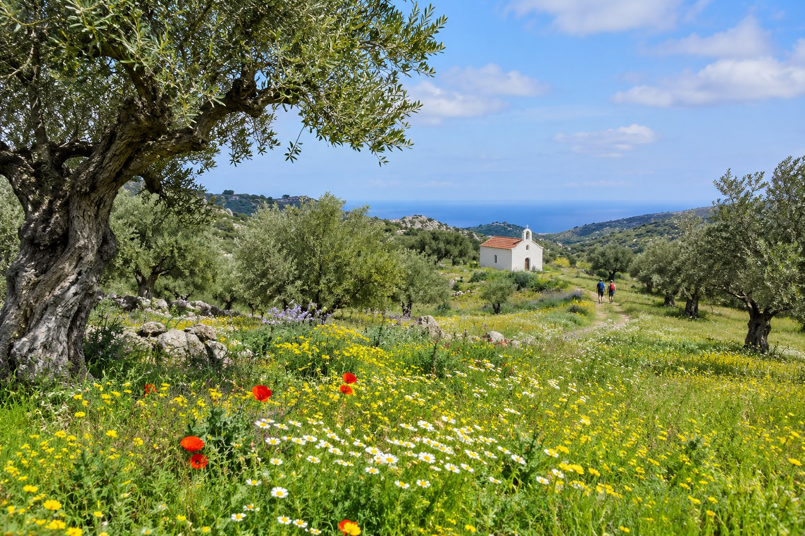
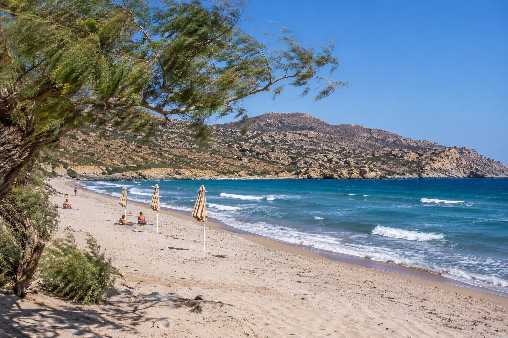
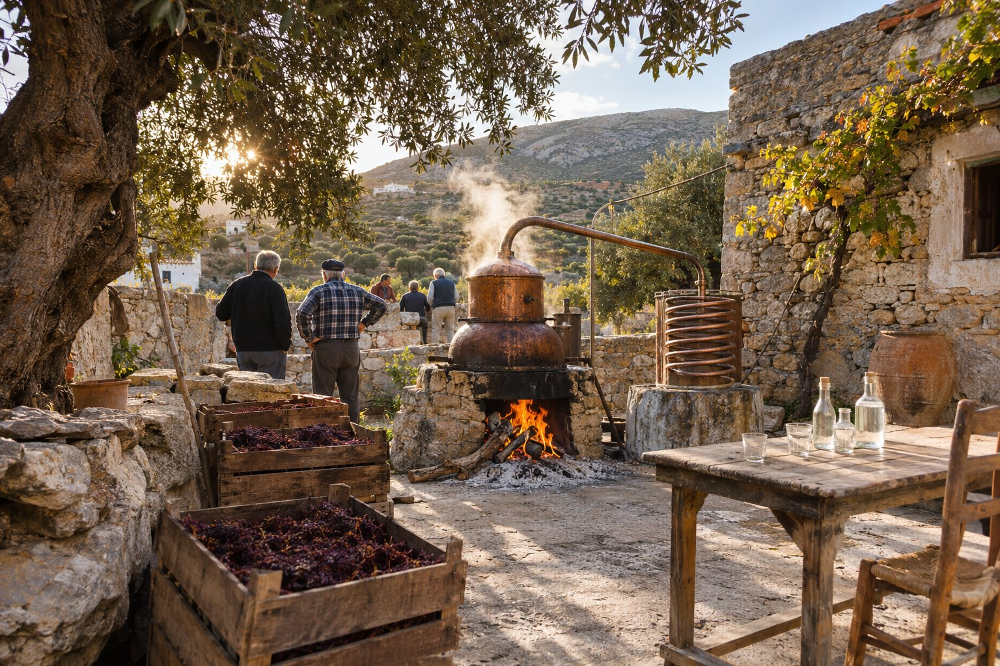

Il n’y a pas une seule bonne période pour venir à Agios Nikolaos : cela dépend de ce que vous cherchez — mer chaude, tranquillité, randonnée ou vie locale. Ce qui change vraiment d’un mois à l’autre, c’est le temps, l’affluence et ce que vous trouverez d’ouvert. Voici à quoi vous attendre à chaque saison, avec un récapitulatif à la fin pour vous aider à décider.

## Printemps : avril et mai

Les maximales passent d’environ 19 °C en avril à environ 23 °C en mai, et les pluies se font de plus en plus rares. La campagne est verte et fleurie, et c’est une période très agréable pour marcher, parcourir les villages de l’intérieur ou visiter des sites archéologiques sans la chaleur de l’été.

La mer est encore fraîche : autour de 16–19 °C, et beaucoup de gens ont du mal à se baigner avant la fin mai. Les hôtels, les tavernes et les excursions en bateau ouvrent peu à peu au fil de ces semaines : début avril, certains établissements n’ont donc pas encore commencé la saison.

### Pâques orthodoxes

Pâques est la fête la plus importante de l’année en Grèce et ne coïncide pas toujours avec celle de l’Église catholique : elle se calcule autrement et tombe souvent une ou plusieurs semaines plus tard. En 2027, par exemple, le dimanche de Pâques orthodoxe tombe le 2 mai.

À Agios Nikolaos, la nuit du Samedi saint a sa propre tradition : à minuit, quand on annonce la Résurrection, on brûle un mannequin de Judas sur un radeau au milieu du [lac Voulismeni](/fr/blog/lago-voulismeni/), au milieu des feux d’artifice et d’une foule rassemblée autour de l’eau. Le Vendredi saint, il y a des processions, et le dimanche est le jour des repas de famille. Gardez à l’esprit que le Vendredi saint et le lundi de Pâques sont fériés et que certains musées et sites archéologiques ferment le dimanche.

- **Avantages :** climat doux, paysage vert, bon moment pour les excursions.
- **Inconvénients :** mer froide pour beaucoup, certains services encore fermés en début de saison.

## Été : juin, juillet et août

C’est la haute saison. Les maximales moyennes tournent autour de 26–28 °C, avec des vagues de chaleur ponctuelles qui les dépassent largement, et il ne pleut pratiquement pas. La mer se réchauffe jusqu’à environ 25 °C en août. Tout est ouvert : tavernes, buvettes de plage, bateaux pour Spinalonga et vie nocturne jusque tard.

C’est aussi la période où il y a le plus de monde, surtout en juillet et en août, avec un pic autour du 15 août, jour férié national en Grèce. Les plages les plus proches se remplissent vite et il vaut mieux réserver à l’avance l’hébergement, la voiture et les excursions.

### Le meltem

En été, le meltem souffle sur la mer Égée : un vent sec du nord qui atteint son point culminant entre la mi-juillet et la mi-août. Il y a des jours de calme complet et d’autres où le vent rafraîchit et où la mer devient agitée sur certaines plages. Cela vaut la peine de consulter les prévisions de vent pour choisir où vous baigner ; vous trouverez des idées dans notre article sur les [plages d’Agios Nikolaos](/fr/blog/playas-de-agios-nikolaos/).

Un conseil pour la chaleur : profitez des premières heures. Le lever du soleil sur la baie de Mirabello, que l’on voit depuis les balcons de la pension, est le meilleur moment de la journée en plein mois d’août.

- **Avantages :** mer chaude, longues journées, tout est ouvert.
- **Inconvénients :** forte chaleur à midi, beaucoup de monde, c’est la période la plus demandée.

## Automne : septembre et octobre

Pour beaucoup, c’est la meilleure période. En septembre, la mer reste autour de 25 °C, l’air commence à se rafraîchir le soir et, avec la rentrée des classes, le nombre de familles diminue. Octobre est encore doux, avec une eau au-dessus de 20 °C, mais les jours raccourcissent et les premières pluies arrivent : environ quatre ou cinq jours de pluie en moyenne dans le mois.

Vers la fin octobre, certains établissements touristiques commencent à fermer ; si vous venez à cette période, confirmez donc au préalable les bateaux et les excursions qui vous intéressent.

### Vendanges et raki

À la fin de l’été, on vendange, et à l’automne arrive l’une des traditions les plus aimées de Crète : la distillation du raki (aussi appelé tsikoudia). Le marc de raisin fermente quelques semaines puis est distillé dans des alambics autorisés, dans les villages, surtout entre octobre et novembre. Ce sont des réunions de voisins et de familles plus que des activités touristiques, mais elles en disent long sur la manière dont on vit ici. Nous vous en parlons plus à loisir dans [vins et raki de Crète](/fr/blog/vinos-y-raki-de-creta/).

- **Avantages :** mer chaude, moins de monde, températures agréables.
- **Inconvénients :** les premières pluies et, à la fin octobre, moins de services ouverts.

## Hiver : de novembre à mars

C’est la saison des pluies. Les maximales descendent à environ 14–16 °C en janvier et février, et en décembre et janvier il y a une dizaine de jours de pluie par mois, mais aussi beaucoup de jours de soleil. La mer descend à environ 15–16 °C à la fin de l’hiver.

Beaucoup d’hôtels, de buvettes de plage, de restaurants tournés vers le tourisme et d’excursions en bateau ferment pendant ces mois, et les bus sont moins fréquents. Mais Agios Nikolaos est une ville où l’on vit toute l’année : les cafés, les commerces et de nombreuses tavernes restent ouverts, et c’est un bon moment pour découvrir la vie locale sans se presser.

L’hiver est aussi la saison de l’olive. La récolte commence à l’automne et se concentre approximativement entre novembre et janvier, et dans la campagne on voit les filets étendus sous les oliviers. Si le sujet vous intéresse, lisez notre article sur l’[huile d’olive de Crète](/fr/blog/aceite-de-oliva-de-creta/).

Pour les jours de pluie, les musées ont des horaires d’hiver, plus courts, qu’il vaut mieux consulter avant d’y aller.

- **Avantages :** tranquillité, ambiance locale, bonne période pour les musées et les balades.
- **Inconvénients :** pluie, journées courtes, de nombreux services touristiques fermés.

## Alors, quand venir ?

- **Pour se baigner avec tout d’ouvert :** de juin à septembre.
- **Pour une mer chaude avec moins de monde :** septembre et début octobre.
- **Pour marcher et faire des excursions :** avril, mai et octobre.
- **Pour vivre Pâques à la grecque :** la semaine de Pâques orthodoxe, en réservant à l’avance.
- **Pour la tranquillité et la vie locale :** de novembre à mars, en sachant qu’il pleuvra certains jours.

Les chiffres de cet article sont des moyennes approximatives : chaque année est différente, et une semaine donnée peut être plus fraîche, plus chaude ou plus venteuse que la normale. Avant de fixer vos dates, consultez le calendrier des jours fériés grecs et, si vous voyagez hors saison, vérifiez quelles excursions et quels services fonctionnent à ces dates.
