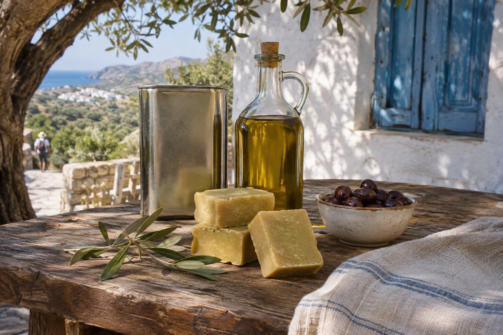
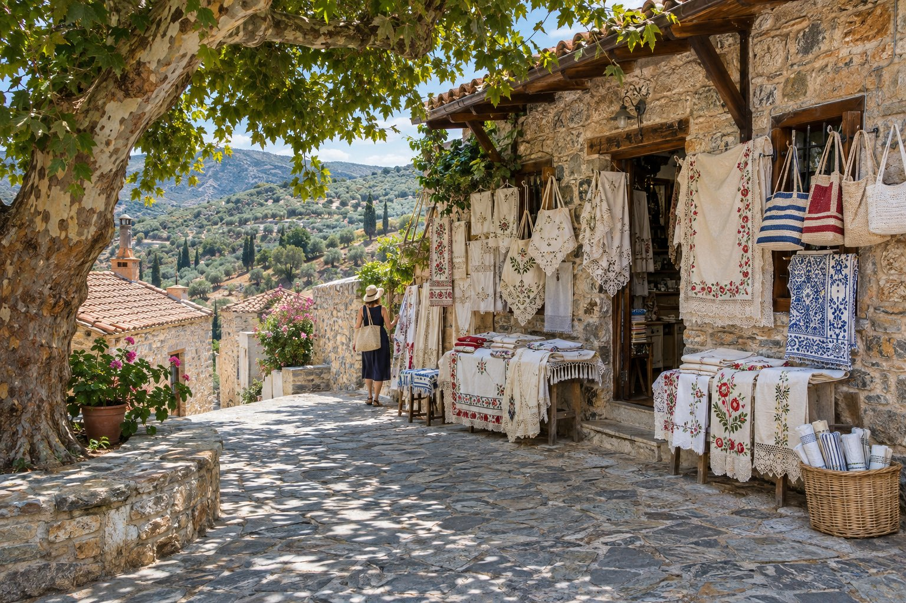

Les meilleurs souvenirs de Crète sont généralement ceux que l’on mange, que l’on boit ou que l’on utilise chez soi. Nous passons ici en revue ce qui vaut la peine d’être acheté à Agios Nikolaos et dans ses environs, et comment le rapporter sans mauvaise surprise à l’aéroport.

## Où acheter

- **Le centre.** Les rues autour du lac Voulismeni et du port concentrent des boutiques de produits locaux, d’artisanat et de souvenirs. Depuis la pension, le lac est à environ 6 minutes à pied et le centre à environ 9 (vous pouvez voir les distances sur la [carte](/fr/#location)).
- **Le marché hebdomadaire.** Le mercredi matin se tient la *laikí*, le marché en plein air, avec fruits et légumes de saison, fromages, miel, herbes, mais aussi vêtements et articles pour la maison. Confirmez l’emplacement et l’horaire à votre arrivée, car ce sont des données qui peuvent changer.
- **Les villages.** Kritsa, dans les collines au-dessus de la ville, est l’endroit pour les tissages et les broderies. Aux alentours, il y a aussi des coopératives et des producteurs qui vendent directement.

## Pour manger et boire

### Huile d’olive et savon à l’huile

C’est le souvenir crétois par excellence. Cherchez de l’huile vierge extra, de préférence en boîte métallique, et si vous voulez quelque chose de cette région, l’AOP Sitia. Dans notre article sur l’[huile d’olive de Crète](/fr/blog/aceite-de-oliva-de-creta/), nous expliquons comment lire l’étiquette et comment la déguster.

À côté de l’huile, vous trouverez des savons à l’huile d’olive, simples, légers et qui ne comptent pas comme liquide en avion, ainsi que des crèmes et des cosmétiques élaborés avec de l’huile et des herbes.

### Miel de thym

Le miel de thym est l’un des plus appréciés de l’île : dense, très aromatique et au goût intense. Avec le temps, il cristallise naturellement, et ce n’est pas un signe de mauvaise qualité. Si vous voulez le rendre de nouveau liquide, chauffez le pot au bain-marie, sans exagérer la température.

### Herbes et thé de montagne

- **Malotira** (*Sideritis syriaca*), le thé de montagne crétois : une infusion douce et sans caféine. Ses populations sauvages ont diminué à cause de la cueillette excessive ; il vaut donc mieux l’acheter conditionnée et issue de culture.
- **Dictame** (*Origanum dictamnus*), une plante endémique de Crète que l’on boit en infusion.
- **Origan, thym et sauge**, secs et en bouquets, pour cuisiner chez soi.

### Raki et vin

Une bouteille de raki ou de vin crétois est un cadeau classique. Nous vous expliquons ce qu’est chacun et quels cépages chercher dans [vins et raki de Crète](/fr/blog/vinos-y-raki-de-creta/).

### Fromages et paximadia

- **Graviera de Crète** (AOP) : fromage dur, surtout au lait de brebis, qui supporte bien le voyage.
- **Xinomizithra** (AOP), frais et légèrement acidulé, et **xygalo de Sitia** (AOP), crémeux et tartinable. Ils sont délicieux, mais ont besoin de froid et voyagent moins bien.
- **Paximadia** : les pains d’orge grillés avec lesquels on prépare le *dakos*. Légers et durables, ils se transportent sans problème.

Si la boutique peut vous emballer le fromage sous vide, c’est mieux. Au sein de l’Union européenne, vous pouvez rapporter des fromages et d’autres aliments pour votre consommation personnelle. Si vous rentrez dans un pays hors de l’UE, renseignez-vous avant d’acheter : beaucoup restreignent ou interdisent l’entrée de produits laitiers et de produits carnés dans les bagages.

## Artisanat

### Tissages et broderies de Kritsa

Kritsa est l’un des centres traditionnels du tissage crétois, et dans ses rues on trouve des boutiques de nappes brodées, de dentelles, de tapis et de sacs tissés. Le travail fait main demande de nombreuses heures et cela se voit dans le prix. Si vous tenez à ce que la pièce soit artisanale et locale, demandez sans hésiter. Vous trouverez d’autres idées pour la visite dans [Kritsa et ses environs](/fr/blog/kritsa-y-alrededores/).

### Céramique

La Crète a une longue tradition potière, avec des villages réputés pour cela comme Margarites, dans la région de Réthymnon, ou Thrapsano, dans celle d’Héraklion. À Agios Nikolaos, vous trouverez aussi bien des pièces d’usage quotidien que des reproductions de vases minoens. Demandez qu’on vous les emballe bien et, si elles sont fragiles, emportez-les en bagage cabine.

### Couteaux crétois

Le couteau traditionnel crétois, avec un manche en corne, en os ou en bois d’olivier, porte généralement gravée sur la lame une *mantinada*, un bref vers rimé de la tradition populaire. Sur l’île, c’est un cadeau très symbolique.

Attention en avion : la réglementation européenne interdit en cabine les couteaux dont la lame dépasse 6 cm, et les contrôles peuvent être plus stricts. Le plus sûr est de mettre tout couteau dans la valise enregistrée.

### Cuir et bois d’olivier

Les sandales et les sacs en cuir sont un autre classique. Il y a aussi des ustensiles en bois d’olivier, comme des planches, des cuillères ou des bols, résistants et avec un très beau veinage. Pour qu’ils durent, lavez-les à la main et huilez-les de temps en temps.

## Comment les transporter en avion

- **Liquides : en soute.** Huile, miel, raki, vin et fromages mous comptent comme des liquides ou des pâtes au contrôle de sécurité. En bagage cabine, la règle générale est de contenants de 100 ml au maximum ; consultez les conditions de votre aéroport et de votre compagnie avant de voler.
- **Bien protégé.** Mieux vaut des boîtes métalliques que du verre. Les bouteilles et les pots, enveloppés dans des vêtements et placés dans un sac fermé.
- **Attention au poids.** Quelques boîtes d’huile et quelques bouteilles pèsent plus qu’il n’y paraît ; vérifiez la franchise de bagages de votre billet.
- **Si vous achetez beaucoup**, demandez à la boutique si elle fait des envois : cela revient parfois moins cher que de payer des bagages supplémentaires.

## Un dernier conseil

Gardez les achats alimentaires pour les derniers jours, quand vous saurez ce qui vous a le plus plu dans les tavernes, et profitez du marché du mercredi s’il coïncide avec votre séjour. Achetez ce que vous utiliserez vraiment, renseignez-vous sur l’origine et gardez de la place dans la valise : il en faut toujours plus qu’on ne le croit.
