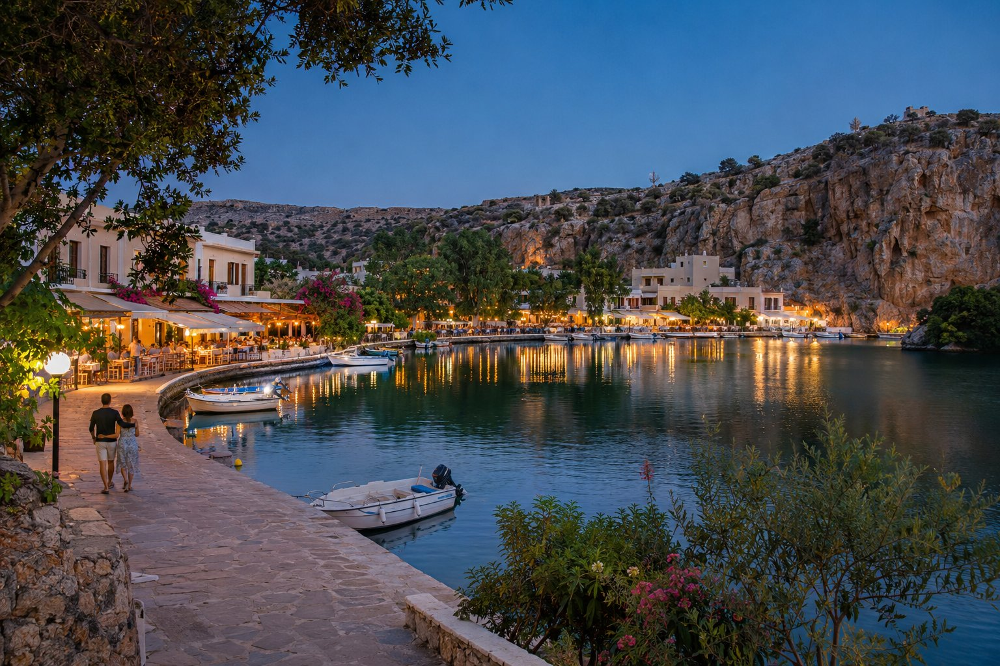
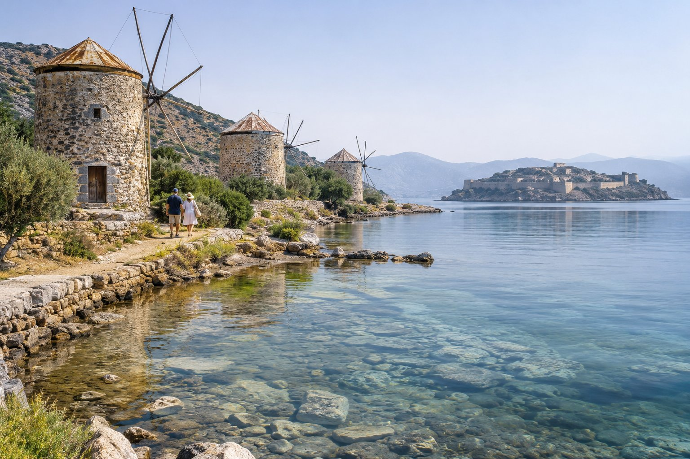
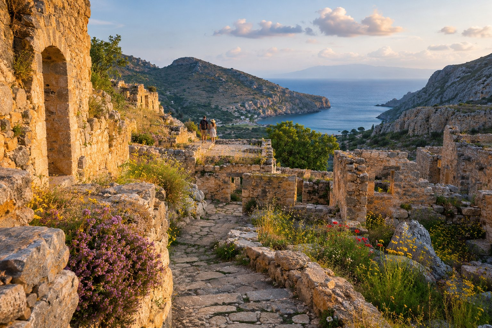

Agios Nikolaos ha la misura giusta per una fuga di coppia: è abbastanza piccola da girarla a piedi e senza fretta, e intorno c'è varietà a sufficienza (paesi di montagna, un'isola ricca di storia, spiagge tranquille) per riempire diversi giorni. Ecco alcune idee per organizzarli al tuo ritmo.

## Iniziare la giornata con l'alba

Dai balconi della pensione, nella zona di Mylos, si vede sorgere il sole sul golfo di Mirabello. Vale la pena mettere la sveglia almeno una mattina: un caffè sul balcone, la luce che cambia sull'acqua e sulle montagne, e la città ancora in silenzio. In estate l'alba è prestissimo; se non sei mattiniero, in primavera e in autunno è più facile.

Poi, la spiaggia di Kitroplatia è a un minuto a piedi (100 m). Di prima mattina c'è poca gente e il mare di solito è calmo, quindi è un buon momento per il primo bagno della giornata.

## Passeggiate al calar della sera

### Intorno al lago

Il lago Voulismeni è a sei minuti a piedi (450 m). Al tramonto si accendono le luci dei ristoranti che lo circondano e si riflettono nell'acqua, tra le barche ormeggiate. Se sali nella parte alta, vedrai il lago, la città e il porto dall'alto. Una leggenda dice che il lago non ha fondo; è solo questo, una leggenda, ma fa parte del fascino del luogo.

### Dal porto a Kitroplatia

Il porto è a tre minuti dalla pensione (200 m). Lì si trova la statua del ratto di Europa, che ricorda il mito secondo cui Zeus, trasformato in toro, portò la principessa Europa a Creta. Dal porto puoi proseguire lungo il mare fino a Kitroplatia o avvicinarti al centro (9 minuti, 600 m), un percorso breve e piacevole per dopo cena.

Se vuoi trovare un buon posto per vedere il tramonto, ne parliamo in [tramonto ad Agios Nikolaos](/it/blog/atardecer-en-agios-nikolaos/).

## Cene sull'acqua

Tra il lago, il porto e Kitroplatia ci sono molte taverne e ristoranti con i tavoli quasi a bordo acqua. Non facciamo nomi perché i locali cambiano da una stagione all'altra, ma ecco alcune regole che di solito funzionano:

- Fai un giro prima di sederti e guarda dove mangiano le persone del posto.
- Chiedi il pesce del giorno e come lo preparano. Il pesce fresco di solito si paga a peso, quindi conviene chiedere il prezzo prima di ordinare.
- Ordina più piatti da condividere: insalate, verdure di stagione, formaggi cretesi, qualcosa alla griglia.
- In alta stagione, se vuoi un tavolo sull'acqua, vai presto o prenota.

Trovi altri suggerimenti in [come scegliere una taverna](/it/blog/como-elegir-una-taberna/).

## Una giornata a Elounda, Plaka e Spinalonga

Elounda è a circa 23 minuti in auto (15 km). All'ingresso della sua piccola laguna si conservano alcuni mulini a vento dell'inizio del XX secolo e, vicino al canale che la collega al mare aperto, restano i resti dell'antica città di Olous, in buona parte sott'acqua. Con il mare calmo e una maschera da snorkeling si distinguono alcune tracce.

Un po' più avanti c'è Plaka, un paesino di fronte a Spinalonga. Da lì la traversata fino all'isola dura appena pochi minuti; da Elounda, un po' di più. Spinalonga fu una fortezza veneziana e, tra il 1903 e il 1957, una colonia di malati di lebbra. Visitarla con calma, guardando il mare, è una delle esperienze più toccanti della zona. Porta acqua e cappellino, perché c'è pochissima ombra, e scarpe comode per i sentieri di pietra.

Per chiudere la giornata, niente di meglio che pranzare o cenare davanti al mare a Plaka prima di rientrare. Trovi tutti i dettagli nella nostra guida a [Elounda e Plaka](/it/blog/elounda-y-plaka/).

## Spiagge tranquille

In piena estate le spiagge della città si riempiono a mezzogiorno. Per godertele con calma:

- **Scegli bene l'orario.** Al mattino presto o a fine pomeriggio il sole è più dolce e c'è meno gente.
- **Cammina un po' di più.** Almiros, a 26 minuti a piedi (2,1 km), è una spiaggia di sabbia e acqua poco profonda alla foce di un piccolo fiume, con una zona umida protetta proprio accanto.
- **Pensa alla stagione.** A giugno, a settembre e per buona parte di ottobre il mare è di solito piacevole e c'è molta meno gente che a luglio e ad agosto.

Ámmos (10 minuti, 650 m) e Ammoudi (18 minuti, 1,2 km) sono altre due opzioni vicine per un bagno senza auto.

## Kritsa e dintorni

A circa 10 km dalla città, sul versante della montagna, si trova Kritsa, uno dei paesi tradizionali più conosciuti di Creta orientale. Le sue strade sono piene di piccoli negozi di tessuti e ricami fatti a mano, una tradizione che il paese mantiene viva.

Poco prima di arrivare si trova la chiesa bizantina di Panagia Kera, con affreschi dei secoli XIII e XIV. E a circa 3 km dal paese ci sono le rovine di Lato, un'antica città dorica costruita tra due colline, con vista sul golfo. È una bella escursione di mezza giornata, meglio al mattino o a fine pomeriggio, quando il caldo si attenua. Ne parliamo di più in [Kritsa e dintorni](/it/blog/kritsa-y-alrededores/).

## Consigli per la fuga

- **Non cercare di vedere tutto.** Due o tre uscite fuori città bastano per una settimana; il resto del tempo, mare e passeggiate.
- **Alzati presto per le escursioni.** Se noleggi un'auto, partire presto ti permette di sfruttare la luce migliore ed evitare le ore più calde.
- **Controlla gli orari.** Le barche per Spinalonga, i siti archeologici e i musei cambiano orario a seconda della stagione. Verificali il giorno prima, al porto o su internet.

Una fuga di coppia qui funziona meglio senza un'agenda troppo fitta: l'alba dal balcone, un bagno prima che arrivi il caldo, qualche escursione e cene lunghe in riva all'acqua. Se hai dubbi su come combinare i programmi, puoi scriverci a info@pensionmylos.com.
