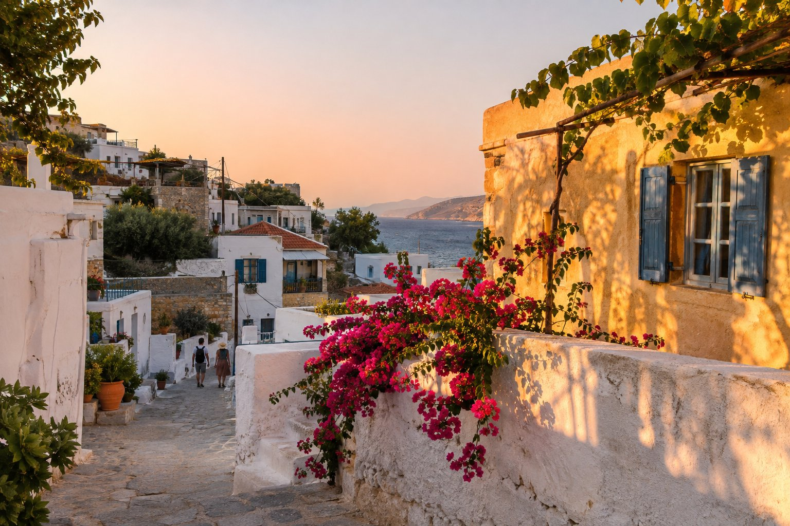
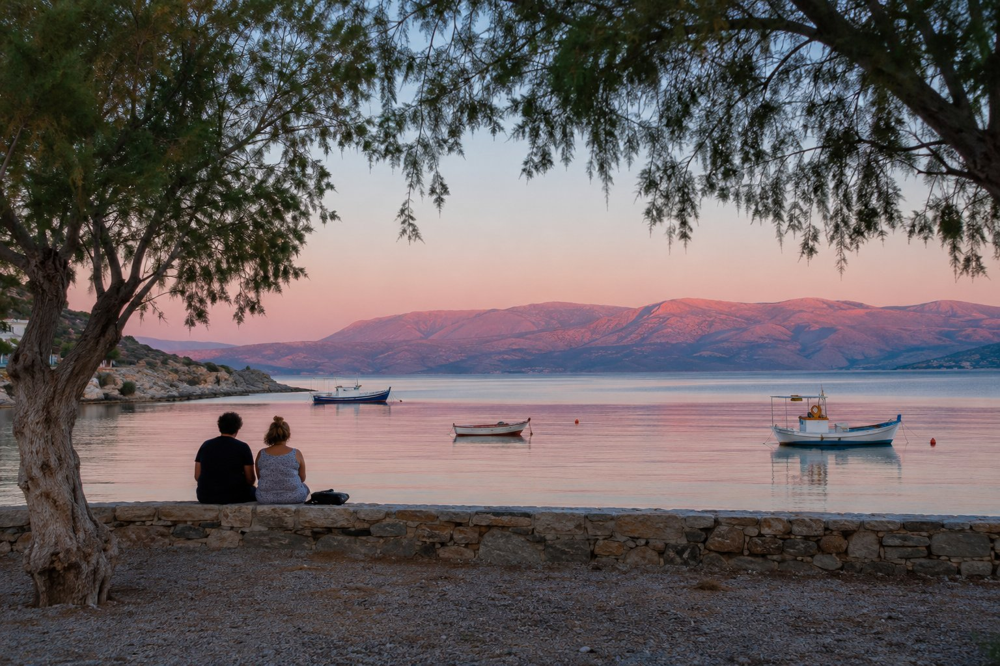
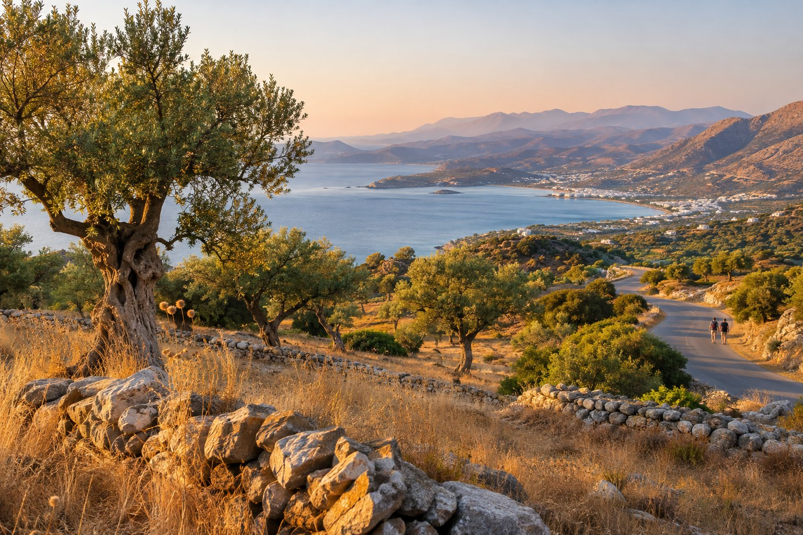

Agios Nikolaos guarda a est, verso il golfo di Mirabello. Questo ha una conseguenza che conviene sapere prima di uscire a cercare il tramonto: qui il sole non tramonta sul mare, ma dietro il paese, oltre le colline e le montagne a ovest.

Quello che si vede dal paese è un'altra cosa, e a nostro giudizio altrettanto bella: la luce dorata sulle facciate, il lago e il porto che cambiano colore e, dall'altra parte del golfo, le montagne che si tingono di rosa quando il paese è già in ombra.

## Com'è il tramonto qui

Ad Agios Nikolaos lo spettacolo non è il disco del sole, ma la luce. Ci sono tre momenti:

- **L'ultima ora prima del tramonto.** Il sole basso illumina di lato le case, che diventano dorate e poi arancioni, e l'acqua del golfo riflette il cielo.
- **Il tramonto vero e proprio.** Non vedi il sole sparire, ma vedi la luce ritirarsi: prima dalle strade, poi dai tetti e, alla fine, dalle cime dall'altra parte del golfo, come il massiccio di Thripti.
- **I minuti successivi.** Il cielo conserva il colore per un po', si accendono le luci delle terrazze e tutto si riflette nell'acqua.

L'ora cambia molto a seconda della stagione. A fine giugno il sole tramonta verso le 20:30, più o meno, e a dicembre poco dopo le 17:00. In estate lo fa più verso nord-ovest e in inverno più verso sud-ovest, ma sempre dietro la terraferma. La cosa più semplice è controllare l'ora esatta del giorno in una qualsiasi app meteo e uscire con mezz'ora di margine.

Una precisazione sulla pensione: i nostri balconi guardano il golfo, quindi quello che si vede da lì è l'alba, con il sole che sorge sul mare. Per il tramonto bisogna spostarsi un po', ma non molto.

## In paese, a piedi

### Il belvedere sul lago Voulismeni

Il lago è a circa sei minuti a piedi dalla pensione (450 m). Su uno dei suoi lati lo circonda una scogliera, e in alto c'è un piccolo parco con belvedere a cui si sale per scale dalla riva. Da lì si vede il lago intero, il canale che lo collega al porto, le case del centro e il golfo sullo sfondo.

È il posto per vedere il paese acceso d'arancione, come nella foto qui sopra, con il sole alle spalle. Le scale hanno la loro pendenza: porta scarpe comode e, se resti fino al buio, la torcia del telefono per scendere. Del lago e della sua storia parliamo nel [nostro articolo sul lago Voulismeni](/it/blog/lago-voulismeni/).

### La riva del lago e il ponte

Giù, sulla passeggiata che circonda il lago, il momento migliore arriva subito dopo il tramonto. Il cielo ha ancora colore, si accendono via via le luci dei ristoranti e l'acqua ferma raddoppia tutto. Il piccolo ponte sul canale che collega il lago con il porto è un buon punto per guardare da entrambi i lati.

### Il porto e Kitroplatia

Il porto è a tre minuti dalla pensione (200 m), accanto alla statua del ratto di Europa, e la spiaggia di Kitroplatia a uno. Da entrambi si guarda a est, con il golfo davanti. È un'opzione comoda, senza scale: ti siedi accanto all'acqua, vedi come cambia il colore del mare e come le montagne dall'altra parte si prendono l'ultima luce quando il paese è già in ombra.

## Fuori dal paese

### Dall'acqua

In stagione dal porto partono escursioni in barca sul golfo al tramonto. Dalla barca la vista si inverte: hai davanti il paese e, dietro, il sole che scende dietro le montagne. Le compagnie, gli orari e i prezzi cambiano da un anno all'altro, quindi chiedi al porto stesso o cerca su internet.

### Le colline di Kritsa

Kritsa è un paese di montagna a circa 10 km, sul versante che guarda il golfo. Dalla strada che sale e dal paese stesso si vede la baia dall'alto, e nel tardo pomeriggio la luce è molto bella. Il sole tramonta alle tue spalle, dietro le montagne, quindi nemmeno qui vedrai il sole sul mare, ma vedrai il golfo intero con l'ultima luce. Si abbina bene alla fine di un pomeriggio in zona; trovi idee in [Kritsa e dintorni](/it/blog/kritsa-y-alrededores/).

### La riva est del golfo

Se quello che vuoi è l'immagine classica, con l'acqua davanti e il sole che scende sullo sfondo, devi attraversare dall'altra parte del golfo. La strada verso Sitia sale lungo la riva est e ha diversi belvedere. Da lì si guarda a ovest, con tutto il golfo di Mirabello davanti e il sole che si nasconde dietro le montagne dell'altra riva.

È un bel modo di concludere un'escursione in auto verso est (trovi proposte in [itinerari in auto di mezza giornata](/it/blog/rutas-en-coche-de-medio-dia/)). Tieni presente che è una strada tutta curve, con tratti sul mare, e che il ritorno sarà già col buio: guida con calma.

## Consigli pratici

- **Arriva in anticipo.** La luce migliore è nella mezz'ora prima del tramonto e nei minuti successivi.
- **Controlla l'ora del tramonto di quel giorno.** Tra giugno e dicembre il tramonto si anticipa di più di tre ore.
- **Porta uno strato in più** in primavera e in autunno, soprattutto se sali sulle colline: quando il sole se ne va, rinfresca in fretta.
- **Per le foto**, il paese rende di più con il sole alle spalle. Per le silhouette contro il cielo bisogna guardare a ovest, dall'acqua o dall'altra riva.

Dopo il tramonto, il centro si anima. Se vuoi idee per continuare la serata, le trovi in [Agios Nikolaos di notte](/it/blog/agios-nikolaos-de-noche/).

## Per concludere

Per vedere il tramonto qui non serve l'auto: il porto è a tre minuti dalla pensione e il lago a sei, quindi si può andare a passeggio e tornare per cena. Scegli il belvedere per vedere il paese dorato dall'alto, la riva del lago per le luci e i riflessi, e l'altra riva del golfo se cerchi il sole che scende sullo sfondo, sul mare. E se un giorno ti alzi presto, esci sul balcone: anche l'alba sul golfo vale la pena.
