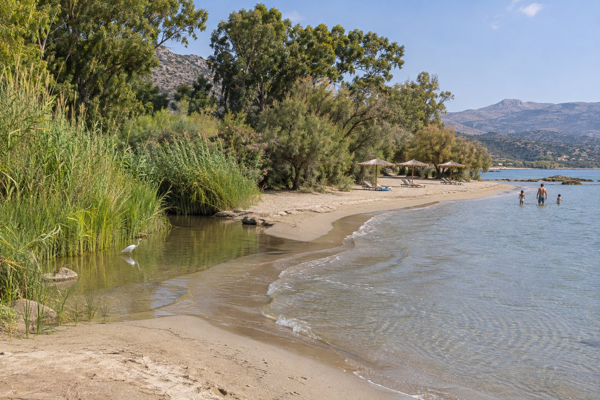
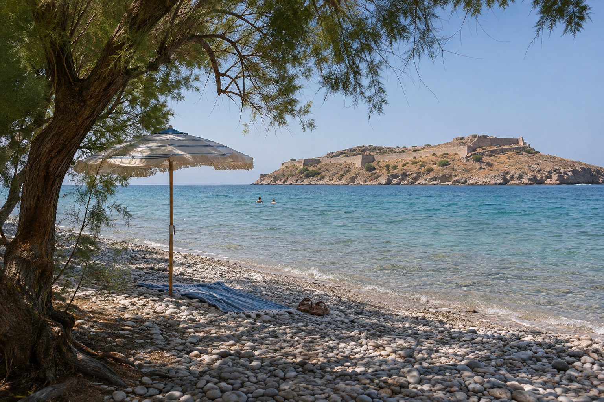

Ad Agios Nikolaos puoi fare il bagno senza prendere l'auto: ci sono quattro spiagge a meno di mezz'ora a piedi dalla pensione e diverse altre a breve distanza. Nessuna è la migliore per tutti. Dipende se vai con bambini, se ti danno fastidio i sassi, se vuoi ombra o se preferisci avere un posto dove mangiare lì accanto. Ecco come le sceglieremmo noi.

## Tre domande prima di scegliere

- **Sabbia o sassi?** Ámmos, Ammoudi, Almiros, Voulisma e la spiaggia di Elounda sono di sabbia. Kitroplatia e Havania mescolano sabbia e ghiaietta fine. Plaka è di sassi.
- **Ti serve acqua bassa?** Se vai con bambini piccoli, Ámmos, Ammoudi e Almiros hanno un ingresso dolce e di solito sono calme.
- **Servizi o tranquillità?** Quasi tutte le spiagge vicine al paese sono attrezzate, con lettini, ombrelloni e qualche bar. Se cerchi qualcosa senza servizi, bisogna allontanarsi un po' di più.

## Le spiagge del paese, a piedi

### Kitroplatia (1 minuto, 100 m)

Quella che abbiamo accanto. È una spiaggia piccola, di sabbia e ghiaietta fine, davanti a una piazza con grandi tamerici che fanno ombra e con taverne e caffè tutt'intorno. Ha ombrelloni e docce, e l'acqua di solito è tranquilla. Il nome viene dai cedri, un agrume con cui qui si commerciava nel secolo scorso.

È perfetta per un bagno veloce al mattino o tra una visita e l'altra. In piena estate si riempie, quindi non è l'opzione giusta se cerchi spazio per stendere l'asciugamano.

### Ámmos (10 minuti, 650 m)

Una spiaggia di sabbia accanto al porto turistico, con acqua bassa e normalmente calma, il che la rende molto comoda per i bambini piccoli. Ci sono lettini, ombrelloni e docce, e molti posti dove bere qualcosa lì vicino. Essendo in pieno paese, di solito c'è anche parecchia gente.

### Ammoudi (18 minuti, 1,2 km)

A nord del centro, in una baia grande e ben riparata, al riparo dai forti venti del nord. È una spiaggia piccola di sabbia, con acqua bassa e tamerici che danno un po' di ombra naturale. Piace tanto alla gente del paese quanto ai visitatori, quindi alcuni giorni si riempie.

### Almiros (26 minuti, 2,1 km)

A sud, la spiaggia di sabbia più ampia del paese. L'acqua è bassa e di solito calma, ideale per i bambini. Si trova alla foce del fiume Almiros, che porta acqua tutto l'anno, e per questo in alcuni punti l'acqua del mare è molto più fredda.

Dietro c'è una zona umida protetta, con canne, eucalipti e tamerici, dove si vedono uccelli, soprattutto in primavera e in autunno, quando si fermano i migratori. In spiaggia ci sono lettini, ombrelloni, sport acquatici e qualche chiosco. È la più popolare del paese, quindi ad agosto conviene andare presto.

## A breve distanza in auto

### Havania

Alla periferia del paese, sulla strada per Elounda. È una spiaggia di sabbia e ghiaietta morbida, con acqua limpidissima e rocce alle estremità dove vale la pena affacciarsi con la maschera, perché di solito ci sono pesciolini. È una spiaggia comunale attrezzata; delle scarpette da scoglio sono utili per le rocce.

### Voulisma, accanto a Istro

A circa 12 km, accanto al paese di Istro, è una delle spiagge di sabbia più conosciute della zona: sabbia chiara, acqua turchese e bassa. È attrezzata, con lettini e bar, e a luglio e agosto si riempie molto. Se vai in alta stagione, meglio la mattina presto o a fine pomeriggio.

### Verso Elounda e Plaka

Elounda è a circa 23 minuti in auto (15 km). La sua spiaggia principale è di sabbia, con acqua tranquilla e bassa, ed è attrezzata. Poco più avanti, a Plaka, la spiaggia è di sassi, con tamerici e vista su Spinalonga.

Se cerchi qualcosa senza servizi, sulla penisola di fronte a Elounda c'è Kolokytha, una caletta non attrezzata che si raggiunge per una strada sterrata e un tratto a piedi. C'è appena ombra, quindi porta tutto ciò che ti serve. Trovi altro sulla zona in [Elounda e Plaka](/it/blog/elounda-y-plaka/).

## Scegliere in base a ciò che cerchi

- **Con bambini piccoli:** Ámmos, Ammoudi e Almiros, per la sabbia e l'acqua bassa. Trovi altre idee in [Agios Nikolaos con i bambini](/it/blog/agios-nikolaos-con-ninos/).
- **Ombra naturale:** Kitroplatia e Ammoudi hanno le tamerici. Nelle altre, ombrellone a noleggio o proprio.
- **Senza auto:** le quattro del paese. Almiros è un po' più lontana, ma si raggiunge bene a passeggio.
- **Per vedere il fondale:** Havania e in generale le zone rocciose. Porta maschera e boccaglio.
- **Una spiaggia lunga di sabbia:** Almiros o Voulisma.
- **Tranquillità:** Kolokytha, senza servizi, o una qualsiasi di quelle del paese di prima mattina.
- **Mangiare accanto all'acqua:** Kitroplatia e Ámmos, con taverne e caffè a pochi passi.

## Il vento e la Bandiera Blu

In estate soffia spesso il meltemi, un vento del nord che a Creta arriva da nord-ovest e di solito è più forte nel pomeriggio. Il golfo di Mirabello ripara parecchio, e spiagge come Ammoudi sono protette dal vento del nord, ma nei giorni di vento forte il mare si increspa nelle zone più esposte. Se è previsto vento, scegli una spiaggia riparata e controlla le previsioni prima di uscire.

Quanto alla Bandiera Blu, il comune di Agios Nikolaos, che comprende anche Elounda, è tra quelli con più spiagge premiate in Grecia. L'elenco cambia ogni anno, quindi se ti interessa, consulta quello dell'anno in corso sul sito ufficiale del programma in Grecia (blueflag.gr).

## Per concludere

Se è il tuo primo giorno, comincia da Kitroplatia o Ámmos, che sono a un passo, e lascia Almiros, Havania o Voulisma per quando saprai che tipo di spiaggia ti piace. Prima di uscire, ripassa [cosa portare in spiaggia a Creta](/it/blog/que-llevar-a-la-playa-en-creta/), soprattutto scarpette da scoglio e ombra se vai in una spiaggia di sassi o senza servizi. E se vuoi vedere sulla mappa a che distanza si trova ogni spiaggia dalla pensione, la trovi nella [nostra pagina sulla posizione](/it/#location).
