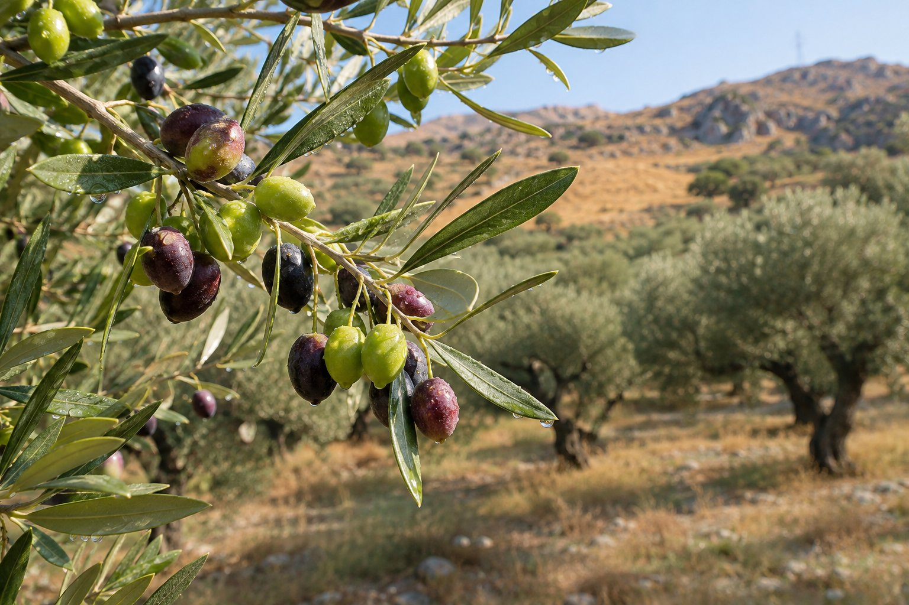
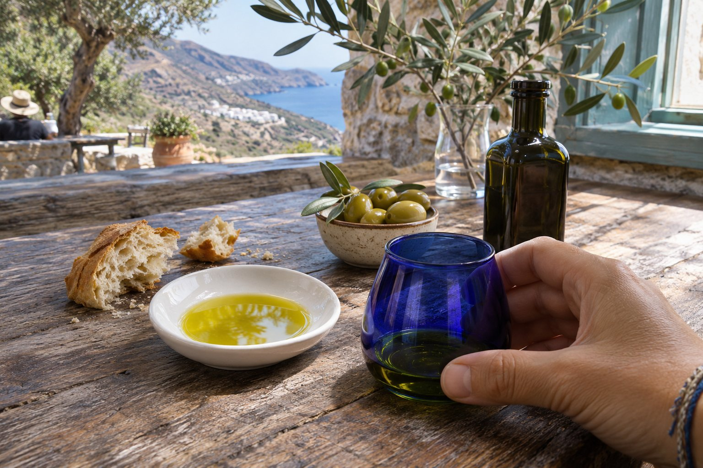

クレタ島（Crete）では、オリーブオイルがほとんどすべての料理に登場します。サラダにも、野菜の煮込みにも、朝食のパンにも、タベルナの厨房から出てくる料理の多くに使われています。ここでは、クレタ産のオイルの特徴、ラベルの読み方、アギオス・ニコラオス（Agios Nikolaos）の近くで味わえる場所をご紹介します。

## とても古い伝統

クレタ島では、ミノア時代からオリーブが栽培されてきました。[クノッソス宮殿（Knossos）](/ja/blog/palacio-de-knossos/)では、油、ワイン、穀物などを貯蔵していた大きな粘土の壺、*ピトス（pithoi）*がいまも見られます。

今日でもオリーブ畑は、海岸から山の斜面まで風景を埋め尽くしていて、多くの村では、各家庭が自分たちの木と、一年分の自家製オイルをもっています。

## 島のオリーブ、コロネイキ

クレタ島で主役となる品種は、コロネイキ（koroneiki）です。小粒のオリーブで、緑色から黄金色のオイルができます。刈りたての草、青葉、果実を思わせる香りがあり、苦味と辛味は若いオイルほどはっきり感じられます。このほか、ツナティ（tsounati）など、ほかの地元品種も栽培されています。

## 「エクストラバージン」とは

欧州連合（EU）では、「エクストラバージン・オリーブオイル」は法的な区分であり、宣伝用の形容詞ではありません。この名前を名乗るには、オイルは次の条件を満たす必要があります。

- 溶剤や精製を使わず、機械的な方法のみで得られたものであること。
- 遊離酸度が0.8%以下であること。
- 官能検査で、欠陥がまったくなく、フルーティーさが多少あると認められること。

その下には、バージン・オリーブオイルと、単に「オリーブオイル」として売られているものがあり、後者は精製オイルとバージンオイルを混ぜたものです。酸度がとても低いのは結構なことですが、それだけでは、味がどうか、オイルが新鮮かどうかはわかりません。

## 原産地のマーク：PDOとPGI

クレタ島には、オリーブオイルに関する原産地呼称保護（PDO）がいくつかあります。イラクリオン（Heraklion）県のペザ（Peza）、アルハネス（Archanes）、ヴィアノス（Viannos）、メサラ（Messara）、ハニア（Chania）県のコリンバリ（Kolymvari）、アポコロナス（Apokoronas）などです。

私たちの県であるラシティ（Lasithi）では、島の東端にある**PDO Sitia Lasithiou Kritis**が基準で、おもにコロネイキから作られます。

さらに、2025年からは、島全体を対象とする地理的表示保護（PGI）**Kriti**（Κρήτη）があり、オリーブの少なくとも90%がコロネイキかツナティ、またはその混合であることが求められます。西部には、より古いPGI、Chania Kritisもあります。

パッケージでは、PDOは赤と黄色のEUのマークで、PGIは青と黄色のマークで見分けます。これらが保証するのは産地であり、最高のオイルであるということではありません。マークのない優れた小規模生産者もいます。

## ラベルの読み方

購入する前に、次の点を確認しましょう。

1. **区分。** 「エクストラバージン・オリーブオイル」と書かれているか。ギリシャ語では*εξαιρετικό παρθένο ελαιόλαδο*です。
2. **産地。** クレタ産のオイルを探すなら、はっきり表示されているか、島のPDOかPGIがついているか。
3. **収穫年。** 収穫年を記載している生産者もあります。ない場合は、賞味期限を見てください。
4. **「コールドエクストラクション（低温抽出）」。** EUでは、オイルが27 °C以下で得られた場合にのみ表示できます。現在の近代的な搾油所では一般的です。
5. **容器。** 缶か、光を通しにくい濃い色のガラス。日光にさらされた透明なボトルは避けましょう。

## テイスティングの方法

プロのテイスターは青いグラスを使います。色で品質を判断しないためです。お店や自宅では、小さなグラスで十分です。

- 手でふたをして、数秒温めると、香りが立ちます。
- 香りをかぎます。良いエクストラバージンは、草、青葉、トマト、アーティチョーク、リンゴを思わせます。
- 少量を口に含み、歯の間から少し空気を吸い込んで、口全体に広げます。
- 舌に感じる苦味と、のどに感じる辛味に注目します。若いオイルでは、欠点ではなく、良い特徴です。

あってはならないのは、酸化した古いオイルの臭い、カビの臭い、酸っぱくなったワインの臭い、発酵したオリーブの臭いです。最後のものは、テイスティングでは「フスティ（fusty）」と呼ばれる欠点です。

## オイルが作られる時期

収穫は、地域や標高、天候によって、10月下旬から11月ごろに始まり、1月まで続きます。まだ緑色のうちに摘んだ最初の実からは、*agourélaio*（アグレライオ）という、早摘みのオイルができます。色がとても緑で、味は力強く、生産量は限られています。

秋や冬に旅行する場合は、オリーブの木の下に広げられたネットや、フル稼働の搾油所を目にするでしょう。夏のお店には前年の収穫のオイルが並んでいて、きちんと保管されていれば、まだ良い状態です。

## アギオス・ニコラオス近郊で味わえる場所

### タベルナで

*ダコス*（トマトをすりおろし、やわらかいチーズとオイルをのせた、大麦のラスク）、ゆでた野生の野菜（*horta*、ホルタ）にオイルとレモンをかけたもの、または*ladera*（ラデラ）と呼ばれる、オイルで煮込んだ野菜の料理を注文してみてください。テーブルのオイルが、そのお店の家族のオリーブの木から採れたものであることも珍しくないので、尋ねてみましょう。そのほかのアイデアは、[クレタ島で何を食べるか](/ja/blog/que-comer-en-creta/)と[タベルナの選び方](/ja/blog/como-elegir-una-taberna/)のガイドにあります。

### 地元の産品を扱うお店で

アギオス・ニコラオスの中心部には、島のさまざまな地域のオイルを揃えた、地元の産品のお店があります。購入前に試食させてくれるお店もあり、それがいちばん良い選び方です。

### 協同組合と搾油所で

周辺、たとえばクリツァ（Kritsa）方面やネアポリ（Neapoli）周辺には、試飲つきのガイドツアーを行っている農業協同組合や搾油所があります。条件や営業時間は季節によって変わるので、インターネットで調べるか、事前に予約してください。[クリツァとその周辺](/ja/blog/kritsa-y-alrededores/)の訪問と組み合わせることもできます。

## 自宅へ持ち帰るために

缶はもっとも丈夫な容器で、光からオイルを守ります。機内持ち込み手荷物には液体の制限があるので、しっかり包んで閉じた袋に入れ、預け荷物にするのが現実的です。帰宅したら、熱と光を避けて保管し、数か月のうちに使い切ってください。オイルは時間がたっても良くなりません。

アギオス・ニコラオスの中心部は、ペンションから徒歩約9分です。決める前にいくつか違うオイルを試し、収穫について尋ね、今後数か月で使い切れる量だけ買いましょう。そうすれば、最もよい状態で楽しめます。
