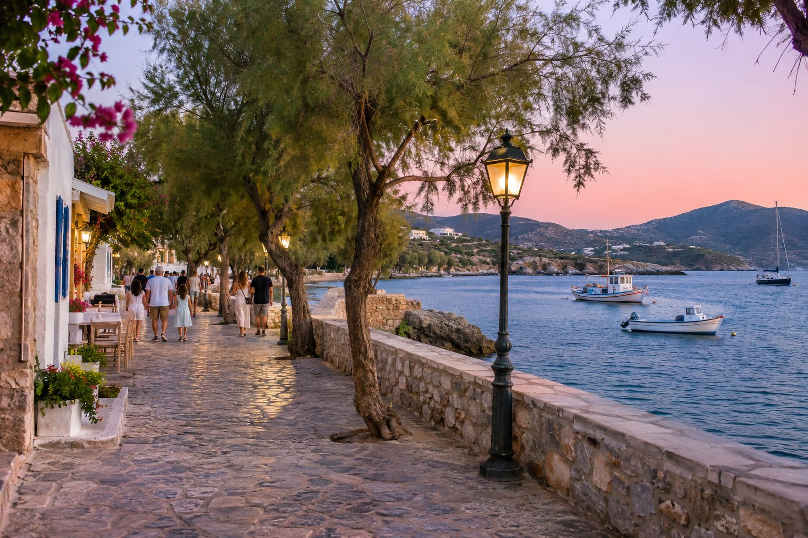
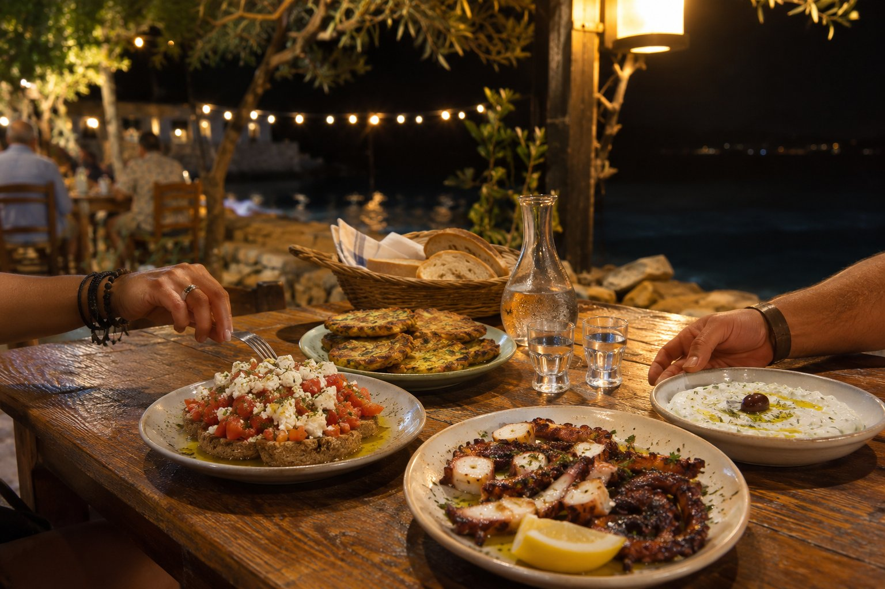
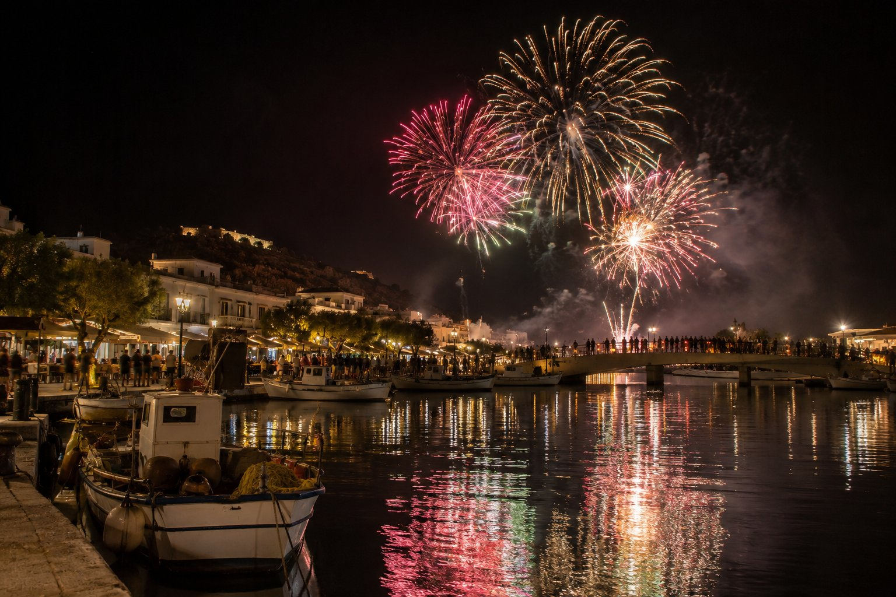

暑さがやわらぐと、アギオス・ニコラオス（Agios Nikolaos）は通りに繰り出します。夏は日中の暑い時間帯には日陰と休息が必要で、町が本当に活気づくのは日没から。家族連れの散歩、満席のテラス、埠頭のそばで揺れる小舟。夕食は遅めで、夜9時を過ぎてからということもよくあります。

うれしいことに、どこも近くにあります。ペンションからなら、車もタクシーも使わずに、夜をまるごと歩いて楽しめて、帰りも散歩がてら戻れます。

## 夕方の散歩

ギリシャでは、夕暮れどきのゆったりした散歩に専用の呼び名があります。「*ヴォルタ*（vólta）」です。ここではほとんどの場合、水辺で行います。ペンションからの徒歩の所要時間とともに、手軽なコースをご紹介します。

1. **キトロプラティア（Kitroplatia、1分）。** ビーチ沿いの小さな広場から始めましょう。砂浜のすぐそばにタベルナが並んでいます。夕暮れにつれて、湾の色が移り変わっていきます。
2. **岬と港（3分）。** 海岸沿いに港まで歩くと、「エウロペの略奪」像が空を背にくっきりと浮かびます。夕暮れの最後の光の中で、写真を撮るのにちょうどいい時間です。
3. **運河と湖（6分）。** 橋を渡って、ヴーリスメニ湖（Lake Voulismeni）へ。ちょうどテラスの明かりがともり、水面に映る頃です。行く前に湖の歴史を少し知りたい方は、[ヴーリスメニ湖の記事](/ja/blog/lago-voulismeni/)で紹介しています。
4. **中心部（9分）。** 湖から上っていく通りには、お店やカフェが並んでいます。夏は、夜遅くまで開いているお店もよく見かけます。

もっと静かに過ごしたい方は、キトロプラティアからマリーナとアモス（Ámmos）のビーチへ続く石畳の道がおすすめです。人通りが少なく、湾の景色もすてきです。

## 一日の終わりの光

アギオス・ニコラオスは東向き、ミラベロ湾（Mirabello Bay）に面しています。そのため、満月の夜には、月が湾の上に昇り、水面に長い光の帯を落とします。その前、夕方の終わりには、海と湾の向こうの山々が色づきます。その時間の楽しみ方は、[アギオス・ニコラオスの夕日の記事](/ja/blog/atardecer-en-agios-nikolaos/)でご紹介しています。

## 遅めの夕食をゆっくりと

夜の中心は夕食です。湖のまわり、港、キトロプラティア周辺には、屋外のテーブルを置いたレストランやタベルナがたくさんあります。夏は、夜9時か10時以降に食べ始めるのが普通です。

知っておくと役に立つことがいくつかあります。

- **水辺の席がいちばん人気です。** 7月と8月に最前列の席が欲しい場合は、早めに行くか、予約を受けているか尋ねてみましょう。
- **急ぐ必要はありません。** ギリシャでは食後におしゃべりを長く続けるのが普通で、お勘定は、頼まないとなかなか来ません。
- **料理はシェアしましょう。** 前菜を何皿か頼んで真ん中に置くのが、クレタ島（Crete）のタベルナでの最も一般的な食べ方で、少しずつ何でも味わえるいい方法です。
- **最後にサービスが出ることもあります。** クレタ島の多くのタベルナでは、食事の終わりに甘いものやラキを小さなグラスで出してくれる習慣があります。

観光客向けの店ばかりを選ばないためのヒントは、[タベルナの選び方](/ja/blog/como-elegir-una-taberna/)にあります。

## 水辺で一杯

夕食後は、湖、港、中心部のすぐ近くの通りに雰囲気が集まります。テラス付きのバー、BGM、夜を引き延ばしてくれるカフェなどです。7月と8月はいっそうにぎやかで、夜更かしする人も増えます。春と秋は夜が穏やかで、騒がしくない一杯にぴったりです。

冬も町は活気を保っています。ここはラシティ県の県庁所在地で、一年中住んでいる人がいるからです。ただし、観光客向けの一部のお店は、次のシーズンまで閉まります。

カップルでの旅行で、特別な夜のプランをお探しなら、[カップルで過ごすアギオス・ニコラオス](/ja/blog/agios-nikolaos-en-pareja/)にもっとアイデアがあります。

## 特別な夜

いくつかの日付には、夜の雰囲気ががらりと変わります。

- **復活祭の夜。** 正教会の聖土曜日の真夜中、復活が告げられた後に、湖の真ん中に設けられた台の上でユダの人形が燃やされます。花火や爆竹も上がります。町の大勢の人が湖畔に集まるので、余裕を持って到着してください。日付は毎年変わります。
- **ナウティカル・ウィーク（海の週間）。** たいてい夏に開かれ、海上や港でさまざまなイベントがあります。日程は年によって異なるので、市役所の告知をご確認ください。
- **コンサートと夏のイベント。** シーズン中は、野外コンサートなどのイベントが催されます。プログラムは毎年変わります。町で尋ねるか、着いたらインターネットで調べてみてください。

## 夜のための実用的なヒント

- **薄手の上着を。** 春と秋は日が落ちると肌寒くなり、海辺では風が吹くこともあります。
- **歩きやすい靴を。** 町は丘の上に築かれていて、中心部と海岸の間には坂や階段があります。
- **帰りも歩いて。** 湖からペンションまでは約6分、中心部からは約9分です。
- **ハイシーズンは気長に。** 8月は中心部のテラスは満席になります。水辺から一本奥の通りに入るだけで、席が見つかることもあります。

ここの夜には、凝った計画は要りません。水辺の散歩、ゆっくりした夕食、のんびり歩いて帰る道。それだけで、この町のことがよく分かります。出かける前に位置関係を確かめたい方は、[距離がわかる地図](/ja/#location)で、ペンションから歩いて行ける場所をすべてご覧いただけます。
