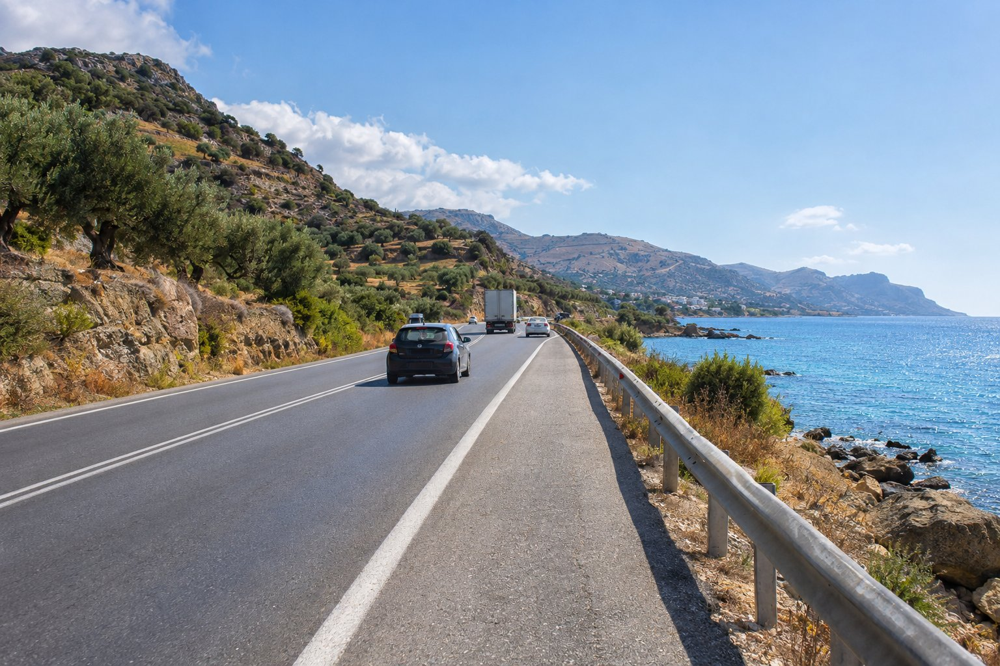
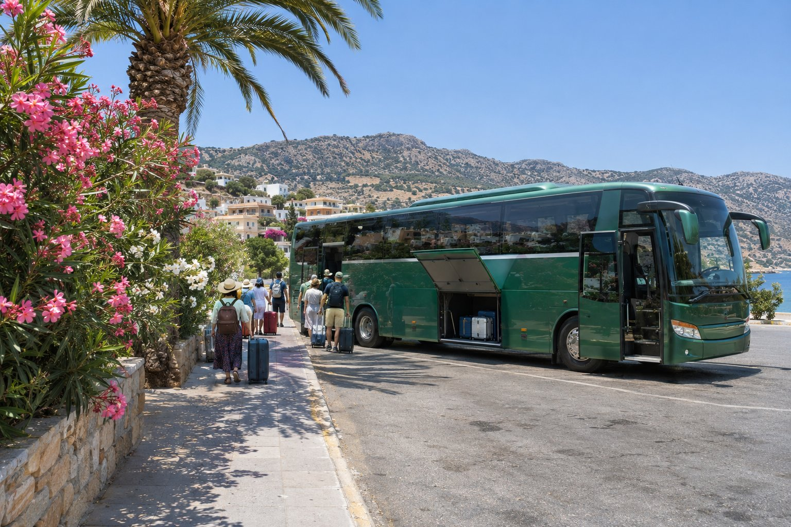

アギオス・ニコラオス（Agios Nikolaos）を訪れる方の多くは、イラクリオン（Heraklion）の市街地東端にあるニコス・カザンザキス空港に到着します。空港からアギオス・ニコラオスまでは約62kmで、渋滞がなければ車でおよそ50分です。移動方法は主に3つ、レンタカー、タクシー、バスです。それぞれの仕組みと注意点をご紹介します。

## レンタカーで

クレタ島（Crete）東部を動き回るつもりなら、いちばん実用的な選択肢です。空港には、地元の会社も国際的な会社も、多くのレンタカー会社があり、カウンターか受け取り場所が設けられています。ハイシーズンには早めに予約し、署名する前に保険の補償範囲をよく確認しておきましょう。

### ルート

道のりは簡単です。空港を出たら、クレタ島北部の国道（VOAK、E75とも表示されています）を東へ向かい、アギオス・ニコラオスの標識に従ってください。道はヘルソニソス（Hersonissos）とマリア（Malia）のそばを通り、そのあとネアポリ（Neápoli）周辺で内陸に入り、最後にミラベロ湾（Mirabello Bay）とアギオス・ニコラオスへと下っていきます。

この道路について、役立つことをいくつかご紹介します。

- **工事があります。** ヘルソニソス、ネアポリ、アギオス・ニコラオスのあいだのいくつかの区間で、改良工事が本格的に進んでおり、迂回や車線の狭まり、一時的な通行止めがあるかもしれません。出発前に地元のニュースやナビを見ておくとよいでしょう。
- **路肩は道を譲るために使われます。** 遅い車が路肩に寄って、追い越しをしやすくするのが慣習です。状況がはっきりしないときは、無理にそうしなくても構いません。追い越しは、見通しがよいときだけにしてください。
- **夜はゆっくりと。** 長いフライトのあとは、カーブの続く最後の区間が負担に感じられます。疲れて到着する場合は、最初の夜はタクシーにすることも検討してください。

### アギオス・ニコラオスに着いたら

港へ向かってください。「エウロペの略奪」像があり、無料の大きな公共駐車場があります。そこからペンションまでは歩いて約3分（200m）です。地図と距離は「[ペンションの所在地](/ja/#location)」でご覧いただけます。

その後、車を活用したいなら、アギオス・ニコラオスから行ける「[半日ドライブルート](/ja/blog/rutas-en-coche-de-medio-dia/)」のアイデアがあります。

## タクシーで

いちばん楽な方法です。とくに夜に到着する場合や、お子さま連れ、荷物が多い場合に向いています。到着ロビーの出口にはタクシー乗り場があり、お好きな会社に事前に送迎を予約することもできます。

料金は季節や時間帯によって変わるので、出発前に運転手におおよその料金を尋ねるか、オンラインで予約する場合は見積もりを書面で依頼してください。行き先は、次のように伝えれば十分です。24 Sarolidi Str.、Mylos地区、アギオス・ニコラオス、キトロプラティア（Kitroplatia）のビーチのそば。

## バス（KTEL）で

クレタ島の長距離バスは緑色で、KTEL（長距離バス）という会社が運行しています。この区間で利用するのは、イラクリオンとアギオス・ニコラオスを結ぶ **KTEL Heraklion–Lasithi** です。

### 乗り場

アギオス・ニコラオス行きのバスは、港の近くにあるイラクリオンのメインバスターミナルから出ています。東へ向かう便の多くは、空港ターミナルから少し歩いたところにある道路沿いの停留所にも停まりますが、どの便が停まるかは、季節や工事によって変わることがあります。出発前に、KTEL Heraklion–Lasithiのウェブサイトで、空港の停留所からの時刻表を調べてください。

その停留所から合う便がない場合は、空港からイラクリオン中心部へ行く青い市内バスに乗り、メインバスターミナルでアギオス・ニコラオス行きのバスに乗り換える方法があります。

### 知っておきたいこと

- **車より時間がかかります。** 途中でいくつかの町に停まるためです。
- **時刻は変わります。** 夏と冬で異なり、シーズン外は便数が少なくなります。出かける前に必ずKTELのウェブサイトで確認し、その日の最終バスだけを頼りにしないでください。
- **大きな荷物**は、バスのトランクに積みます。
- **アギオス・ニコラオスのバスターミナル**は、イラクリオンから来ると町の入り口にあり、港からは少し離れています。スーツケースがあるなら、ペンションまで短い距離をタクシーに乗るのがいちばん楽です。

車なしで数日過ごす予定なら、この地域を「[車なしで移動する](/ja/blog/moverse-sin-coche/)」ためのガイドが役に立つかもしれません。

## シティア空港は？

アギオス・ニコラオスの東、シティア（Sitia）のそばに、国内線を中心に便数の少ない小さな空港があります。道路で約70km、カーブの続く1時間以上の道のりで、バスの接続もよくありません。ほとんどの旅行者にとってはイラクリオンのほうが便利で、シティアは、都合のよい便が見つかった場合にだけ検討する価値があります。

また、イラクリオンの南東にあるカステリ（Kastelli）では、新しい国際空港が建設中であることも知っておくとよいでしょう。開業するまでは、ここでご紹介していることはすべて現在の空港についてのものです。

## 到着日のまとめ

- **レンタカー：** 遠足に出かけるなら、いちばん自由度が高い選択肢です。渋滞がなければ約50分。
- **タクシー：** いちばん楽な方法で、とくに夜やお子さま連れに向きます。
- **KTELバス：** いちばん経済的ですが、時間がかかり、時刻は季節によって変わります。

出発前に、住所（24 Sarolidi Str., Agios Nikolaos）と私たちの電話番号 +30 2841 14 15 17 を保存しておいてください。到着時に道案内が必要になったときに役立ちます。また、フライトが遅い時間に到着する場合は、移動手段を早めに考えておきましょう。その時間帯は選択肢が限られるので、離陸する前に手配しておくのが安心です。町のどこに泊まるかを決めるには、「[アギオス・ニコラオスの泊まる場所の選び方](/ja/blog/donde-alojarse-en-agios-nikolaos/)」もあわせてお読みください。
