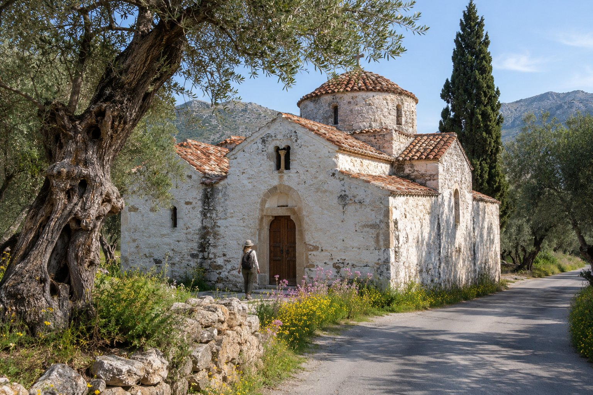
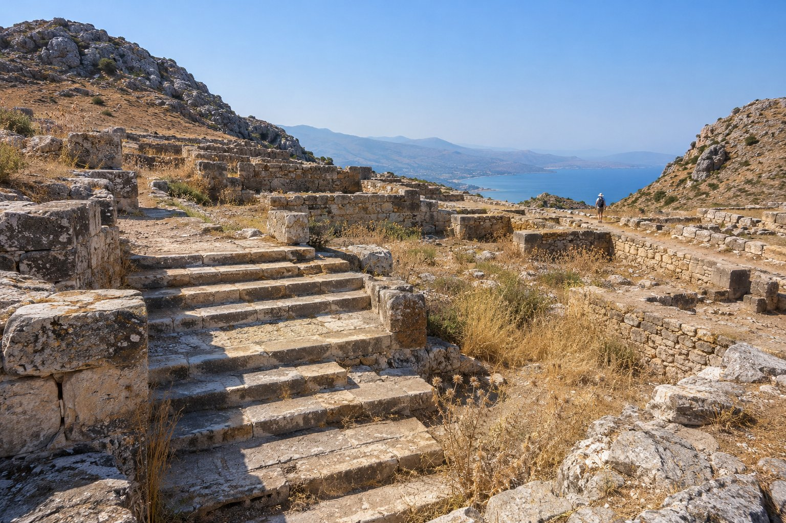

Kritsa ligt zo'n 10 km van Agios Nikolaos, landinwaarts, op de helling van de berg Kastellos en op ongeveer 375 meter hoogte. Met de bus ben je er in zo'n twintig minuten. Het is een verandering van landschap zonder veel kilometers te maken: olijfbomen, stenen huizen en bergen in plaats van strand. In de omgeving vind je een Byzantijnse kerk met fresco's, een stad uit de Oudheid en een kloof om te wandelen, genoeg om een dag te vullen.

## Panagia Kera: Byzantijnse fresco's

De kerk van Panagia Kera ligt ongeveer een kilometer voor het dorp, aan de weg die vanuit Agios Nikolaos omhoog loopt. Ze wordt beschouwd als een van de belangrijkste Byzantijnse monumenten van Kreta.

Het is een driebeukige kerk met koepel, in fasen gebouwd vanaf de 13e eeuw. Het middenschip, het oudste, is gewijd aan de Ontslapenis van Maria; het zuidelijke aan de heilige Anna en het noordelijke aan de heilige Antonius. Binnen zijn de wanden bedekt met fresco's, vooral uit de 13e en 14e eeuw, in verschillende stijlen per beuk.

Enkele tips voor je bezoek:

- **Ga vroeg.** De ruimte is klein, en met weinig mensen bekijk je de fresco's rustiger.
- **Toegang en openingstijden.** Er is entree, en de openingstijden verschillen per seizoen. Check ze voordat je gaat.
- **Het is een gebedshuis.** Draag gepaste kleding en praat zachtjes.

## Het dorp Kritsa

Kritsa is een van de dorpen met de meeste geschiedenis van Oost-Kreta. Je zet de auto het best op de openbare parkeerplaats en loopt omhoog, want de straten zijn smal en steil. Je vindt er stenen huizen, binnenplaatsen met geraniums en kleine kerken die opduiken als je een hoek omslaat.

Het dorp staat bekend om zijn weefwerk en borduurwerk. In de hoofdstraat zijn werkplaatsen en winkels met tafelkleden, kleedjes en andere handgemaakte stukken met patronen die van generatie op generatie zijn doorgegeven. Wil je iets kopen, vraag dan wie het gemaakt heeft en waar. Er is van alles, en het handwerk zie je aan het detail en aan de prijs. Meer ideeën vind je in [wat te kopen in Agios Nikolaos](/nl/blog/que-comprar-en-agios-nikolaos/).

Volgens de plaatselijke overlevering stammen de inwoners van Kritsa af van de bewoners van de nabijgelegen oude stad Lato.

## Lato, de Dorische stad

Zo'n 3 km ten noorden van Kritsa, aan een bewegwijzerde weg, liggen de ruïnes van Lato, een van de belangrijke Dorische steden van het eiland. Wat je nu ziet, stamt vooral uit de 5e en 4e eeuw v.Chr.

De stad werd gebouwd op een plek die makkelijk te verdedigen was, in het zadel tussen twee heuvels die dienstdeden als akropolis. Vanaf de hoofdpoort loop je omhoog langs resten van winkels en huizen naar het centrum van de stad, waar je herkent:

- de **agora**, met haar cisterne en een klein heiligdom;
- het **prytaneion**, het bestuursgebouw van de stad;
- een **zone met tribunes**, waarschijnlijk voor vergaderingen en openbare bijeenkomsten.

Van bovenaf zie je de baai van Mirabello. De haven, Lato pros Kamara, lag dicht bij het huidige Agios Nikolaos. Slechts een deel van de vindplaats is opgegraven.

Er is erg weinig schaduw en de grond is steenachtig, dus neem water, een pet en goede schoenen mee, en ga in de zomer liever vroeg. Openingstijden en entree verschillen per seizoen.

## De kloof van Kritsa

Als je graag wandelt, is de kloof van Kritsa een korte en mooie route. Ze is zo'n 4 km lang, begint bij de oude stenen brug van het dorp en eindigt bij het dorp Tapes. Op sommige stukken wordt ze tot anderhalve meter smal, tussen hoge wanden die schaduw geven.

- **Moeilijkheid.** Het is een eenvoudige route, al moet je op sommige punten over grote rotsen klauteren. Reken op ongeveer twee en een half uur.
- **Periode.** Het voorjaar is de beste tijd, met bloemen en wat water. Na hevige regen kunnen er plassen ontstaan die de doorgang versperren, dus vermijd het op die dagen.
- **Terugweg.** De route is geen rondwandeling. Bepaal voordat je begint hoe je terugkeert: langs dezelfde weg of met iemand die je ophaalt.
- **Uitrusting.** Neem wandelschoenen, voldoende water mee en laat iemand weten welke route je loopt.

## Als je tijd over hebt: het Katharo-plateau

Vanuit Kritsa loopt een geasfalteerde weg zo'n 16 km omhoog naar het Katharo-plateau, op ongeveer 1.100–1.200 meter hoogte. Boven is het koeler, zijn er wandelpaden en verandert het uitzicht over de kust volledig. De weg die verder naar het Lasithi-plateau loopt is een zandweg in slechte staat, alleen geschikt voor voertuigen met veel bodemvrijheid. Wil je Lasithi leren kennen, dan ga je beter over de weg, zoals we vertellen in [het Lasithi-plateau](/nl/blog/meseta-de-lasithi/).

Dicht bij Kritsa ligt ook Kroustas, een ander rustig dorp dat bekendstaat om zijn traditionele taverna's.

## Een mogelijke dag

1. **Vroeg in de ochtend:** Panagia Kera.
2. **Halverwege de ochtend:** Lato, voordat de hitte toeslaat.
3. **Rond de middag:** wandeling door Kritsa en lunch in het dorp of in Kroustas. Om te kiezen, kijk je in [hoe kies je een taverna](/nl/blog/como-elegir-una-taberna/).
4. **Middag:** weefwinkels, of de klim naar Katharo als je er nog zin in hebt.

Liever de kloof doen? Ruil hem dan in voor Lato en begin vroeg met wandelen. En heb je maar een halve ochtend, dan passen Panagia Kera en het dorp er ruimschoots in. In [autoroutes van een halve dag](/nl/blog/rutas-en-coche-de-medio-dia/) vind je andere ideeën in de buurt van Agios Nikolaos.

Check voordat je vertrekt de openingstijden van Panagia Kera, van Lato en van de bussen, want die verschillen per seizoen. Neem water en gemakkelijke schoenen mee, en reken erop dat je in Kritsa bijna alles te voet en bergop doet.
