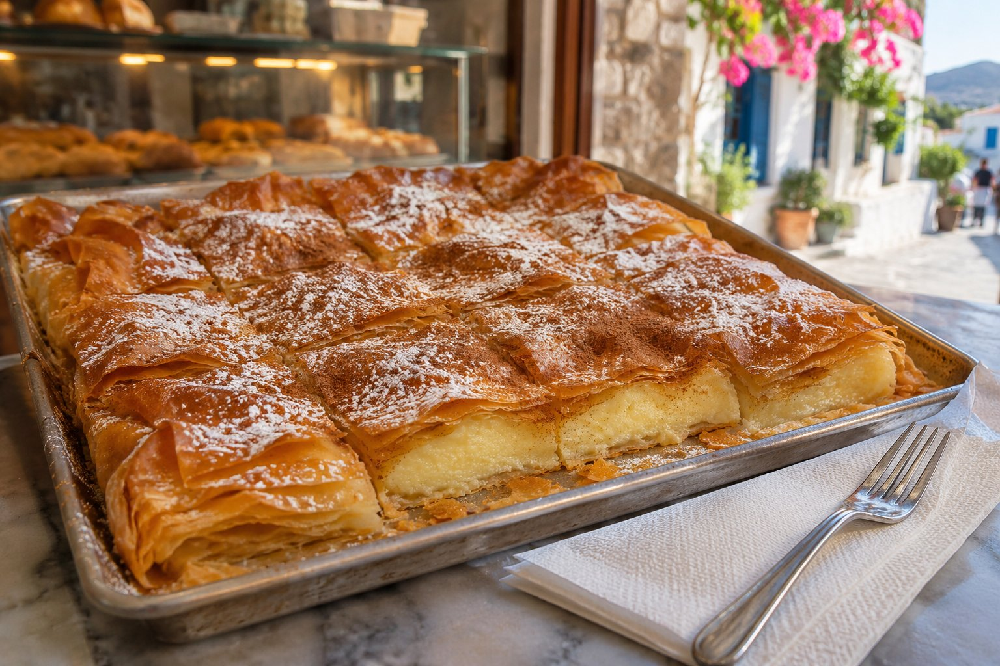
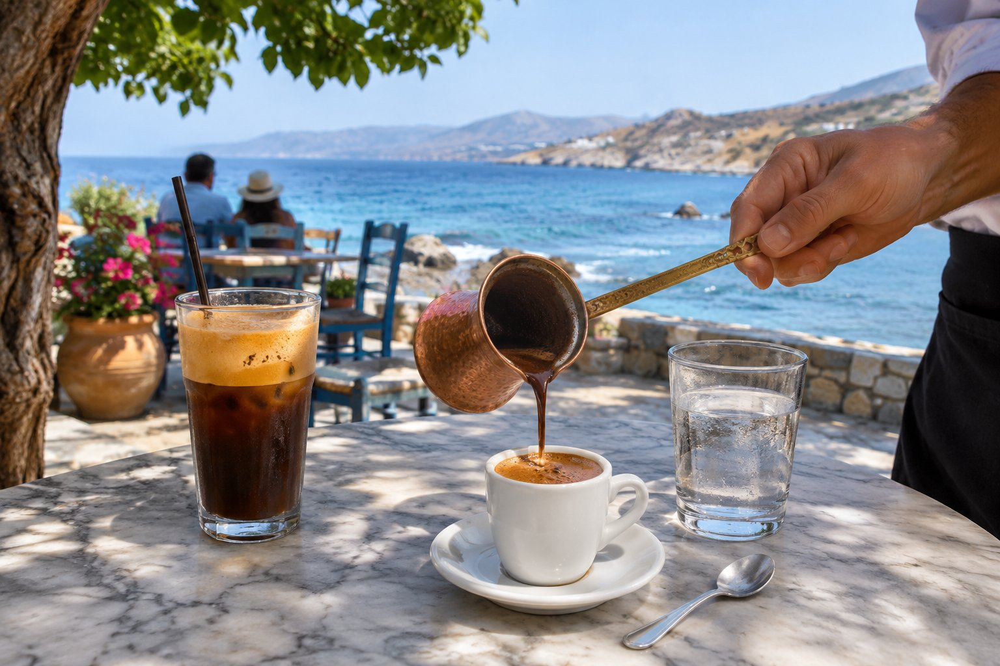

Традиционный критский завтрак был простым: хлеб или паксимади, оливковое масло, сыр, маслины, немного фруктов и, если было, мёд. Сегодня в Агиос-Николаосе можно найти всё — от такого вековечного завтрака до холодного кофе с собой по дороге на пляж. Вот что стоит попробовать и где это искать.

## Греческий йогурт с тимьяновым мёдом

Это классика. Греческий процеженный йогурт густой и кремовый, а йогурт из овечьего молока имеет более насыщенный вкус, чем из коровьего. На Крите его подают с мёдом, часто с тимьяновым (θυμαρίσιο, *тимарисио*), очень ароматным, а иногда и с грецкими орехами.

Другой традиционный способ — съесть его с *глико ту куталиу*, ложечными сладостями: фруктами, сваренными в сахарном сиропе, которыми в греческих домах угощают гостей.

## Бугаца, сладкая или с сыром

Бугаца — это очень тонкое тесто фило с начинкой, запечённое и нарезанное небольшими кусочками. На Крите вам встретятся в основном два варианта:

- **С мизитрой:** вариант, связанный с Ханьёй, с начинкой из этого свежего сыра и посыпанный сахаром. Вся прелесть — в контрасте сыра и сахара.
- **С кремом:** с начинкой из манного крема, посыпанная сверху сахарной пудрой и корицей.

Обычно можно выбрать: просите *ме крема* (с кремом) или *ме мизитра* (с мизитрой). Её едят горячей, только что нарезанной.

## Питы: пирожки с собой

В пекарнях легко найти пирожки из теста фило или домашнего теста, идеальные для завтрака на ходу:

- **Тиропита (τυρόπιτα):** с сыром.
- **Спанакопита (σπανακόπιτα):** со шпинатом и другой зеленью.
- **Калитсуния (καλιτσούνια):** пирожки со свежим сыром, сладкие или солёные, в зависимости от заведения.

*Сфакианес питес*, тонкие лепёшки с мизитрой, которые подают с мёдом, тоже очень критский завтрак. В [нашей статье о том, что поесть на Крите](/ru/blog/que-comer-en-creta/) мы рассказываем об этих и других блюдах острова.

## Паксимадия, масло и помидор

Паксимади — это хлеб, часто ячменный, дважды запечённый до сухости и твёрдости. Его делали так, чтобы он хранился долго, и он остаётся частью критского стола. Его размягчают несколькими каплями воды и едят с оливковым маслом, тёртым помидором, сыром и орегано: то, что в таверне называют дакосом, прекрасно подходит и для утра.

Если вам интересно масло, которое здесь подают к каждой трапезе, прочитайте [нашу статью об оливковом масле Крита](/ru/blog/aceite-de-oliva-de-creta/).

В пекарнях вы также увидите *кулури* — бублик из хлеба с кунжутом, типичный для всей Греции завтрак на ходу.

## Для более сытного завтрака

Некоторые кафе и таверны, которые открываются рано, предлагают более плотные блюда, особенно для позднего завтрака:

- **Яичница-глазунья со стакой** — сливками из овечьего или козьего молока, проваренными; очень по-критски.
- **Гравьера**, выдержанный сыр острова, иногда с мёдом.
- **Апаки** — свинина, замаринованная в уксусе и копчёная с травами.
- **Омлеты** с сезонными овощами и сыром.

Они есть не везде, но если увидите их в меню, это хороший способ познакомиться со вкусами острова.

## Сезонные фрукты

Фрукты меняются вместе с календарём. Летом в изобилии арбузы, дыни и виноград, а к концу лета появляется инжир. Зимой наступает время апельсинов и мандаринов.

Как и во многих греческих городах, в Агиос-Николаосе есть еженедельный рынок под открытым небом (*лайки*), где продают фрукты, овощи, мёд и другие местные продукты. День и место могут меняться, поэтому спросите в городке, прежде чем идти.

## Кофе по-гречески

Кофе — это почти ритуал. Когда вы его заказываете, вас спросят о сахаре, потому что его добавляют при приготовлении:

- **Скето:** без сахара.
- **Метрио:** умеренно сладкий, золотая середина.
- **Глико:** сладкий.

А вот самые распространённые варианты:

- **Кофе по-гречески (элиникос кафес):** его варят в маленьком ковшике, *брики*, и подают нефильтрованным. Дайте ему немного отстояться и не допивайте последний глоток — это гуща.
- **Фраппе:** растворимый кофе, взбитый с водой и льдом до пены. Родился в Салониках в 1957 году и остаётся классикой.
- **Фредо эспрессо и фредо капучино:** эспрессо, взбитый со льдом; во втором сверху добавляют холодную молочную пену. Сегодня это одни из самых заказываемых кофейных напитков летом.

Если хотите что-нибудь без кофеина, попробуйте *малотиру* — критский горный чай (*Sideritis syriaca*), травяной настой, который пьют сам по себе или с небольшим количеством мёда.

## Где позавтракать в Агиос-Николаосе

- **Пекарни (φούρνος, *фурнос*):** открываются рано и лучше всего подходят для бугацы, питы и кулури с собой.
- **Кондитерские (ζαχαροπλαστείο, *захаропластио*):** за сладостями и пирожными.
- **Кафе у воды:** в Китроплатии, в порту и вокруг озера Вулисмени есть кафе, где можно посидеть с видом. От пансиона до Китроплатии минута пешком, до порта три, до озера шесть.

С балконов пансиона видно, как над заливом Мирабелло встаёт солнце. После этого достаточно пройти несколько шагов, чтобы позавтракать у моря и, если захочется, искупаться в первый раз на [одном из ближайших пляжей](/ru/blog/playas-de-agios-nikolaos/).

## Чтобы день начался хорошо

Единого способа завтракать на Крите не существует: кофе и тиропита в руке стоят не меньше, чем стол с йогуртом, мёдом и фруктами. Часы работы и ассортимент пекарен и кафе меняются в зависимости от сезона, особенно вне лета, поэтому перед выходом лучше спросить или посмотреть в интернете.
