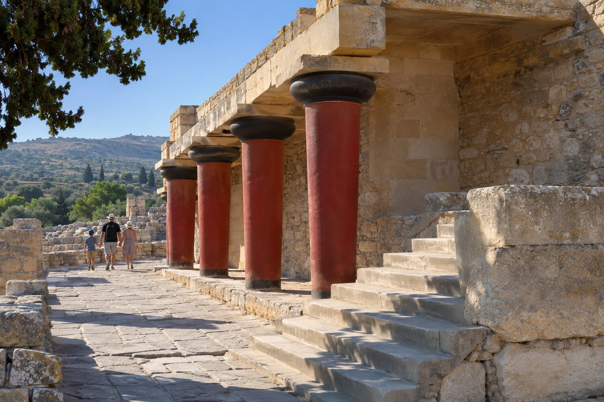
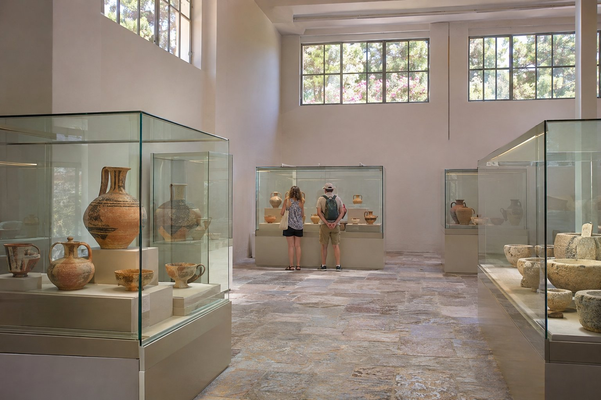

Кносс — самый известный археологический памятник Крита и главный центр минойской цивилизации. От нашего пансиона в Агиос-Николаосе до него час езды на машине (65 км), на окраине Ираклиона. Это поездка на целый день, и смысл она приобретает прежде всего в сочетании с Археологическим музеем Ираклиона, где хранятся подлинные находки.

## Чем был Кносс

Холм Кносса был заселён с эпохи неолита, около 9000 лет назад. Первый дворец построили около 1900 г. до н. э.; он был разрушен и отстроен заново, а то, что можно увидеть сегодня, относится главным образом к периоду его наивысшего расцвета, примерно 3500 лет назад. Дата и причина окончательного разрушения, около XIV века до н. э., до сих пор обсуждаются.

Не стоит представлять его только как резиденцию царя. Это был политический, экономический и религиозный центр с кладовыми, мастерскими, культовыми пространствами и парадными помещениями вокруг большого центрального двора. В 2025 году ЮНЕСКО включила Кносс в Список всемирного наследия вместе с другими минойскими дворцовыми центрами Крита, такими как Фест, Малия и Закрос.

### Миф и археология

Название «минойский» происходит от царя Миноса из греческой мифологии. По легенде, Дедал построил для него лабиринт, в котором жил Минотавр, убитый в конце концов Тесеем. Это древний и очень притягательный рассказ, но именно легенда: никакого лабиринта археологи не нашли. Зато здесь есть огромное здание со множеством уровней и коридоров, и оно помогает понять, почему миф связали с этим местом.

## Реконструкции Эванса

Британский археолог Артур Эванс начал раскопки Кносса в 1900 году и проработал здесь около тридцати лет. Помимо раскопок он реконструировал части дворца, главным образом начиная с 1920-х годов и из железобетона: знаменитые красные колонны, некоторые верхние этажи и стены с раскрашенными копиями фресок.

Эти реконструкции помогают представить объём здания, но это интерпретация Эванса и его команды, а не точный портрет того, каким дворец был на самом деле. Многие археологи их критиковали, а сегодня их считают частью истории самого памятника. Для посещения важно знать вот что: **фрески, которые вы увидите в Кноссе, — это воспроизведения**, подлинные фрагменты находятся в музее Ираклиона.

## Что посмотреть во время обхода

Памятник большой, и обозначен он не так, как музей, поэтому лучше пойти с несколькими чёткими остановками:

- **Центральный двор** — большое открытое пространство, вокруг которого был организован дворец.
- **Тронный зал** с каменным троном и нарисованными на стенах грифонами (воспроизведение). Иногда его можно увидеть только от входа.
- **Кладовые западного крыла** с рядами больших керамических сосудов (пифосов), где хранили масло, вино или зерно.
- **Большая лестница** восточного крыла и зона, которую Эванс назвал «царскими покоями», с копией фрески с дельфинами.
- **Северный вход** с воспроизведением рельефа с быком — одно из самых фотографируемых изображений на этом месте.

Для неспешного осмотра рассчитывайте от полутора до двух с половиной часов, в зависимости от интереса и жары.

## Археологический музей Ираклиона

Музей находится в центре Ираклиона, в нескольких километрах от Кносса, и располагает важнейшей в мире минойской коллекцией. Здесь хранятся подлинные фрески из Кносса (например, с прыгунами через быка или так называемый Принц лилий), статуэтки богини со змеями, ритон в форме бычьей головы и Фестский диск, а также много других экспонатов.

Осмотр памятника без музея оставляет посещение незавершённым. Одни предпочитают начать с музея, чтобы лучше понимать то, что увидят потом, другие — наоборот. Всё это можно успеть за один день, хотя день получится долгим: если вы путешествуете с детьми или в самый разгар лета, возможно, музей лучше оставить на другой день. Это также хороший план на дождливый день, о чём мы рассказываем в статье [что делать в Агиос-Николаосе в дождливую погоду](/ru/blog/que-hacer-cuando-llueve/).

## Практические советы

- **Приезжайте пораньше.** В Кноссе очень мало тени, и летом жара давит уже с середины утра, а именно тогда приезжает больше всего групп. Ближе к вечеру людей обычно меньше.
- **Защищайтесь от солнца**: вода, головной убор и солнцезащитный крем, даже весной и осенью.
- **Удобная обувь.** Здесь есть ступени, неровный камень и скользкие места.
- **Экскурсия с гидом или аудиогид.** Без объяснений легко запутаться среди стен и уровней. У входа обычно предлагают экскурсии с гидом, есть также аудиогиды и приложения.
- **Проверяйте часы работы и билеты, прежде чем выезжать.** Они меняются в зависимости от сезона, а в дни сильной жары власти могут ограничивать часы работы памятников под открытым небом. Лучше всего посмотреть на официальном сайте продажи билетов или на самом памятнике.
- **Весна и осень** — самое комфортное время для посещения.

## Как вписать это в поездку

На машине дорога из Агиос-Николаоса почти всё время идёт по главной трассе северного побережья. По пути вы проедете рядом с Малией, где находится ещё один минойский дворец, поменьше и обычно более тихий, на случай, если вам захочется большего.

Поскольку аэропорт Ираклиона находится в 50 минутах от пансиона (62 км), Кносс и музей хорошо вписываются и в день приезда, и в день отъезда, если позволяет ваш рейс. Мы рассказываем об этом в статье [как добраться из аэропорта Ираклиона](/ru/blog/como-llegar-desde-el-aeropuerto-de-heraclion/). Если у вас нет машины, можно доехать на междугородном автобусе до Ираклиона, а оттуда на городском автобусе до Кносса; подробности — в статье [как передвигаться без машины](/ru/blog/moverse-sin-coche/).

Если вам интересна глубинка острова, ещё одна поездка, сочетающая пейзажи и мифологию, — это [плато Ласити](/ru/blog/meseta-de-lasithi/) с пещерой, которую предание связывает с рождением Зевса.

Чтобы организовать день, наш совет прост: выезжайте из Агиос-Николаоса пораньше, осмотрите Кносс до наступления жары, пообедайте в Ираклионе, а вторую половину дня посвятите музею. Возьмите воду и накануне проверьте часы работы, и вы вернётесь с гораздо более ясным представлением о том, кем были минойцы.
