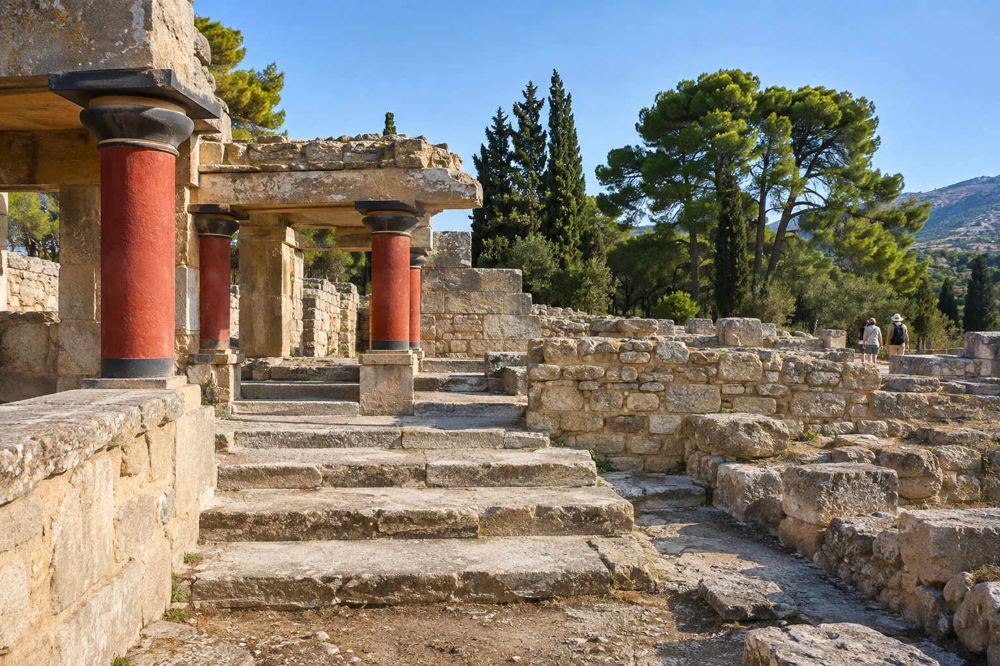
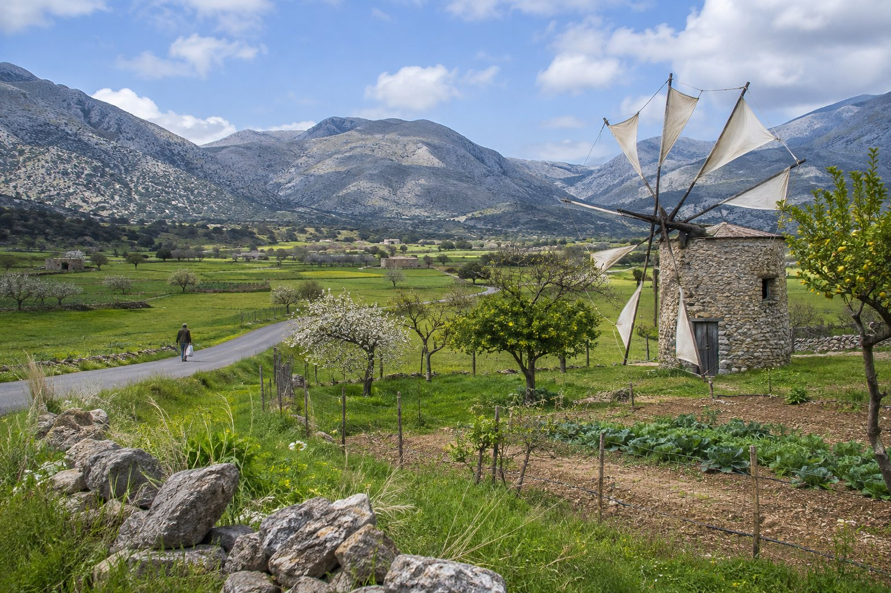

Агиос-Николаос удачно расположен для знакомства с востоком Крита без смены жилья. Спиналонга, Крица, плато Ласити и Кносс находятся не дальше часа езды на машине, а самое дальнее — Сития и пальмовая роща Вай — занимает один долгий день. В этом плане на семь дней экскурсии чередуются с более спокойными днями, чтобы вы не провели всю неделю в машине.

## Прежде чем начать: машина, автобус и катер

Машина нужна не каждый день. От автовокзала Агиос-Николаоса регулярные рейсы идут в Элунду, Крицу, Ираклион, Иерапетру и Ситию, а до Спиналонги добираются на катере. А вот для плато Ласити, Мохлоса или полного маршрута по Ситии и Вай за один день практичнее машина: там либо нет автобуса, либо рейсов очень мало.

Если вы берёте машину в аренду всего на несколько дней, используйте её в те дни, когда она нужна. Ниже мы это кратко подытожим, а если вы предпочитаете обойтись без неё, больше идей вы найдёте в статье [как передвигаться без машины](/ru/blog/moverse-sin-coche/).

## День 1: Агиос-Николаос пешком

Первый день — без спешки и без машины. От пансиона до пляжа Китроплатия минута пешком, до порта — три (там стоит статуя «Похищение Европы»), а до озера Вулисмени — около шести. Центр находится в девяти минутах, так что всё можно обойти пешком.

- Утром: [озеро Вулисмени](/ru/blog/lago-voulismeni/) и улицы центра.
- После обеда: купание на Китроплатии и прогулка по порту.
- Остальные идеи — в нашем путеводителе [что посмотреть в Агиос-Николаосе](/ru/blog/que-ver-en-agios-nikolaos/).

Если вы встанете пораньше, с балконов пансиона можно увидеть, как солнце поднимается над заливом Мирабелло.

## День 2: Спиналонга, Элунда и Плака

Элунда находится примерно в 23 минутах езды на машине (15 км). До Спиналонги — острова с венецианской крепостью XVI века, которая служила лепрозорием до 1957 года, — добираются на катере. От Плаки переправа совсем короткая, около десяти минут; катера отправляются также из Элунды, а экскурсии — из порта Агиос-Николаоса.

Этот день можно провести без машины, сочетая автобус и катер. На острове мало тени: возьмите воду и головной убор, а летом постарайтесь приехать пораньше. Подробнее — в статьях [поездка на Спиналонгу](/ru/blog/excursion-a-spinalonga/) и [Элунда и Плака](/ru/blog/elounda-y-plaka/).

## День 3: Кносс и Археологический музей Ираклиона

Кносс находится в часе езды на машине (65 км). Дворец расположен примерно в 5 км от центра Ираклиона, где находится Археологический музей, поэтому логично осмотреть и то и другое в один день: раскопки — с самого утра, до жары и туристических групп, а музей — после.

Можно поехать на машине или на автобусе до Ираклиона, а оттуда на городском автобусе до Кносса. Если вы прилетаете или улетаете через аэропорт Ираклиона (50 минут, 62 км), этот визит можно перенести на тот день и освободить другой. Мы рассказываем об этом в статье [как добраться из аэропорта](/ru/blog/como-llegar-desde-el-aeropuerto-de-heraclion/) и в нашей статье о [дворце Кносс](/ru/blog/palacio-de-knossos/).

## День 4: Крица и Лато, а после обеда — пляж

Полдня экскурсии и полдня отдыха. Крица находится примерно в 11 км, на склоне горы. Перед въездом в деревню стоит Панагия Кера — небольшая византийская церковь с фресками, а в 3 км находятся руины Лато, древнего дорийского города с видом на залив.

- До Крицы ходит автобус; до Лато удобнее ехать на машине.
- Заранее проверьте часы работы церкви и археологического памятника: они меняются в зависимости от сезона.
- Возвращайтесь пообедать в Агиос-Николаос, а вторую половину дня посвятите пляжу.

Больше об этом — в статье [Крица и окрестности](/ru/blog/kritsa-y-alrededores/).

## День 5: Сития и пальмовая роща Вай

Самый долгий день недели, поэтому лучше выехать пораньше. До Ситии чуть больше часа езды на машине, а до Вай, на восточной оконечности острова, — около двух. По пути вам встретятся порт и музей Ситии и монастырь Топлу.

Чтобы успеть всё за один день, нужна машина. О том, как это организовать, мы рассказываем в статье [Сития и пальмовая роща Вай](/ru/blog/sitia-y-palmeral-de-vai/).

## День 6: отдых или Мохлос

После дня в Вай — спокойный день. Есть пляжи на любой вкус, и садиться за руль не нужно: Аммос примерно в 10 минутах пешком, Аммуди — в 18, Альмирос — примерно в 26. Мы рассказываем о них в статье [пляжи Агиос-Николаоса](/ru/blog/playas-de-agios-nikolaos/).

Если захочется ненадолго выбраться, во второй половине дня можно съездить в [Мохлос](/ru/blog/mochlos/) — рыбацкую деревню примерно в 45 минутах езды на машине, на другой стороне залива, с островком с минойскими руинами напротив таверн. Это хорошее место, чтобы поужинать рыбой у самой воды.

## День 7: плато Ласити и пещера Зевса

Пещера Зевса на плато Ласити находится в часе езды на машине (45 км). Плато — это возделываемая равнина среди гор на высоте около 850 м, известная старинными ветряными мельницами. Диктейская пещера возле деревни Психро — место, где, согласно мифу, родился Зевс.

- К пещере поднимаются пешком по короткой, но крутой тропе, а внутри есть ступени, которые могут быть скользкими: возьмите удобную обувь.
- Наверху прохладнее, чем на побережье; вне лета возьмите что-нибудь тёплое.
- Автобусов на плато очень мало, поэтому в этот день вам понадобится машина.

Больше идей — в статье [плато Ласити](/ru/blog/meseta-de-lasithi/).

## Иерапетра и Хриси: замена для летних дней

Если вы приезжаете в купальный сезон, день 4 или день 6 можно заменить на Иерапетру и остров Хриси. Иерапетра на южном побережье находится примерно в 42 минутах езды на машине (36 км), и туда тоже ходит автобус из Агиос-Николаоса. Из её порта отправляются катера на Хриси — необитаемый заповедный остров со светлыми песчаными пляжами и можжевеловым лесом.

- Катера ходят в сезон, примерно с мая по октябрь, а при сильном ветре рейсы могут отменять.
- В зависимости от катера переправа занимает от получаса до чуть более часа.
- Правила посещения острова за последние годы ужесточились: уточните условия при бронировании.
- Тени мало, и инфраструктуры почти нет: возьмите воду и солнцезащитные средства.

## В какие дни нужна машина

- **Без машины:** день 1 (Агиос-Николаос) и день 2 (Спиналонга, на автобусе и катере).
- **На машине или автобусе:** день 3 (Кносс и Ираклион), день 4 (Крица; до Лато лучше на машине) и Иерапетра.
- **На машине:** день 5 (Сития и Вай), день 7 (Ласити) и Мохлос.

## Чтобы неделя прошла удачно

- Не планируйте два долгих дня в машине подряд; поэтому день отдыха стоит после Вай.
- В июле и августе осматривайте археологические памятники и музеи утром, а середину дня оставьте для пляжа или тени.
- Часы работы музеев, археологических памятников и катеров меняются в зависимости от сезона. Проверьте их на официальных сайтах или на месте перед выходом.
- Если выпадет день с плохой погодой, загляните в статью [что делать, когда идёт дождь](/ru/blog/que-hacer-cuando-llueve/) и поменяйте порядок дней: план гибкий.
- Если вы ещё выбираете даты, у нас есть путеводитель [когда лучше приехать в Агиос-Николаос](/ru/blog/cuando-visitar-agios-nikolaos/).

Дни можно переставлять в зависимости от погоды и расписания катеров, но стоит сохранить две вещи: спокойный день после каждого долгого и осмотр достопримечательностей под открытым небом с самого утра. Расстояния от пансиона до каждого из этих мест указаны на [карте на нашем сайте](/ru/#location).
